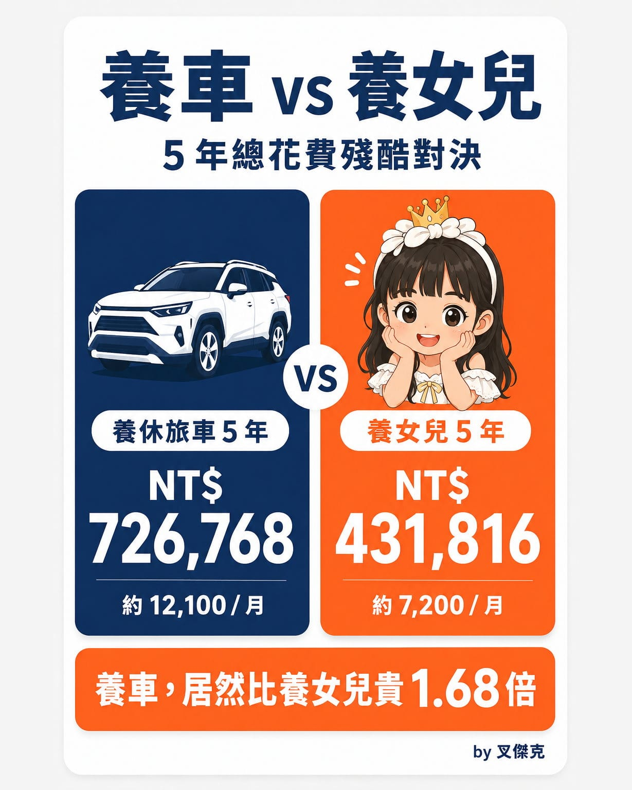

而且不是貴一點，是整整 \*\*1.68 倍。\*\*

再過幾天，桐桐就要滿 6 歲了。

去年她 5 歲生日，我做了一件很瘋狂的事：把養了 5 年的女兒，跟家裡同樣養了 5 年的 RAV4，做了一場成本大對決。

結果完全出乎我的意料。

養女兒 5 年：NT$431,816（平均每月約 7,200 元）

養休旅車 5 年：NT$726,768（平均每月約 12,100 元）

一台從來沒叫過我爸爸的車，5 年硬是多花了快 30 萬。

想知道錢到底花去哪？全部攤開給大家看。

【養車 5 年，錢都花去哪】

折舊攤提　NT$353,333\
保險　NT$98,630\
規費與稅　NT$96,985\
汽油　NT$63,200\
保養維修　NT$60,870\
用品　NT$21,254\
通行費　NT$19,304\
停車費　NT$13,192

\*\*合計：NT$726,768\*\*

【養女兒 5 年，錢都花去哪】

教育　NT$172,041\
保險　NT$50,028\
玩具　NT$42,153\
用品　NT$36,470\
禮物　NT$33,087\
醫療　NT$27,480\
食物　NT$26,469\
尿布　NT$25,792\
衣物　NT$18,296

\*\*合計：NT$431,816\*\*

給你我的 3 個觀察：

1\. 養車最大的黑洞，是折舊。

很多人算養車成本，只會算油錢、保養和保險。

真正最貴的，其實是折舊。

車子買回來開始，每一天都在默默燒錢，只是沒有刷卡通知而已。

2\. 養女兒最大的支出，是教育。

5 年累積花了 17 萬。

尤其從 4 歲到 5 歲，教育支出直接暴衝 178%。

英文、才藝課真的是報好報滿。

其他項目大多只增加約 20%，只有教育像坐火箭一樣往上衝。

3\. 成長第二快的是衣物。

一年增加了 56%。

不過這筆到底該算在桐桐頭上，還是算在很愛幫她買衣服的桐媽頭上……

我到現在還沒有定論。😂

最後，有幾個較特別的計算前提補充說明一下：

1\. 汽車折舊以購入價格、15 年平均攤提計算。\
2\. 所有公司報帳、洽公相關費用都沒有列入，所以實際養車成本只會更高。\
3\. 桐桐幼幼班就讀公幼，中班轉到非營利幼兒園。\
4\. 食物只計算她自己的奶粉與專屬點心，家庭共食沒有分攤，畢竟她們母女倆真的吃很少。\
5\. 桐媽是全職家庭主婦自己照顧，省下一大筆保母費，雙方父母也可以支援照顧。\
6\. 恩典牌來者不拒，非常感謝一路照顧桐桐的親朋好友。

我知道一定有人會說：

「等她上國中、高中、大學，你再來算。」

放心，我也很好奇。

反正我都有記帳，這系列應該還可以一路更新很多年。
