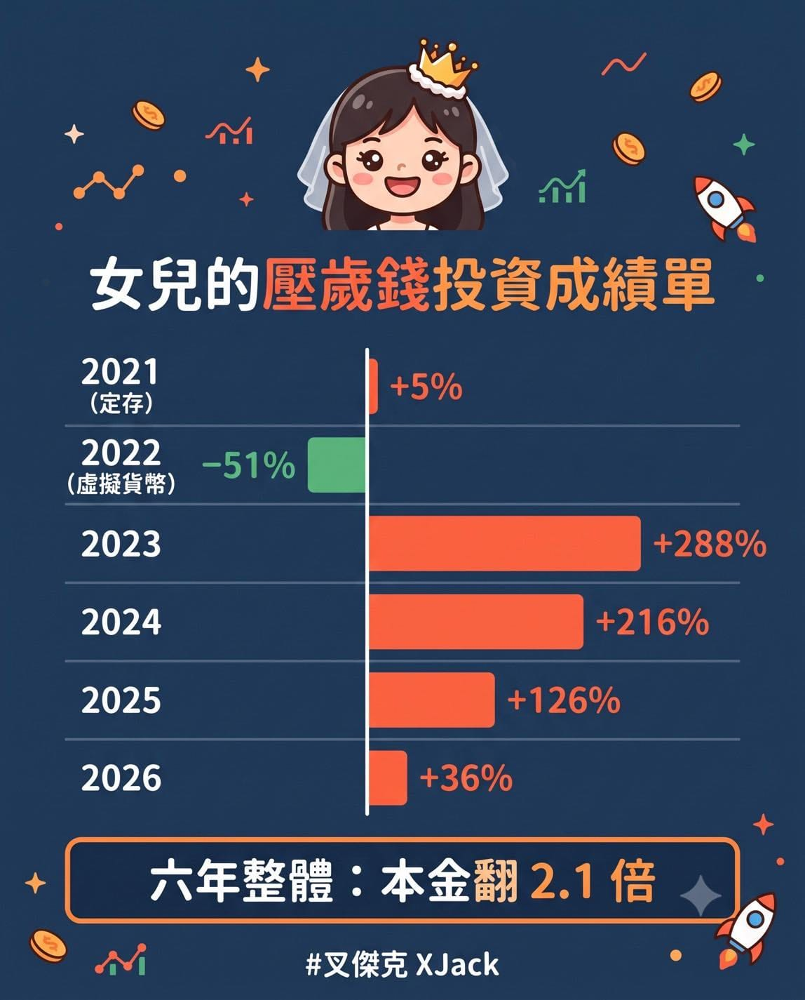

除了那台 Switch 2 禮物外（好啦，我知道其實是桐媽想買的），我還準備了一份她現在還看不懂的生日禮物：一張屬於她自己的壓歲錢投資成績單。

金額不多，每年也不同，只公開報酬率。

而且，絕對不只有分享光鮮亮麗的部分。

2021 年，第一年最保守。

紅包全部放銀行定存，一年 1%，幾乎沒什麼變化。

2022 年，虛擬貨幣大爆發。

身為一個電玩咖，我當時也覺得虛擬世界是未來。結果到今天，那筆投資還是腰斬。

用女兒紅包繳的學費，是我人生最不想承認的一筆。

但我沒有賣掉，還一直留著，提醒自己曾經犯過什麼錯。

也是因為那次慘賠，逼我停下來，把資產配置、投資理財、跟家庭規劃，重新花了一整年從頭學過一次。

2023 年，我幫桐桐開了證券戶。

從那一年開始，我替她訂下一條很無聊，但我相信能走很久的規則：

每年過年的紅包，全買 0050。

配息再投入。\
然後，什麼都不做。

六年下來，每一筆紅包一路抱到今天（2023 年起含配息再投入），成績如下：

2021（定存）　+5%\
2022（虛擬貨幣）　−51%\
2023　+288%\
2024　+216%\
2025　+126%\
2026（今年才進場半年）　+36%

六年的本金加起來，目前大約翻了 2.1 倍。

老實說，這份成績有很大一部分，只是剛好遇到這一年台股的大多頭，加上 0050 分割後一路上漲所形成的高點快照。

這絕對不是常態，小朋友不要學。

重點是如果明年縮水了，我也完全不在意。

因為這筆錢，本來就打算一路放到她經濟獨立的那一天，再交給她自己保管。

真正改變的，是我終於找到一種適合我們家的投資方式。

不用花大量時間研究市場，每年只需要動一次手，剩下的時間，拿去專心做好自己的事業，陪著桐桐一起長大。

這份生日禮物，是一位爸爸，把自己曾經慘賠、認錯、重新學習，最後找到適合自己家庭的方法，完整留下來。

我真正想留給桐桐的，就是這三句話：

\- 每件事情的出現，都有它的意義。

\- 看不懂的東西，就不要碰。

\- 理財要很主動，投資要很被動。

希望等妳長大，再看到這張成績單的時候，能知道爸爸也曾經犯過錯，以及我們一家人最後選擇的生活方式。

最後，生日快樂，桐桐。

爸爸愛妳。
