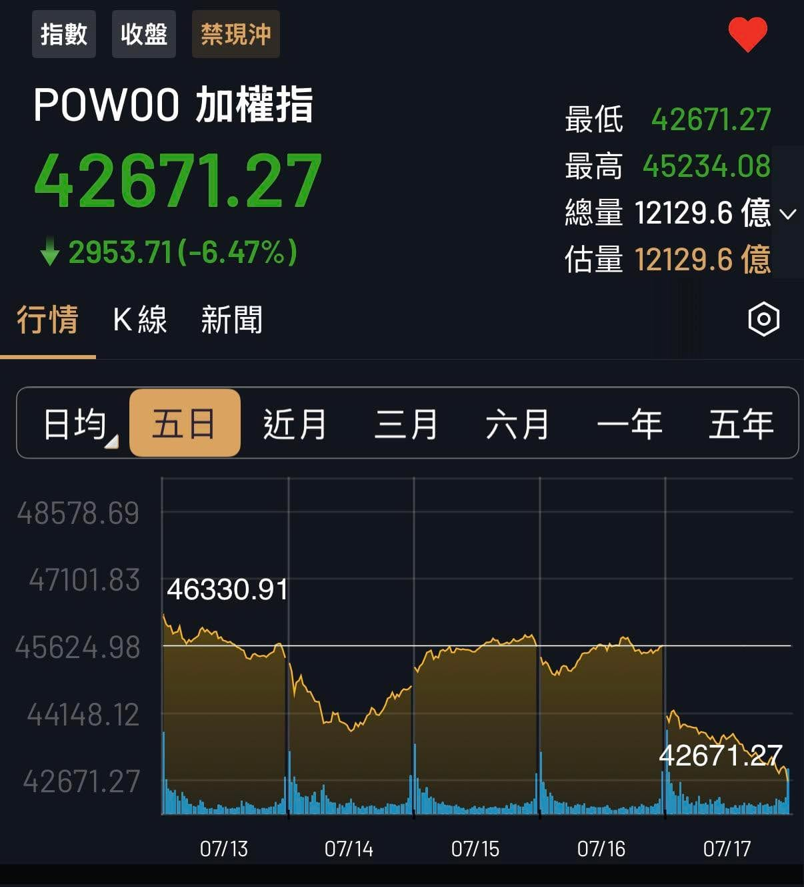

一起見證台股奇蹟時刻。

今天應該會被很多人記住。

台股一天跌了將近 3,000 點，跌幅 6.47%，歷史又多了一頁。

偏偏我今天超忙。

一早去幼兒園當志工爸爸，下午又接著參加一場腦力激盪，等忙完打開手機，才看到新聞滿天飛。

原來，我又錯過了一個歷史現場。

同時突然想到一件事。

如果這一天，是發生在我跟我爸「十年之約」第一局公開之前。

以他那種滿手現金、耐心等機會的操作，大概所有人都會說：

「高手就是高手，這也看得到！」

不過，市場肯定會寫新的歷史。

對大盤市值投資人來說，我完全沒有打算猜中哪一天，是每一次都照著自己的策略走。

剩下的，就交給時間。

.\
.\
.

不說了，我先去看看公園哪邊還有位置。
