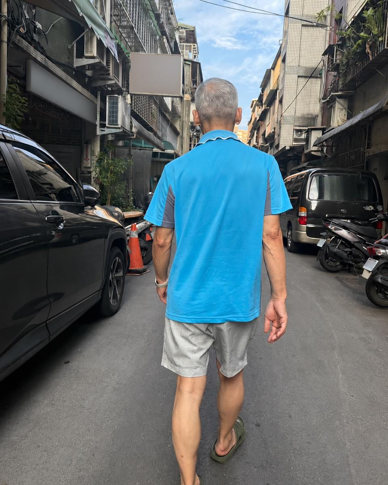

第一局公開後，我第一次回台北看我爸，他一見到我，劈頭就是這一句。

我愣了一下。

「怎麼？終於認同我這個大盤市值仔了？」

他搖搖頭。

原來貼文公開之後，一直有他的朋友打電話來「關心」，壓力大到他不想再公開數據了，只想安安靜靜，做自己的投資。

老實說，我聽到時有點難過。

但難過歸難過，我更想跟你們介紹一下我爸爸。

這是一位在傳統菜市場打拚一輩子，跟我媽一起把姐弟三人養大的爸爸。

當年我創業，身上一毛錢都沒有，他一句話也沒問，直接拿出 90 萬給我當創業資金。

我結婚、生桐桐，他也都默默包了大紅包。

第一局輸了。

他其實有很多選擇。

可以用爸爸的身分叫我不要公開。

也可以說：「算了啦，自己知道就好。」

甚至，如果真的想，數字動點手腳，誰會知道？

但他沒有。

他反而特地跑去銀行，把存摺刷出來，把對帳單攤在我面前。

「說好要公開，就公開。」

「輸多少，就是多少。」

這兩個字，比投資報酬率更珍貴。

叫做誠信。

一個這麼愛面子的爸爸，輸了第一局，還願意讓兒子公開寫、公開拍、公開分享。

我原本的如意算盤，是想靠這十年之約做出一點成績，讓我爸以我為榮。

結果第一局打完。

反而是我，以身為他的兒子為榮。

至於投資。

第一局我會贏，我一直覺得有很大的運氣成分。

剛好遇到了一段很漂亮的行情。

在多頭下，人人都是股神。

真正困難的是，當市場崩跌、資產腰斬，每天睜開眼都不知道底在哪裡時，還能不能守住自己的策略。

這也是為什麼，我始終提醒自己，不要因為贏了一局，就覺得自己比較厲害。

最後，我想公開跟我爸說一句話。

以後包吃、包住、包娛樂。

這個兒子養你一輩子。

我現在研究最多的事情，反而不是怎麼多賺一點錢。

而是怎麼讓你的身體更健康，怎麼讓上了年紀的人，也能舒服地動起來。

錢，我們可以比十年。

健康，我想陪你比更久。

至於十年之約會不會繼續公開……

我還在努力說服他 😆

讓他知道，大家想看的從來不是誰輸誰贏。

而是真實。

真實地贏。

真實地輸。

以及一對父子，用十年寫完一個故事。
