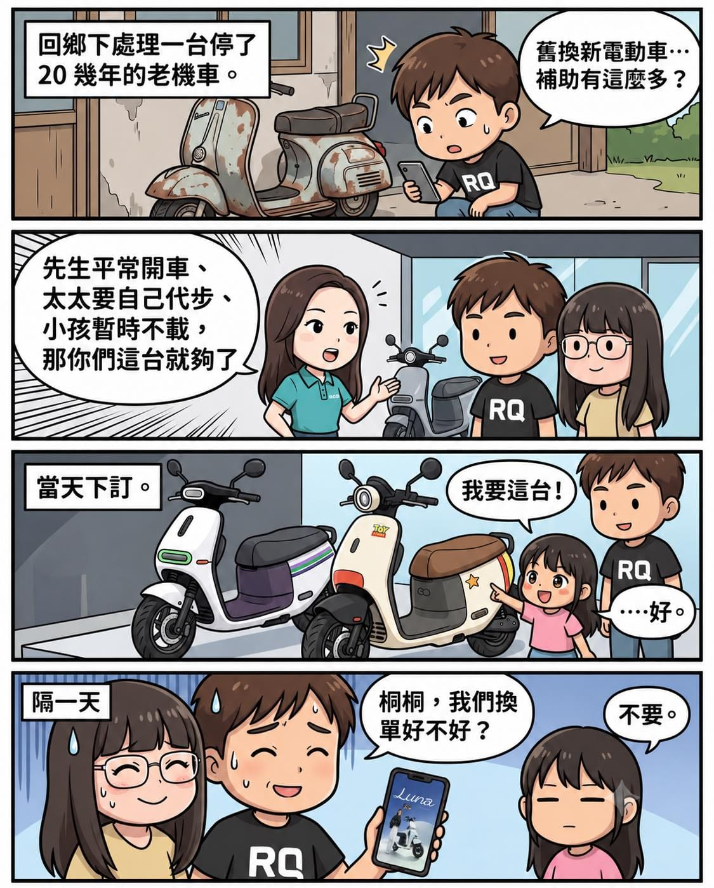

鄉下老家有一台 20 幾年的機車，報廢這差事落到我頭上。

結果處理到一半，我發現機車舊換新換電動車，政府補助多到不像話。

我們家一直都開車，老婆又不太會開車，全家出門一定要等我。買機車這件事其實想很久了，卡在我們從小就不讓桐桐坐機車，載她一定得開車。

現在她已經滿 6 歲了，也差不多該來面對新的挑戰，讓她先練習坐機車這件事情，但還是開了條件，等到她長到 125 公分、25 公斤以上、可以拉單槓 30 秒以上，才可以坐後座。

做了一下功課後，決定就買 Gogoro，找了天全家一起去門市參觀。

接待我們的是珍妮。她講得又快又準，我查了半天的東西，她大概三分鐘就講完。（誤

她推薦我們最適合的 EZZY 500 剛好有玩具總動員聯名，巴斯光年跟翠絲各一款。翠絲那台車身上有一枚金色的警徽，深得桐桐的心。

當天就下訂了。毫不猶豫刷卡，就是聽女兒的。

結果沒幾天，Gogoro 就發表了 Lulu 黃路梓茵 代言的 Luna，專門為女性打造，立刻又約了珍妮賞車。

試騎完之後，我跟老婆都很心動，問桐桐能不能換單。

「不要。」

好吧！看來這台翠絲 12 年後就是要交接給她了。
