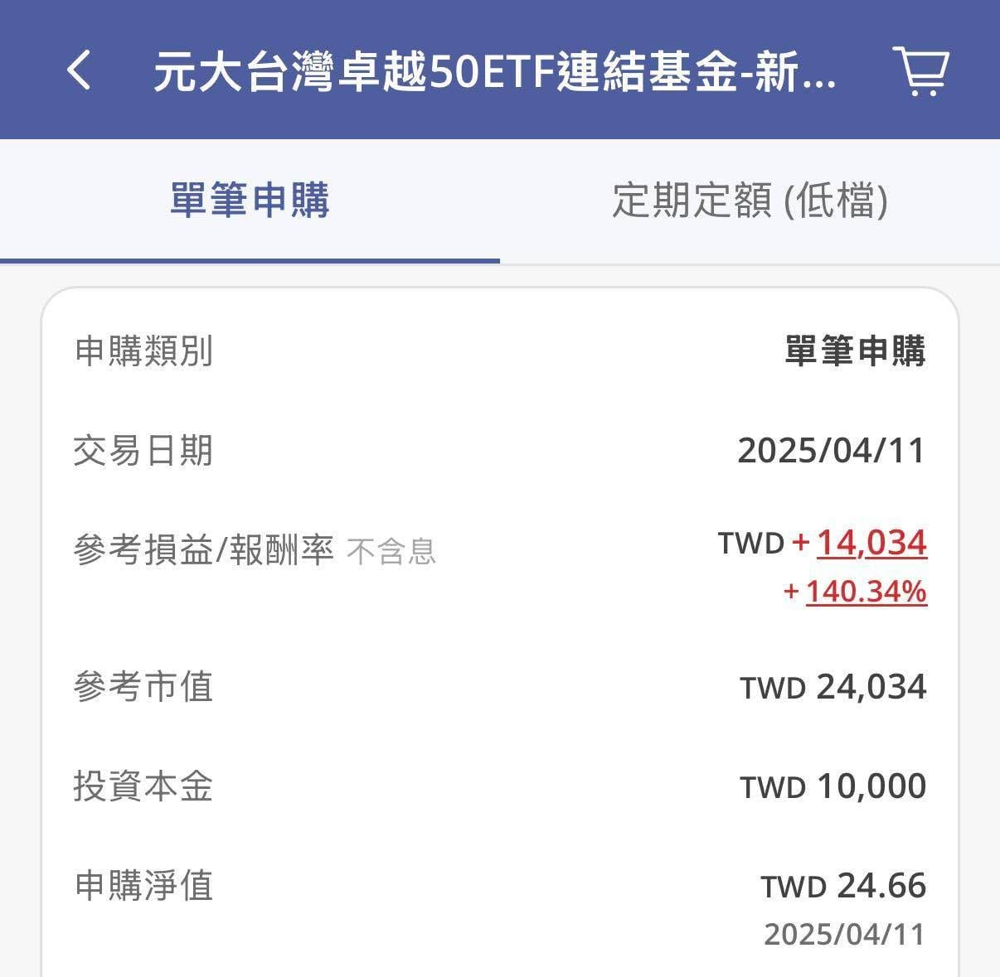

先報數字。

今天加權指數收在 40,039.18 點。

單日跌 1,564.18 點，跌幅 3.76%，跌點排史上第 7 大。

盤中最低到 39,495 點，四萬真的破了，三字頭我們都看到了。

收盤又爬回來，守住四萬之上 39 點。

只差 39 點。

加上昨天那根 2,030 點，兩天合計蒸發 3,595 點，8.2%。

台積電 2,200 元，一天掉 80 元。

超過 1,590 家上市櫃翻黑，記憶體那幾檔直接躺在跌停板上。

我手上的 0050 收 93.7 元，盤中最低摸到 91.8。

而我今天在忙什麼？

在研究怎麼安排臺北馬的課表。

十二天前，台股跌了快 3,000 點的那天，我在這裡寫過一句話：

「真正困難的是，當市場崩跌、資產腰斬，每天睜開眼都不知道底在哪裡時，還能不能守住自己的策略。」

那時候只是感慨。

十二天後，市場直接把考卷發下來了。

我知道有人想說，你這樣叫躺平。

也有人想說，先出場、等落底再接回來不是更好。

問題是我不知道底在哪。

昨天覺得四萬三是底，今天四萬破了。

我的做法簡單也不需要判斷：

每個月固定投入，跌多跌少都投。

不看盤，不猜點位，不改配置。

然後補一個現在很多人需要的數字。

去年 12 月 31 日，加權指數收在 28,963.6 點。

今天崩成這樣，收在 40,039.18 點。

今年以來，大盤還是紅的，而且是 +38%。

從 6 月 23 號盤中最高的 48,218 點算下來，我們確實回檔了 18%。

這兩件事同時是真的。

你覺得很痛，是因為你的錨定點是六月的最高點。

講一個更具體的。

去年關稅戰大跌那次，我東湊西湊擠出一萬塊加碼。

買的是 0050 的連結基金，不配息，股息自動滾回淨值。

一年三個多月後的今天，那一萬塊是 24,034 元。

\+140%！

這是經過昨天那根 2,030 點之後的數字。

今天，我一樣在翻抽屜，找有沒有遺漏的鈔票可以拿出來加碼。

至於跟我爸的十年之約，第二局 12 月 31 日才結算。

他滿手現金等波段等了大半年，這幾天大概是他最爽的一個禮拜。

我還在努力說服他繼續公開 😆

照例提醒，這不是投資建議，我不是專家，只是分享我自己怎麼想、怎麼做。

每個人的資金、年期、能扛的風險都不一樣。

我就是一股不賣。

真要說有什麼策略，大概就是明天早上起床先去跑個課表，然後認真上班不要看盤了。

來，大家一起取暖。
