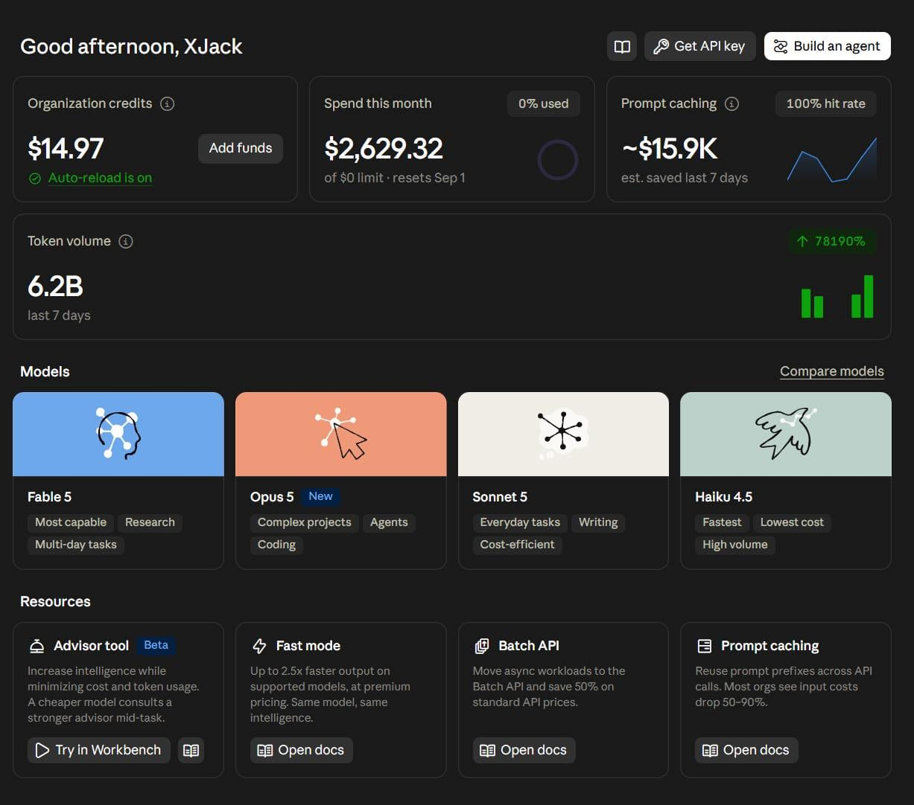

今年二月因為 AppWorks 的關係，我們拿到 5,000 美金的 Claude Credits。

也是那時候才真正開始用 Claude Code。

後來陸續參加活動又拿到一些額度，OpenAI 那邊也給了不少，我自己還加訂了 Claude Max 20x。

額度多到我完全忘記有這筆錢。

直到整理資料時才發現，這 5,000 美金 8/5 就過期。

效期只有半年。\
當下剩不到七天。

七天要燒掉 15 萬台幣的 API 費用。\
而且我日常開發本來就掛在訂閱制上，等於還得另外找任務來燒。

我立刻把其他事全部排開，直接進入全力開發狀態。

七天後的結果：

花掉 62 億個 token（這還沒算訂閱那邊跑掉的）。

開了 73 個 issue，合併了 71 個 PR，公司大大小小的規劃文件也全部梳理過一輪。

之前看新聞說有老闆要求員工每月至少燒掉一份月薪的 token 費用，我還想這怎麼可能。

結果七天就做到了 XDDD

拚成這樣，最後還是有大概 200 美金沒燒完。

時間一到，直接蒸發。

然後額度歸零的那一刻，auto-reload 很盡責地從我的信用卡扣了 10 美金儲值進來。

終於可以好好睡覺了。

等等，開工前是 414 個 issue，現在 459 個。\
我才解掉 28 個，又開了 73 個。

到底要不要讓人休息？
