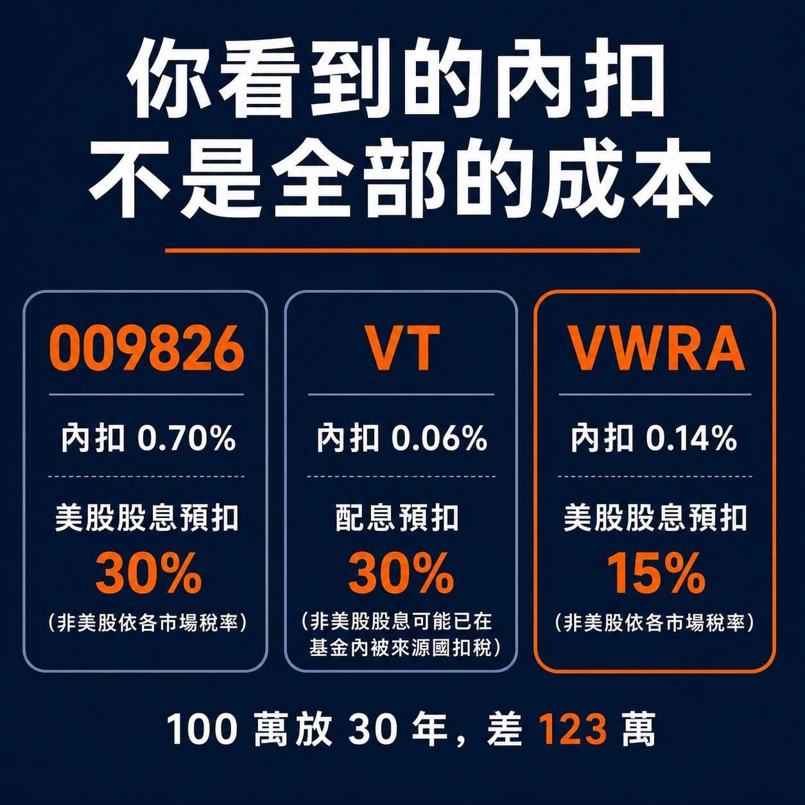

結果一個神人朋友，加上一票網友，都跑來跟我說同一句話：

「你不能只比 VT，還有 VWRA。」

我查完之後，發現上一篇漏掉了整篇最重要的一層。

8 月 3 號，009826 掛牌了，現在台股帳戶裡直接買得到。

所以我把三檔重新攤開一次。

先講那個最多人不知道的事。

你看到的內扣費用，不是全部的成本。

009826 目前公開的固定費用，是經理費 0.45% 加保管費 0.15%，合計 0.60%；基金規模達到最高級距後，最低可降到 0.50%。

不過這還不包含指數授權、上市、交易及其他基金營運費用。因為它才剛成立，還沒有完整年度財報，所以目前只能估算實際總費用率約 0.7%。

VT 約 0.06%，VWRA 是 0.14%。

這是大家都看得到的數字。

看不到的那一層，叫股息預扣稅。

009826 是台灣註冊的基金。

台灣跟美國沒有租稅協定。

所以它買的美股配息進來時，一樣被美國扣 30%。

VWRA 是愛爾蘭註冊，愛爾蘭跟美國有稅約。

同一筆美股股息，只扣 15%。

同樣買全世界，光美股這一部分就差一倍。

不過這裡還有一個容易被忽略的地方。

009826 並不是只買美股，另外還有約四成的非美國股票。

不同國家的股息預扣稅不同，而台灣註冊的基金在部分非美國市場，可能比美國註冊的 VT 更節稅。

所以把美股和非美股的稅務差異全部算進去後，009826 的整體成本，估計大約比 VT 高 0.35 個百分點，並沒有單看美股股息稅時那麼吃虧。

上一篇我沒寫到這件事。

補充一下，台美之間的避免雙重課稅法案，2025 年 1 月已經過了美國眾議院。

但還要參議院同意、總統簽署並完成相關程序才會生效。

在那之前，台灣人的美股股息原則上就是扣 30%。

哪天真的生效了，下面這整套算法都要重算。

三檔攤開來長這樣：

009826｜台灣註冊｜台幣計價｜不配息｜實際總費用率暫估約 0.7%｜美股股息扣 30%，非美股依各市場稅率｜無美國遺產稅

VT｜美國註冊｜美元｜季配息｜內扣約 0.06%｜配息給台灣投資人時扣 30%，非美股股息可能已在基金內被來源國扣稅｜美國遺產稅免稅額只有 6 萬美元

VWRA｜愛爾蘭註冊｜美元｜不配息｜內扣 0.14%｜美股股息扣 15%，非美股依各市場稅率｜無美國遺產稅

我自己算了一次，假設全部公開給你看。

單筆 100 萬，放 30 年，年化毛報酬 7%，全球股息殖利率抓 2%，美股占世界指數 6 成。

因為各國股息稅非常複雜，這裡採用簡化估算：009826 的整體成本大約比 VT 高 0.35 個百分點。

009826 這條路，一年成本估約 1.01%，30 年後是 573 萬。

VT 這條路，一年成本估約 0.66%，30 年後是 632 萬。

VWRA 這條路，一年成本估約 0.32%，30 年後是 696 萬。

這裡有一個很多人會意外的地方。

VT 的內扣只有 0.06%，是 VWRA 的一半不到。

但它是季配息的。

而配息發到台灣人手上時，會被美國整筆扣掉 30%。

VWRA 是愛爾蘭註冊的累積型基金，美股股息在基金內通常只扣 15%，剩下的直接留在基金裡再投資。

所以內扣最低的那一檔，長期稅後成本反而可能輸給 VWRA。

這就是我朋友說「你不能只比 VT」的真正意思。

依照這組假設，VWRA 比 VT 多 64 萬，比 009826 多 123 萬。

我也算了對 009826 最有利的情況，就是它規模做大、經理費和保管費降到最低那一級。

差距縮到約 107 萬，但沒有消失。

不過有件事要講清楚，這三檔追的不是同一個指數。

VT 追 FTSE Global All Cap，連小型股都含，持股約一萬檔。

VWRA 追 FTSE All-World，主要是大中型股，持股約 3,800 檔。

009826 追的是標普 TIP 世界股票指數，涵蓋大中小型股，布局近 40 個國家。

所以它們不是同一個東西，只是重疊度很高。

看到這裡你可能覺得，那結論很簡單，全部買 VWRA 就好。

但我沒有打算這樣做。

因為成本從來不是唯一的變數。

我每個月能丟進全球市場的錢，大約剩下 3,000 元。

3,000 元要怎麼買 VWRA？

你得先存起來、換美金、匯出去、再下單，這種金額根本輪不到它。

所以我的做法不是選一檔最便宜的。

是用金額大小決定用哪個工具。

每個月 3,000 元，走 009826。

台幣、台股帳戶、自動扣款，不用換匯、不用匯出。

它比 VT 貴，但整體成本大約高 0.35 個百分點，還算是可以接受的範圍。

更重要的是，它讓一筆小錢能夠每個月準時進場。

等娛樂預備金沒使用到，或有額外獎金存到 10 萬以上，才走 VWRA。

至於已經在裡面的 VT 跟 0050，一股不賣。

舊的不動，新的轉向。

接下來講我已經實際跑過的路，還有一件有點「錯」的事。

朋友邀請我註冊 IBKR 是有推薦禮的，門檻是一萬美金。

為了這個，我把娛樂跟緊急預備金湊一湊，好不容易弄到一萬美金匯進 IBKR，買了 VWRA。

我曾說過：「娛樂預備金是禁區，完全不能動。」

結果，暑假都過一半了還沒打算要出國，我自己直接把禁區拆了 🤣

不過也因為這樣，我把整條路實際走過一次，順便發現幾件事。

永豐的「大戶速匯」可以用新台幣直接匯到海外。

系統自動按牌告匯率折算，不用先自己換匯再匯出。

台幣進去，美金出來，直接落在 IBKR 的戶頭，然後就能買 VWRA。

手續費一筆 130 元。

「大戶」有首次速匯免手續費，「大戶 Plus」則是每月一次速匯免手續費。

實際優惠還是要以 App 顯示的帳戶等級和活動內容為準。

行員還給了我兩個小撇步。

第一，週三換匯有減分優惠。

第二，匯款時的附註記得加上收款行的 ABA 代碼，能夠更快到帳。

我自己實際跑一輪，早上匯出去，下午就能下單了。

一定有人要問，不是才剛說不改配置，怎麼一個禮拜就在換標的。

嘿，無論崩盤或大漲的時候不動存量，跟平常優化新錢的流向，是兩件事。

我沒有賣掉任何一股。

我只是決定接下來新存進去的錢，要走哪一條路。

照例提醒，這不是投資建議，我不是專家，稅務細節也因基金註冊地、投資國家和個人身分而異。

上面的成本和 30 年金額，都是建立在固定報酬、固定殖利率、固定國家權重和固定稅率下的簡化試算，不是實際績效保證。

每個人的資金、年期、能扛的風險都不一樣。

最後講一句真心話。

我花了兩個晚上重算這些數字，省下來的差距，要三十年後才看得到。

而我三十年後應該已經是個老頭了。

到時候我大概只會在意一件事。

我到底達標 BQ 了沒？（波士頓馬拉松資格）
