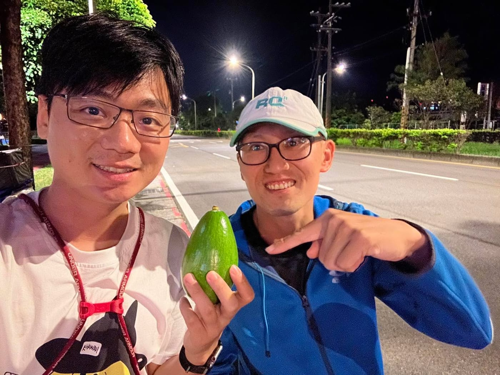

RQ 跑力 本來是不辦訓練營的。

我們做的是系統，一路以來都是把訓練營系統提供給別人用。課表誰開、團練誰帶、學員誰顧，那是合作夥伴的事，我們負責讓數據跑得順。

2020 年疫情，大家不能群聚，實體團練全停了。

那時候我們想，課表跟數據本來就在線上，訓練營有沒有可能整個搬上去？不用集合、沒有操場、教練不在你旁邊，只靠課表、數據和一群人的討論區，能不能練出東西來？

那時候沒人這樣搞，我們算是硬著頭皮自己下場的第一批。

結果疫情過了，我們還繼續做下去。

因為我們發現，線上解決的根本不只是「不能群聚」。

想認真練的跑者不少，但能配合固定團練時間的沒那麼多。加班、輪班、出差、家裡有小孩要接送，週三晚上七點的操場，他就是無法每週都到。

我自己也是那種排不進固定團練的人，時常南北兩地跑，RQ 又是純雲端辦公，這件事我大概比誰都有感。

這幾年，我們跟 徐國峰 HSU KUO FENG 一路從 5K 飆速、初馬破四辦到全馬。一群素未謀面的人，跟著元老「中和飆仔」、「東湖人妻」等線上互相盯課表，最後站上同一場比賽的起跑線。

對了，那顆酪梨，是國峰自己種的。訓練營可以純線上，酪梨還是得本人拿給你。
