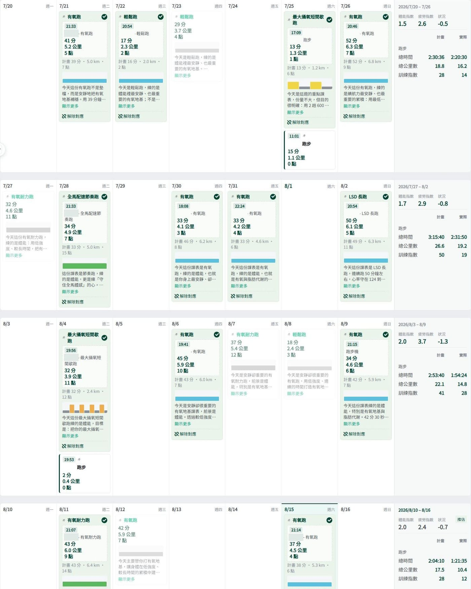

其實，那位教練是我自己寫出來的！

徐國峰 x AI 今日課表，正式版上線了。

七月中它一做完，我就開始拿自己當白老鼠，照它給的課表練到現在。

先報數字。

七月之前，我一週大概跑一次。

現在一週至少三次。

最高紀錄那一週，我產生了五張課表，跑了四次。

從一次變成三次，數字聽起來不大。但那是「幾乎沒在跑」跟「有在練」的差別。

去年底那場台北馬半馬，我整個備賽期的平均週跑量連七公里都不到，賽後也沒有好轉。

那時候我在貼文裡寫「年過四十的阿宅如果還想追 PB，現在不開始就來不及了」，然後就沒有然後了。

現在，這一個新功能深得我心。

一般的訓練計畫是先幫你把八週排好。

第一週你可能跟得上，第二週開始加班，漏了一天，第三週漏兩天，然後你打開那張表，看到一整片沒完成的格子，就再也不想打開了。

今日課表不是那樣運作的。

它平常什麼都不做。\
你有空、想跑了，才去按一下，它才給你一張。

太忙就算了。\
它不會追著你，也不會在那邊算你缺席幾次。

按下去之後，它會先看四件事：

你最近累積了多少訓練量、身上還剩多少疲勞、你自己回報的體感，還有你現在的能力落在哪裡。

然後才決定要給你哪一種。

包括「今天不要跑」。

一份會叫你休息的課表，跟一個只會叫你加量的 APP，是完全不同的東西。

而課表背後那套判斷是徐國峰老師的訓練邏輯，不是我隨便湊的公式。這也是我敢拿自己去試的原因。

課表可以一鍵存進訓練行事曆，直接同步到手錶。

然後是我自己最不習慣的那一條。

存進去之後，你不能編輯，也不能刪掉。

這是刻意的，比照真人教練。\
你不會請了一個教練，然後自己偷偷把間歇改成慢跑吧。

我是老闆，我也改不動。😅

今年十二月的臺北半馬我還是會去。\
上次 2 小時 24 分，備賽期週跑量不到七公里。

這次至少，跑量已經是那時候的好幾倍了。

剩下的，就看這位 AI 敢不敢對我兇一點。
