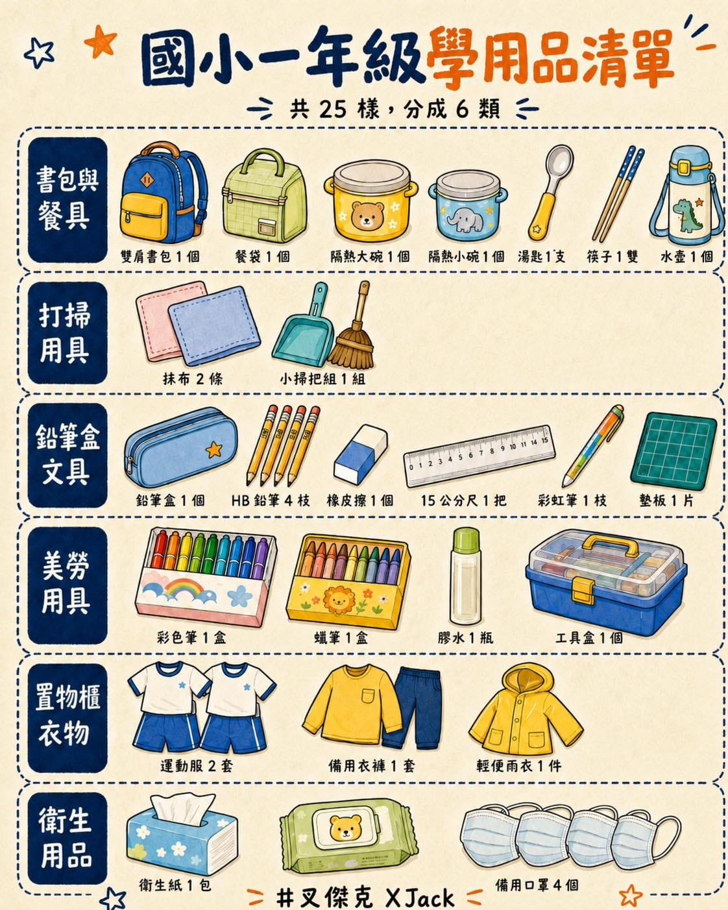

桐桐要上小一了，上週班導師已經聯絡我們加入賴，這幾天開始分享開學前準備，不免也緊張了起來。

最近又傳來該準備的用品有 17 條，哇，現在國小老師都這麼貼心嗎？連該準備什麼跟不該準備什麼都還特別提醒呢。

剩不到一週就要開學，就把我做的檢查清單，一起分享給大家參考。

我有把清單重新排過。

因為那 17 項是條號，不是件數。第 2 項一條就寫了餐袋、大碗、小碗、湯匙、筷子；第 16 項一條寫了彩色筆、蠟筆、膠水。照著條號買，很容易買到一半漏掉。

所以我把它拆開成 25 樣，同類型的放在一起，一組一組結帳：

【書包與餐具｜7 樣】

雙肩背書包 1 個（不建議拖拉式，教室在二樓）\
餐袋 1 個\
隔熱大碗 1 個\
隔熱小碗 1 個\
湯匙 1 支\
筷子 1 雙\
水壺 1 個

【打掃用具｜2 樣】

抹布 2 條（有掛勾更佳）\
小掃把組 1 組（掃把加畚箕）

【鉛筆盒裡的文具｜6 樣】

鉛筆盒 1 個（別太花俏，以免上課分心）\
HB 鉛筆 3 到 4 枝（慢慢脫離 2B 粗三角鉛筆）\
橡皮擦 1 個\
15 公分的尺 1 把\
彩虹筆 1 枝\
墊板 1 片（寫字時墊在簿本內）

【美勞用具｜4 樣，裝進工具盒放教室置物櫃】

彩色筆 1 盒\
蠟筆 1 盒\
膠水 1 瓶\
工具盒或提袋 1 個

【放教室置物櫃的衣物｜3 樣】

運動服 2 套（週一、二、四、五穿運動服，冷的時候外面自己加背心外套；週三穿便服）\
備用衣褲 1 套（含內褲）\
輕便雨衣 1 件

【衛生用品｜3 樣】

抽取式衛生紙 1 包\
濕紙巾 1 包（大號使用）\
備用口罩 3 到 4 個

老師特別註明不用買的：桌墊、帽子。

各校各班規定不同，還是以自己老師的公告為準。

老師只給了三個原則：以實用便利為主、請提早準備、每一樣都要寫上名字或貼姓名貼。

這篇算是我對這位老師的謝謝，雖然大概不會被看到。

前兩個原則我沒問題。

第三個我又數了一次，25 樣拆成實際的單品，要寫上名字的東西也太多了吧！

女兒準備上小學，我本來以為要適應的是她。

結果，先被編班的是爸爸媽媽啊。（遠目
