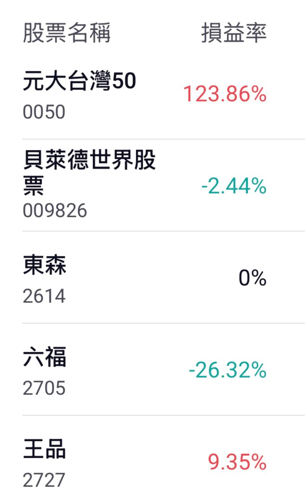

好啦！這才是桐桐真正壓歲錢放的地方。

自從 2022 年我的虛擬貨幣消失後，我才認真研究「投資」這件事情，剛好讓我發現最適合我的配置方式，就是全股 all-in 指數，當時也沒多少錢，就直接選 0050 方便快速。

之後桐桐的壓歲錢也是比照辦理，目前戰績如圖。

我就問一句：

「請問超過兩倍的部分，可以直接分給幫妳投資規劃的『經紀人』嗎？」

PS：009826 是剛剛發現還有錢才買的。
