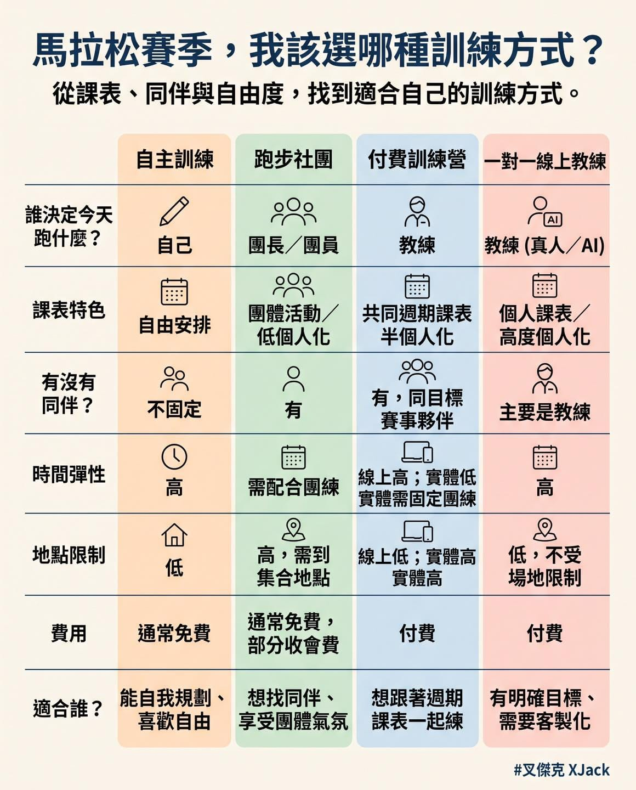

我原本想做一張「馬拉松訓練方式進步排行榜」，查完論文後，發現這題沒有那麼簡單。

結論先講：能持續完成、又能依照自身能力調整的訓練方式，較有機會累積出更好的完賽表現！

以下話很多，請斟酌觀看：

目前沒有研究，直接比較自主訓練、跑步社團、付費訓練營，以及一對一線上教練，最後排出誰一定比較快。

討論較多的是另一件事：

一個人能不能持續完成足夠的訓練量、適當的強度、長跑，以及逐步增加的課表。

一篇整理 85 篇研究、137 組跑者的馬拉松統合分析發現，較快的馬拉松成績，和每週跑步距離、跑步次數、最長單次距離、賽前完成 32 公里以上長跑的次數、訓練配速，以及每週訓練時間都有關聯。

在這份統合分析納入的研究中，馬拉松非完賽比例約為 7.27％。

這提醒我們，完成 42.195 公里的挑戰，是需要一段完整的準備週期，幾次熱血課表很難取代長期累積。

另一篇研究分析 6,771 位馬拉松完賽者賽前 16 週的 Runtastic 訓練紀錄。

在這批資料中，較快完賽的跑者通常有較高的訓練量、較多低強度訓練，並讓訓練速度逐步靠近目標馬拉松速度。

研究結論也提到，高強度訓練約佔總訓練量 5％ 以內。

這份研究還按照跑者一開始的 10 公里速度分成 10 組，因為起點越快，後續進步空間通常越小。

所以我沒有把四種訓練方式硬塞進一張「進步百分比排行榜」。

不同研究的受試者、起始能力、訓練週數、距離和成績指標都不一樣，直接換算成同一個數字，容易讓圖表看起來很精準，實際上卻沒有那麼精準。

身為 RQ 跑力 創辦人，先把我們的歷史講清楚。

RQ 從來沒有主辦過實體訓練營。

過去 RQ 參與的實體訓練計畫，多由核心教練與品牌或賽事合作推動，合作對象包含 Garmin、Under Armour、田中馬、活動咖、臺北馬與華航馬等。

2016 年 RQ 創業初期，特別感謝 Garmin 投入舉辦全馬破 PB 訓練營，還免費在北、中、南培訓心率跑步教練。

當時參與培訓的教練，後來幾乎都成為 RQ 的合作教練。

這件事對我來說很重要。

一個品牌的投入，除了讓跑者有機會參加完整訓練，也讓臺灣多了一批熟悉心率訓練的教練。

後來 RQ 也開始提供線上訓練服務，我接觸到很多住在訓練營或跑班資源較少的城市，也遇到工作排班無法每週固定參加團練的人。

對這些跑者來說，城市與行事曆會直接限制訓練選擇。

有人喜歡固定到同一個地方團練，有人需要配合工作、家庭、交通與睡眠。

課表能不能真正完成，常常比課表看起來多厲害更重要。

跑步社團的價值，也不只在課表。

一項追蹤超過 800 位休閒跑者的研究發現，跑步夥伴增加，通常也會增加每週跑步次數，並提高出現在目標賽事起跑線上的機會。

至於一對一教練，最有價值的地方在於課表可以根據個人反應調整。

一項納入 30 位休閒跑者、為期 15 週的研究，比較依照恢復狀態調整訓練負荷，與按照預先規劃課表訓練的差異。

結果顯示，個人化調整組的 10 公里成績平均縮短約 6.2％，預設課表組約縮短 2.9％；比較最後一次 10 公里測驗的成績變化時，個人化調整組被歸類為「高反應者」的比例約為 81％，預設課表組則約為 23％。

這項研究確實支持個人化調整的價值。

另一項 16 週、120 位休閒馬拉松跑者的研究，比較極化訓練與金字塔式訓練，兩組成績平均改善約 11.3 分鐘與 8.7 分鐘。

研究還發現，不同跑者對課表的反應差異很大，約 17.9％ 被歸類為沒有明顯反應者。

同一份課表，放在不同跑者身上，結果可能完全不同。

我也不想把自主訓練寫成一定會受傷。

一項納入 4,050 位休閒跑者的隨機試驗，測試線上傷害預防課程，結果介入組受傷比例為 35.5％，控制組為 35.4％，兩組沒有顯著差異。

付費、線上或有課表，都不能單獨提供免受傷保證。

真正重要的是，訓練內容是否符合自己的狀態，以及不適合時能不能及時調整。

因此，這張表的用途，是協助你先看清楚自己的需求：

自主訓練：適合能自己規劃、記錄與調整，並且重視高度自由的人。

跑步社團：適合需要同伴、喜歡團體氣氛，也能接受低個人化課表的人。

付費訓練營：適合想跟著教練安排共同週期訓練，也想和同一場目標賽事的夥伴一起前進的人。

一對一線上教練：適合有明確成績目標、生活時間複雜，或需要依個人狀態調整課表的人。

對你最合適的訓練方式與課表，關鍵在於能不能讓你從第一週完成到比賽日。

講了這麼多，唉，原本想做一張有數據的排行榜，查到最後，研究資料只允許我先整理出一張決策表啊。（遠目）
