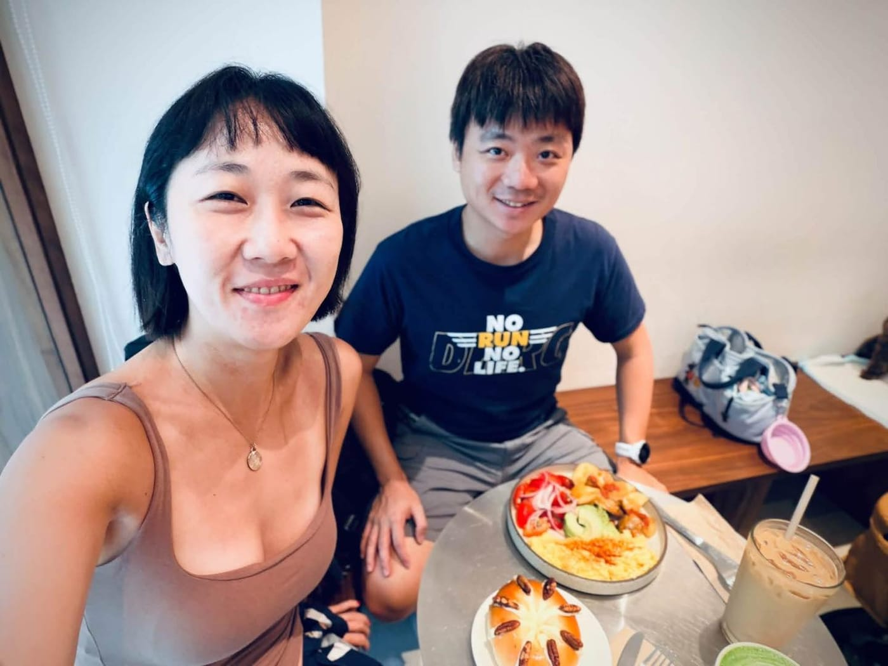

去年訓練營結束，她老公心疼她投入成那樣，直接叫她別當了。她自己也講得很乾脆：

「明年找別人吧！我專心當學員跑步就好。」

一個月前我約她吃了一頓早午餐，只靠一句話，讓她答應接下今年的小隊長。

話說，我跟 Nico 認識很久了，最早是在 Garmin 的全馬 PB 班，總教練也是 徐國峰 HSU KUO FENG。

後來疫情來了，大家被關在家裡，我們跟國峰把訓練營整個搬到線上。她從那時候就開始報名，一屆接一屆，幾乎每一屆都在。

我曾寫過一篇 RQ 跑力 的回顧，裡面有一段在講線上訓練營好玩的地方：沒有實體課，大家靠暱稱認彼此，你可以是中和飆仔、可以當東湖人妻、可以叫秋名山滔滔，有點像線上遊戲。

那位東湖人妻，就是她。

去年我們原本的小隊長懷孕生小孩、請了育嬰假，我就順勢去問以前的學員有沒有人願意接。她那屆本來就自己報名當學員，結果一邊吃課表一邊帶隊，帶得比我預期的好太多。

然後就是開頭那句，老公心疼，她說不當。

而今年是徐國峰全馬線上訓練營的最後一屆。

我原本想說讓公司的新同事來接小隊長就好，想一想還是不對。最後一屆，應該交給真的從頭跟到尾、知道這個訓練營是怎麼一路長出來的人。

所以我約了那頓飯，先聊近況，聊到一半才把「最後一屆」這件事講出來。對，我就是有備而來。

她馬上說好。

看著她今年那篇的標題是「自我介紹\_小隊長\_53\_東湖人妻」。同一個暱稱掛了四、五年，前面多了小隊長三個字。

最後一屆，有她帶隊，我很放心。
