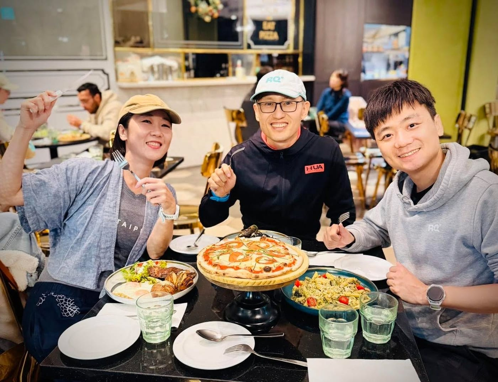

我幫 徐國峰 HSU KUO FENG 老師寫的第一個程式，其實不是跑力。

是 2008 年的環島追蹤網站。

那年他跟鐵人隊的隊友想用跑步環島替飢餓三十募款，四個東華的學生，兩個人跑、兩個人騎腳踏車拉補給，從東華大學出發，17 天跑了 1017 公里，繞臺灣一圈再跑回東華。

那時候我在東華資工的 GAMELAB 念研究所，跟著戴文凱教授做了一個追蹤網站。

技術亮點是即時定位，大家在網頁上就看得到他們現在跑到哪裡，想跟跑的人就自己出門去接一段。

2008 年，手機還沒這麼聰明，這件事做起來比現在麻煩很多很多。

後來我只是想幫這位鐵人隊教練，再寫個程式算跑力。

那時候我自己連操場一圈都跑不完，400 公尺就喘到懷疑人生。

沒想到那個功能，最後寫成了一家公司， RQ 跑力。

這十年我跟國峰一起做的東西，比我當初想像的多太多。跑力、體能狀況、技術分析、課表結構、一對一線上教練、線上訓練營，今年 3 月 15 日「徐國峰 x AI」上線，5 月開始陸續推出單次跑步課表產生器，上週開訓那天中午，徐國峰 x AI 週期化訓練計畫也正式開放了。

我聽他講課也聽了十年。不是一年聽一次那種，是從跑步、鐵人、訓練、教學、系統一路反覆聽。

就算到上週直播課聽他講，我還是會冒出：

「欸，這個角度我以前怎麼沒想過。」

線上訓練營則是疫情那幾年長出來的東西。實體課停掉，大家被關在家裡，我們跟國峰把整套訓練搬上線，一群人靠暱稱互相認識，一屆一屆跑到現在，全馬已經第六屆，半馬也算進去是第七屆。

而今年，是最後一屆。

他在訓練營的自我介紹裡寫，接下來想把跟 RQ 合作的精力，專心放在訓練演算法跟 AI 教練的研究上。所以這一屆帶完，他就不在 RQ 帶全馬訓練營了。

從 2008 年那個追蹤網站到現在，十八年。

沒想到，國峰成為我最重要的夥伴。

照片中這三個人，會一路陪著這最後一屆跑完，後面還有整個 RQ 團隊，一起打造永遠難忘的訓練時光。
