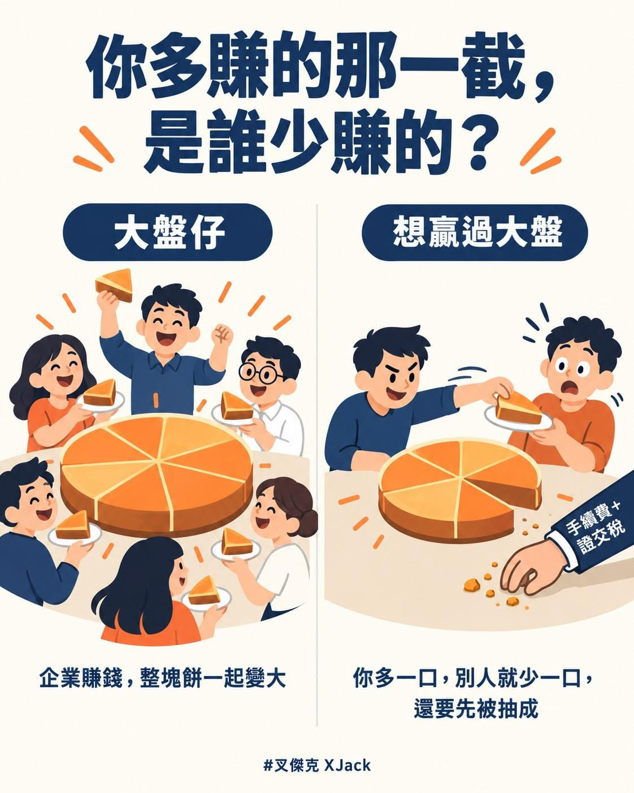

前陣子桐桐阿祖的喪禮，認識了一些長輩。

那天回程，剛好跟阿祖同輩的長輩坐同一台車。

應該是岳母有跟他們說過，長輩一開口就提到我在粉絲團跟我爸比投資績效的戰績，然後直接問我：

「現在應該要買哪一支股票比較好？」

遇到這種問題，我都不太敢回答。

所以我先講了一個概念：拉長到幾十年來看，全世界的經濟都是往上走的，企業會持續賺錢，再加上每年的通膨，帳面上的數字本來就會越來越大。

然後才說，我的流派就是相信全市場，相信台灣，也相信全世界。

我沒有要買哪一支股票。

買了 0050，就是一次買下台灣最大的 50 家公司；買了 009826，就是一次買下全世界一千五百多家公司。

所以我有閒錢就買下大盤市值 ETF，然後把時間認真花在自己的事業跟生活上。

這樣二十年後，很有機會贏過八成以上想打敗大盤的人，本業也會比別人更有優勢。

長輩們一聽，立刻就說：

「今天火化的就是我們的同輩，這幾天都在聊接下來該換誰換誰了，我們已經沒有二十年可以等啦！」

但哩勒！

如果沒有二十年可以等，不就更應該把時間投入在想做的事情上嗎？

那天沒辦法好好說清楚，決定把我的想法寫下來，相信姑婆你們會看到。

我想表達的就是這三點：

第一，自己選股買賣，長期能打敗市場的人非常少。

短期誰都可能贏，但大家只看到倖存者的巨大獲利，沒看到更多默默賠錢離場的人。美國的統計，專業基金拉長到二十年，有九成以上追不上大盤。

而且花在看盤的時間，通常都不會被算進成本。一來一往，只會輸給大盤仔更多啊！

第二，股市本身不是賭場，企業會賺錢，整塊餅會越來越大，大盤仔拿的就是這一份。

但想靠買賣贏過大盤，就是「負和」遊戲了。

每一次買賣，券商跟政府都會先抽手續費跟證交稅，就像牌桌在抽成。如果股價持平，買家跟賣家兩邊都輸錢，只有莊家贏喔！

你如果覺得自己是萬中選一的天選之人，那你該買的是樂透，不是個股吧。（誤

第三，成為大盤市值仔之後，想看到資產翻好幾倍，最好的方式就是好好活超過二十年。

一切生活都變得更健康了。

最後，我認為最重要的一件事。

剛好看到 綠角財經筆記 寫到，名廚、音樂家、外科醫師，大家可以同時都很成功；但在金融市場，有人贏過市場，就一定有人落後市場。

所以靠買賣贏過大盤，你多賺的那一截，就是別人少賺的那一截。

這樣賺到的錢，你捨得花嗎？

指數化投資是一種「不殺生」的投資方法。不用把別人踩在底下，也不會被別人踩在底下。

我寧可把時間花在本業、家人跟跑步上，這些都是可以大家一起變好的事。

照例提醒，這不是投資建議，我也不是專家，只是分享自己怎麼想、怎麼做。

.\
.\
.

然後回到山上後，我就直接開始教他們超慢跑了！
