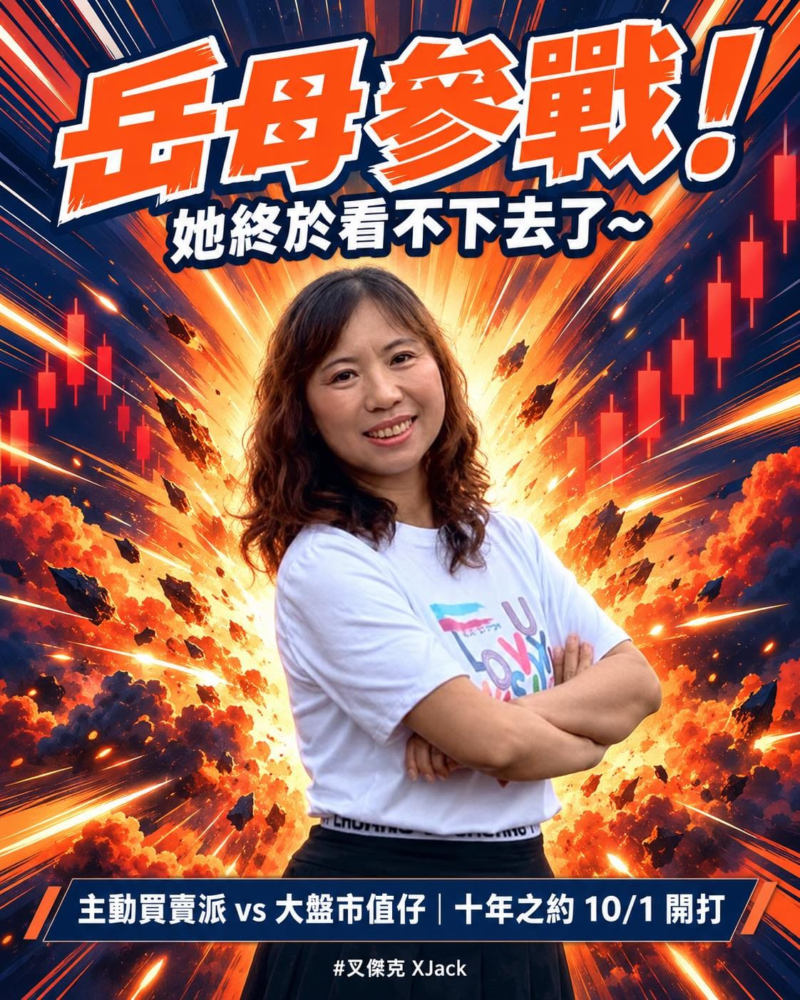

跟我爸的十年之約，只打完第一局。

那局剛好碰上百年難得一見的大盤暴漲，2026/7/1 公開之後，很多人打電話來關心，他覺得壓力有點大，決定不比了。

一個想做十年的真實實驗，才開局就要收攤，我正覺得非常可惜。

剛好中秋連假回南部娘家，就把這件事先跟岳母說。

沒想到她二話不說：

「那我來接手吧！」

看來她已經準備好了！

其實岳母的故事，我以前分享過。

還記得那位買了十張 0050，後來又忍不住全賣掉的親戚嗎？

就是她。

她終於受不了我這五年一直在講 0050，2025 年底下手買了十張。

結果就在 0050 大暴漲的前夕，全數出清。

我那時還發了一篇文，感嘆投資最難的就是「不要動」。

但她賣掉之後，是直接去買了台積電。

喔賣嘎。

一轉手下來，比抱著 0050 多賺了十幾萬。

出手能這麼精準，她覺得要贏過我這個大盤市值仔，應該不難。

好啊！

正在煩惱實驗沒辦法繼續的我，當然是超級開心。

就算是岳母，我也不怕！（誤

十年之約，正式換人接手，2026/10/1 開打。

岳母 aka 波段操作派

我 aka 大盤市值仔

一樣各拿 100 萬出來。

我這次更簡單，直接 70% 0050 + 30% 009826，不看盤、不買賣、不用複委託。

每半年比一次投資績效百分比，結果都會公開。

第一局只比三個月，12/31 結算、2027 元旦公開；之後每六個月一局，連續比十年。

【我為什麼當大盤市值仔？】

我從小看著家裡的氣氛跟著股市上上下下，長大後一直很討厭股票。

直到 2022 年，我把 10 萬元丟進虛擬貨幣，結果交易所倒了，直接歸零。

那一刻，我才開始認真做功課。

後來看了清流君、綠角、周冠男教授的分享，市值型投資的邏輯愈看愈扎實。

原來投資可以不用每天提心吊膽，吃飽睡好，躺著領市場平均報酬。

是平均，不是平庸。

買大盤，就是把整個市場買下來，市場賺多少，我就拿多少。

聽起來很普通，但只要持續投入、撐得夠久，二、三十年後，就能贏過八成以上的人。

而且這套方法沒有任何門檻。

不需要盤感，不需要內線消息，也不需要比別人聰明。

岳母那一手台積電很漂亮，但說實話，你學不來，我也學不來。

我的 70% 0050 + 30% 009826，任何人照抄，都能拿到跟我一樣的市場平均報酬。

更值錢的，是省下來的時間。

我不看盤、不研究個股，時間拿去陪桐桐長大、跑好每一張課表、把本業做好。

錢交給市場，時間留給真正重要的事。

投資上真正的超能力，就是不要太努力。

當然，多頭裡人人都是股神。

真正的考驗，是市場崩跌、資產腰斬的時候，還能不能守住策略。

這也是為什麼我們要比十年，不是只比一局。

照例提醒，這不是投資建議，我也不是專家，只是分享自己怎麼想、怎麼做。每個人的資金、年期、能扛的風險都不一樣。

所以這場十年之約，就是一個真實世界的實驗：

學不來的精準出手，對上誰都抄得走的市場平均，十年後誰會贏？

唯一的煩惱應該就是贏了也不太敢笑吧！（遠目

到底能幾勝幾敗，我自己也非常期待。

就讓我們看下去！
