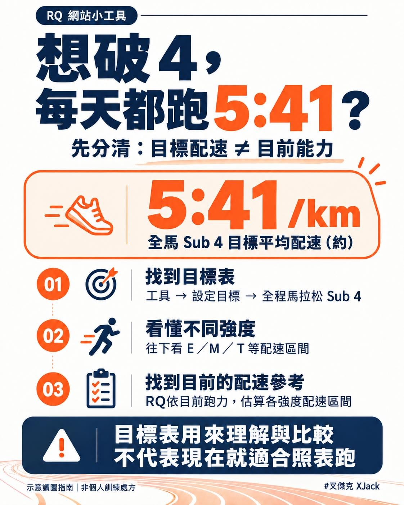

目標全馬破 4，結果連輕鬆跑，都覺得自己應該跑到 5 分 41 秒？

先等等，目標寫下去了，身體可不會自動更新版本啊 😆

10 月進入賽季，長榮馬、臺北馬接著來。最近在確認目標的跑友，可以打開 RQ 網站這個小工具：「全程馬拉松 Sub 4 小時訓練配速表」。

不用登入，就能看~

怎麼用？抓三個重點：

① 找到你的目標

進入「工具」，往下找到「設定目標」，點「全程馬拉松 Sub 4」。

② 別只看最上面的數字

頁首約 5:41/km，是破 4 的目標平均配速。再往下，還有表上的 E 輕鬆有氧、M 馬拉松配速、T 乳酸閾值等訓練區間。

③ 把目標跟現況分清楚

這張表是依「破 4 所對應的跑力」推算的參考，並不是直接量到你現在的能力。

所以，不能因為想破四，就直接把表上的 E、T 配速當成自己的訓練配速。可以先用近期、能反映目前狀態的比賽成績檢視現況，也要考慮那次的距離、天氣和疲勞狀況。

同跑力的其他距離成績，也只是模型推估，不保證一定跑得出來。

那我現在到底該跑多快？

這就是 RQ 跑力 可以幫你的地方。我們可以依據你目前的跑力，估算不同訓練強度的配速參考區間，讓你安排訓練時有個依據。

目標可以先訂，訓練先從現在的自己出發。當天太熱、太累，也別為了追表上的數字硬跑嘿～
