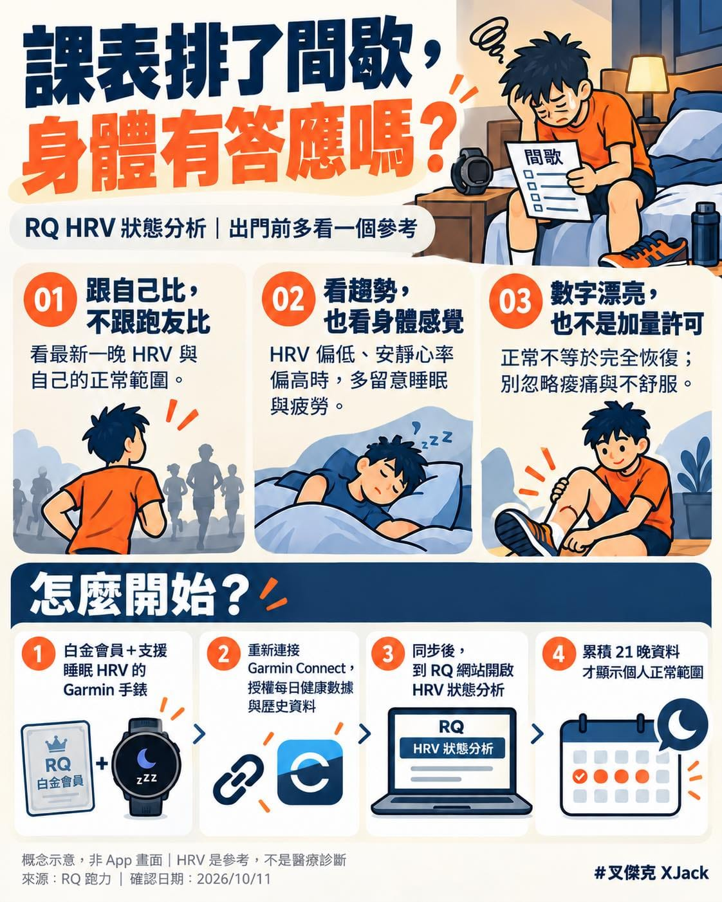

課表寫得很清楚，今天要跑間歇。

但早上起床，腿很重、精神也不好。

這時候最難的問題就來了：到底是我想偷懶，還是真的還沒恢復？

10/25 長榮馬快到了，有人在準備比賽，也有人正為年底的賽事累積訓練。

越認真照課表跑，有時越難接受今天需要調整。

好像少跑一次，前面幾個月就會全部白練。（抖

但工作、睡眠和生活壓力，也不會因為我們報了馬拉松，就自動放假啊。

這週想介紹 RQ 跑力 的一個功能：「HRV 狀態分析」。

HRV 是心率變異度，可以提供恢復與壓力狀態的參考。不過使用它之前，有三件事要先知道。

① 跟自己比，不跟跑友比

不要看到朋友的數字比較高，就覺得自己輸了。

重點是最近的數值，相對於你自己的平常範圍，發生了什麼變化。

② 看數據，也要看身體的反應

打開 RQ 功能頁，先看最新一晚的 HRV 與個人正常範圍，再看幾天的趨勢。

點開趨勢圖，也可以一起查看安靜心率。

如果 HRV 偏低、安靜心率又比平常高，加上睡不好、特別疲累，就值得重新評估今天的強度，或跟教練討論調整。

③ 數字漂亮，不等於今天可以加碼

HRV 正常，也不能保證肌肉、肌腱都恢復好了。

腿還痛、身體不舒服，就不要拿一個漂亮數字說服自己硬跑。單晚的低值也不等於已經過度訓練，更不是疾病診斷。

想開始使用，可以照這個順序：

・需要 RQ 白金會員，以及支援睡眠 HRV 的 Garmin 手錶，睡覺時記得佩戴\
・重新連接 Garmin Connect，授權「每日健康數據」與「歷史資料」\
・同步後，打開 RQ 網站的 HRV 狀態分析頁\
・個人正常範圍需要累積 21 晚資料；首次可回補近 28 天，仍要看裝置是否有記錄及同步是否完整

我覺得這個工具有用的地方，是讓我們在「今天一定要跑完」之前，多停一下，看看身體正在告訴我們什麼。

而且，我們的評估是用最適合跑者的方式，拿原始數據重新分析過喔！

訓練很重要，能繼續訓練也很重要。

課表沒有打勾，心裡可能會有點癢。

但身體也不是按一下重新整理，就會恢復了嘿~
