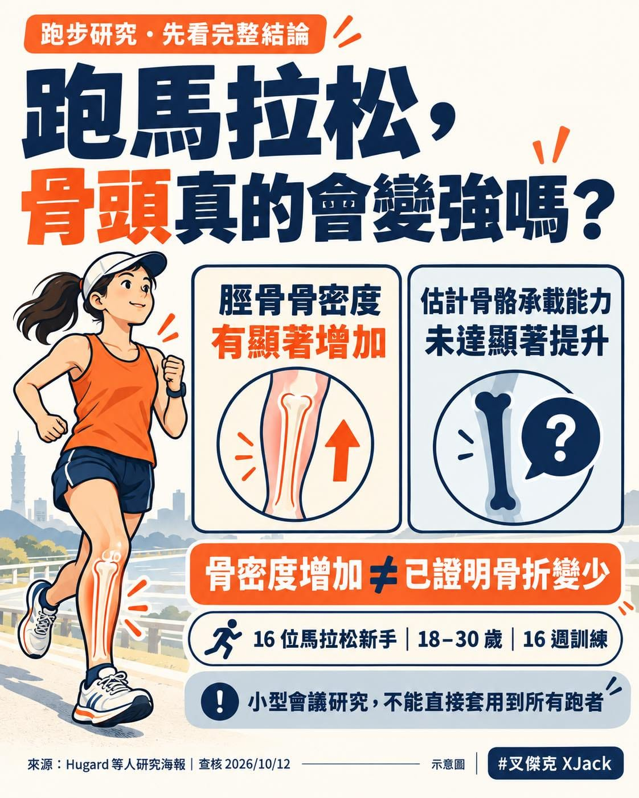

今天在美國的朋友傳來一張研討會的研究海報，說了一句：

「懶人包：馬拉松訓練增加骨密度。」

哇，是最新的研究嗎？ 感覺這消息很值得跑者注意，立刻花點時間查看。 結果，仔細看研究標題，後面還有一句：

but not Failure Load

意思是：但骨頭抗壓能力，沒有顯著提升。

研究標題也不能只跑前半馬啊～

所以，從「骨密度增加」到「骨頭更不容易斷」，中間還有幾件事要搞清楚。

① 他們研究的是誰？

16 位 18～30 歲的馬拉松新手，其中 9 位女性，進行 16 週逐步增加跑量與強度的訓練。

研究者使用高解析度影像，追蹤小腿脛骨特定部位的變化。

海報報告，脛骨骨密度隨訓練時間有顯著增加，遠端部位平均增加約 0.8%。

注意，是「脛骨特定部位」。

不能直接翻譯成：練完馬拉松，全身骨頭都升級了啊～

② 骨密度增加，為什麼還不能說更不容易骨折？

研究除了量骨密度，也透過影像與電腦模型，估計骨頭在壓縮負荷下，能承受多大的力量才會失效。

這就是標題裡的 Failure Load。

這次研究中，這個估計值沒有達到統計上顯著的提升。

而且，研究並沒有追蹤證明，這些跑者之後比較不容易骨折。

骨密度、模型估計的承受能力，以及實際有沒有骨折，是不同的問題，不能直接畫上等號。

③ 那是不是代表跑步對骨頭沒用？

也不能這樣說。

樣本只有 16 人，觀察時間也有限。 「沒有達到統計顯著」，不等於已經證明完全沒有效果。

比較準確的說法是：這份研究觀察到特定部位的骨密度增加，但還沒有足夠證據確認，估計的抗壓能力也跟著提升。

另外，海報沒有呈現不跑步的對照組，參與者也都是年輕的馬拉松新手。 不能直接套用到所有跑者，更不能拿來當成骨質疏鬆的治療結論。

④ 其他研究怎麼說？

我也順手往前找了一下，發現這個議題其實已經有人研究過。

2010 年一項針對女性的訓練研究，在 14 週耐力跑訓練後，也觀察到脛骨遠端的骨密度增加。

這提供了一個支持的線索：

某些跑步訓練，確實可能讓特定部位的骨密度增加。 不過，那不是馬拉松訓練研究，也沒有直接證明骨折變少。

另一篇 2024 年發表的研究，比較了 327 位男性跑者和 212 位缺乏運動的男性，發現跑者的下肢骨密度較高。

但這是把兩群人拿來比較，沒有追蹤同一個人從不跑到開始跑的變化。 因此，不能直接說這些差異全是跑步造成的。

把這些研究放在一起看，跑步對骨骼可能有幫助，是有研究支持的方向。

只是研究方法、參與者和測量部位都不同，不能全部濃縮成一句「跑越多，骨頭就越強」。

所以，回到一開始的問題：

跑馬拉松，骨頭真的會變強嗎？

這份海報提供了一個值得繼續追蹤的線索：年輕馬拉松新手的脛骨局部骨密度，可能隨訓練增加。

但要進一步說「骨頭更能承受負荷」且「比較不容易骨折」，這份研究的證據還沒走到那裡。

至於是不是最新研究，目前還沒找到與這張 16 人海報完全對應的正式期刊論文，所以先把它當成會議研究報告結果來看。

我覺得，這就是看研究有趣的地方。

同一張海報，只看到前半句，會得到一個答案；把後半句也看完，再找找其他研究，才知道這答案能用在哪。

最後忽然覺得，平常一直分享跑步，原來還是有好處的。

朋友人在美國，看到馬拉松的研究，第一個就想到我，還特地拍下來傳給我看。

這種被朋友記得的感覺，真的有點感動嘿～
