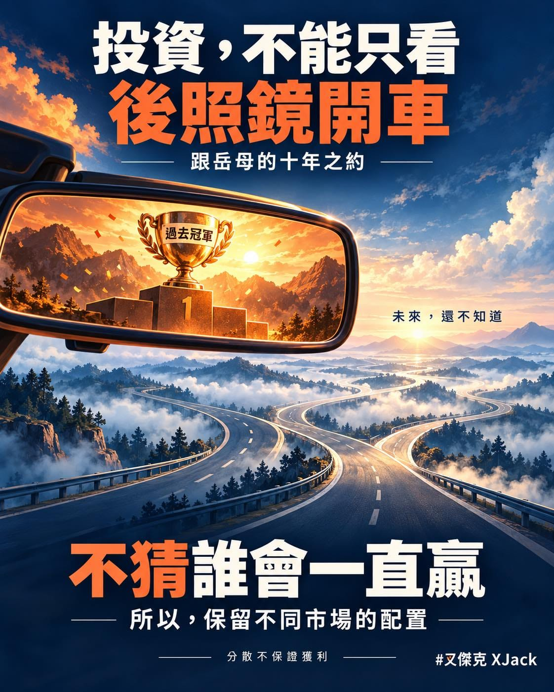

我跟岳母的「十年之約」開始之後，有人對我的配置提出了一個建議：

不要配 009826，全部買 0050 就好了。

我這次比賽的配置是 70% 0050、30% 009826。70% 投資台灣大型股，30% 配置全球股票。

全部買 0050，未來會不會賺更多？

有可能啊。

但如果理由是「因為以前賺比較多，所以以後也會賺比較多」，那就有點像看著後照鏡開車了。

後面的路很清楚，不代表前面的彎也長得一模一樣。

① 過去的冠軍，沒有附送未來的冠軍保證書

過往績效值得研究，可以讓我們知道一個市場曾經經歷什麼、波動可以多大。

但從「過去表現很好」，直接跳到「接下來十年一定比較好」，中間還差了一個很大的「不知道」。

Vanguard 曾經提出一個很有意思的問題。

如果因為過去美股贏全球，就決定只買美股，那為什麼不再往下挑，全部買過去更強的產業，最後只留下過去最強的那一家公司？

照這個邏輯一路挑，分散最後就消失了。

事後回頭看，冠軍很好找。

問題是，我們現在要投資的，是還沒發生的「未來」。

台灣未來可能繼續表現很好，也可能有其他市場表現更好。

我不知道。

這幾個字聽起來很沒氣勢，尤其我都已經跟岳母公開比賽了。（抖

但既然選擇當大盤市值仔，就不用為了看起來很會投資，硬猜下一個冠軍。

② 保留全球配置，不用猜誰會一直贏

009826 的投資範圍涵蓋已開發與新興市場，也包含台灣。

保留這一部分，讓我的股票配置除了台灣，也能參與其他市場。

當台灣一路領先時，這樣配可能就會比全部買 0050 少賺。

這是分散可能付出的代價。

不可能一邊想分散，一邊又要求自己的報酬，每次都要等於當年最強的那個市場。

那已經是希望自己每年都提前拿到答案了啊～

支持全球分散，也不是預測全球股票接下來一定會贏台股。

正因為不知道誰會贏，才保留不同市場的參與機會。

③ 那為什麼我還是放這麼多在台灣？

因為我們一家只想住在台灣啊！

未來的生活支出主要是台幣，匯率變動也是我會考量的事情。加上對台灣的生活選擇，我保留了比較高的台灣比重。

不過這裡要分清楚：台幣計價的台股，仍然會受到公司海外營收、進出口與匯率變化影響。買 0050，不代表匯率風險就完全消失。

而且，生活費與近期要用的錢，也不能只靠會漲跌的股票來保障。

還有一個比較個人的理由。

我自己在台灣做 RQ 跑力 ，也希望自己的努力，能讓台灣多一點競爭力。

當然，這份期待不是台股未來一定會贏的證據，更不是我努力把產品做好，0050 就會跟著上漲。（誤

所以，我保留對台灣的偏重，也保留一部分全球配置。

這是我的生活選擇、信念與風險取捨。

不是「因為住台灣，所以七成台股就是標準答案」。

④ 我的配置，也不是大家都該照抄的作業

談全球股票配置時，全球市值權重常被當成一個起點，再考量成本、稅務、個人目標與承受風險的能力。

我的 70／30，顯然仍然偏重台灣。加上 009826 裡面也有台灣股票，實際台灣比重還會再高一點。

這件事要知道，也要願意承擔。

另外，市值加權不是每家公司平均分一樣多的錢；全球分散，也不等於低風險或保證獲利。

股票市場大跌時，不同國家的股票一樣可能一起跌。

我想維持的原則是：控制成本、分散風險、長期持有，按照事先訂好的規則維持紀律。

至於每個人適合多少股票、多少債券或現金，還是得回到自己的生活與用錢時間。

所以，如果有人問我：

「你這樣配，十年後一定會贏全部買 0050 嗎？」

我當然不會這樣保證。

就像我也不知道，十年後到底是我贏岳母，還是岳母贏我。

這場比賽可以一起看熱鬧、觀察不同做法，但我們兩個人的結果，也不會自動變成全世界都適用的投資定律。

比賽既然叫「十年之約」，就讓時間慢慢走。

如果現在就知道答案，網站應該直接做頒獎頁，不用做計分板了吧。（誤

後照鏡可以看。

但不能因為後面的路跑得順，就認定前面永遠不會轉彎。

那，你這局投誰贏呢？
