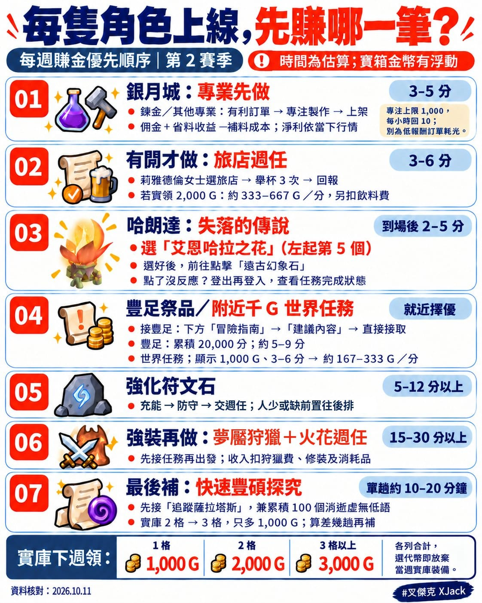

之前看到新的坐騎消息，可以自己選乘客，搭配拍賣場、郵箱等功能，這次改版終於正式上線了。

當年 20 週年沒有幫桐媽買到那隻坐騎的遺憾，終於有機會用這隻補足了！

然後往下看價格。

整套收齊，居然要 700 萬 G。

好吧，既然都決定要買了，就來整理每隻角色上線後，哪些錢比較值得先拿。

有幾隻就跑幾隻，時間不夠就做前幾項。裝備不同，安排也可以不同，不用每隻都跑到天荒地老。

先說清楚，下面的時間是規劃估算，會受交通、讀取、裝備和現場人數影響。寶箱金幣也有浮動，拿 2,000 G 示範計算，不代表每箱固定開出這個數字。

而且，開箱還有額外驚喜。

過去有玩家分享，頂尖儲物箱開過約 18,000 G。不過那是先前賽季的個案，不能直接當成這一季每種寶箱的獎勵上限。

我目前最高紀錄是 6,000 G。

開到的那一下，真的會覺得這週有認真上班。（誤

不過大獎先當驚喜，基本收入不要靠中獎來算。

① 銀月城：上線先處理專業

已經練好鍊金的角色，我會先處理這個。其他專業有賺錢的配方或訂單，也可以一起做。

先抓 3～5 分鐘，看看訂單，再看看拍賣場。

・先挑有利潤、值得做的訂單，再留意到期時間\
・看清楚客人提供哪些材料，自己還要補多少\
・比較藥水、精煉藥劑，挑當下賣得動、淨利好的製作\
・做完領獎勵，把要賣的東西上架

訂單除了佣金，有時還能靠節省材料多賺一點。

但要分清楚：省下來、歸自己的可交易材料，可以增加收益；替客人製作時，多重製作多出的成品是客人的，不能連人家的都算進自己的錢包嘿。

專注力上限 1,000，每小時恢復 10 點，離線也會回。別放到滿出來，也別為了低佣金訂單，把原本能賺更多的專注力耗光。

如果 5 分鐘淨賺 2,000 G，就是每分鐘 400 G；只賺 300 G，就剩每分鐘 60 G。

所以重點不只是手速，而是這筆到底值不值得做。

自己的材料也有成本，放進拍賣場也不代表已經賣掉。算收益的時候，記得扣掉材料、拍賣費用，別只看成交金額就覺得自己發財了。

② 當週有開：先做旅店週任

看莉雅德倫女士當週有沒有提供旅店的選項。

有的話，選好任務，前往旅店完成 3 次舉杯，再回去交任務。舉杯可以對自己使用。

這一趟先抓 3～6 分鐘。

如果寶箱實領 2,000 G，約是每分鐘 333～667 G，再扣飲料花費。

人在銀月城就能先安排，值得擺前面。

但不是每週都有這個選項。沒有的時候，就選能與後面活動一起完成的週任，例如搭配狩獵推進火花任務。

同一個週任的不同選項，不要算成可以全部各領一份獎勵喔。

③ 哈朗達「失落的傳說」：選艾恩哈拉之花

這個直接講重點。

我選的是從左邊數第 5 個「艾恩哈拉之花」。如果你的選單排列不同，就以名稱為準。

選好後，再去點「遠古幻象石」。

我之前遇過點進幻象後，沒有出現新的任務流程，登出再登入後，就完成了任務。

如果你也遇到沒反應，可以嘗試重登，再確認任務狀態。但這是我先前遇到的狀況，不保證改版後每個人都能用同樣方式完成；有正常流程就照任務指示走。

先前到場後的規劃估算是 2～5 分鐘，跨區交通、讀取或重登的時間另外算。如果現在需要跑完整流程，就要重新計時。

假設實領 2,000 G，整趟花 5 分鐘，就是每分鐘 400 G；花到 8 分鐘，就剩 250 G。

所以這個位置也不是永遠固定第三名，實際花多久，才是重點。

④ 豐足祭品與千 G 世界任務：哪個近、哪個快就先做

豐足任務不用特地跑去找人接。

打開畫面下方的「冒險指南」，選「建議內容」，就能直接接取符合條件的任務。

週任要累積 20,000 分，單輪活動 3 分鐘。一輪沒達標，就還要再跑。

如果附近有活動，約 1～2 輪能完成，加上移動與交任務，先抓 5～9 分鐘。需要等活動或多跑幾輪，時間就得往上加。

假設實領 2,000 G，花 5～9 分鐘，約是每分鐘 222～400 G。

另一邊，如果地圖上剛好有獎勵約 1,000 G、又不用打怪的世界任務，也很適合分身。

含繞路花 3～6 分鐘，就是每分鐘約 167～333 G。

如果就在旁邊，2 分鐘就能做完，那就是每分鐘 500 G，當然可以直接插到前面做。

裝備還沒起來的分身，先拿這些就很好。不要一上線，就把它送去跟怪物互相折磨。

⑤ 強化符文石：看現場狀況再決定

正常流程是充能、防守，完成後交週任。

已經解鎖、現場有人一起打的情況，先抓 5～12 分鐘以上。缺前置、還要收集材料，就得再加時間。

假設實領 2,000 G，花 5～12 分鐘，約是每分鐘 167～400 G。花更久，效率就再往下掉。

到場剛好快完成，很值得做；空場又要從頭準備，就往後排。

各位，本週的四倍符文石週任已經確定被修掉了，不用花時間搞這個小偏方啦。

⑥ 裝備好的分身：夢魘狩獵＋火花週任

這一段就開始看角色能力了。

先接好能一起完成的週任，再出發跑狩獵。不要打完回來，才發現任務忘了接。

先抓 15～30 分鐘以上，把同一趟實際拿到的金幣、可出售物品收益加總，再扣狩獵購買費、修裝和消耗品。

裝備、火花有它們的價值，但不能直接當成已經進錢包的金幣。

我不會要求每隻角色都跑滿 3 次。

假設前面的短任務能做到每分鐘 250 G，那這一趟花 20 分鐘，就要淨賺超過 5,000 G，才有贏過它。

能同時完成多個目標的強裝分身，比較值得安排。打得辛苦的角色，做完前面的工作就換下一隻，也很好。

⑦ 最後再看：豐碩探究和寶庫要不要補

挑當下好跑的豐碩探究，單趟先抓約 10～20 分鐘，打不順還可能更久。

有「追蹤薩拉塔斯」記得先接，透過探究、地城與寶藏等內容，累積 100 個「消逝虛無低語」，完成後還能交任務拿獎勵。

同時打開寶庫，確認自己到底差多少進度，不要只憑印象算。

下週領獎時，如果放棄當週寶庫裝備、改選代幣，可以換：

・開 1 格：1,000 G\
・開 2 格：2,000 G\
・開 3 格以上：3,000 G

看的是各列合計的格數，超過 3 格也不會繼續增加代幣。

請記得，從 2 格補到 3 格，只多 1,000 G 嘿，自己要算一下效益。

時光漫遊地城可以累積地城列進度。若地城列第一格還沒開，完成一場符合條件的時光漫遊地城，就能開第一格。

但如果第一格已經開了，後面要看累計 4 場、8 場的門檻。不是每打一場，就再送你一格。

如果只差一趟 10 分鐘，就能讓合計格數從 2 格變成 3 格，寶庫增加的部分就是每分鐘 100 G。

如果還差 4 趟、共 40 分鐘，就只剩每分鐘 25 G。

探究另外拿到的金幣或任務獎勵，再加進來，但同一份獎勵不要算兩次。

這樣才知道，為了把格子填滿硬跑，到底划不划算。

所以，我會把每隻角色的流程先排成：

銀月城專業 → 當週短週任 → 艾恩哈拉之花 → 豐足祭品或附近千 G 世界任務 → 強化符文石。

再依當週任務、交通和現場狀況調整。哪個就在旁邊、哪個快完成，就可以往前插。

裝備好、還有時間的，再做狩獵組合，最後看看探究和寶庫值不值得補。

前面做完就換下一隻，也不用覺得自己漏了什麼大事。

畢竟我是來玩遊戲的，不是來幫每一隻分身打考績的。

相信這樣跑幾週，應該可以慢慢朝存到 100 萬 G 前進吧。

至於距離那隻坐騎還差的 600 萬 G ……

大人要用大人的方式解決。

直接掏出魔法小卡，買官方魔獸代幣換 G。

沒錯，研究半天，最後還是要靠現實世界的本業輸出啊～我還是乖乖上班好了。
