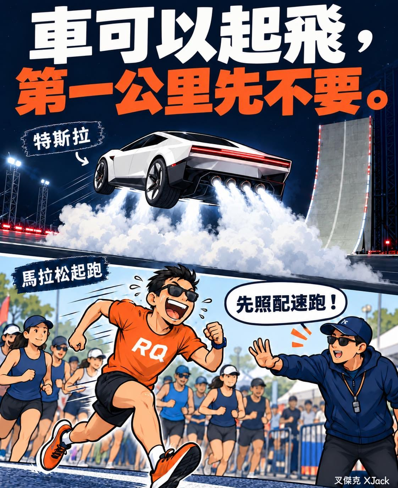

今天特斯拉發表新 Roadster，車真的飛起來了！

身為做跑步軟體的人，我覺得我們跟特斯拉的努力方向，好像有點不一樣。

他們想辦法讓車起飛。

我們卻希望大家跑馬拉松的時候，先不要起飛。

尤其是第一公里。（認真

起跑音樂一下、人群一動，突然覺得自己今天狀況超好。

手錶上的配速，比課表快了一大截。

先冷靜，那不一定是你進步了。

可能只是你把後面三十公里的力氣，拿來付頭期款。

車有推進器。

你有後半馬。

照計畫跑，讓終點的自己也開心得起來嘿！
