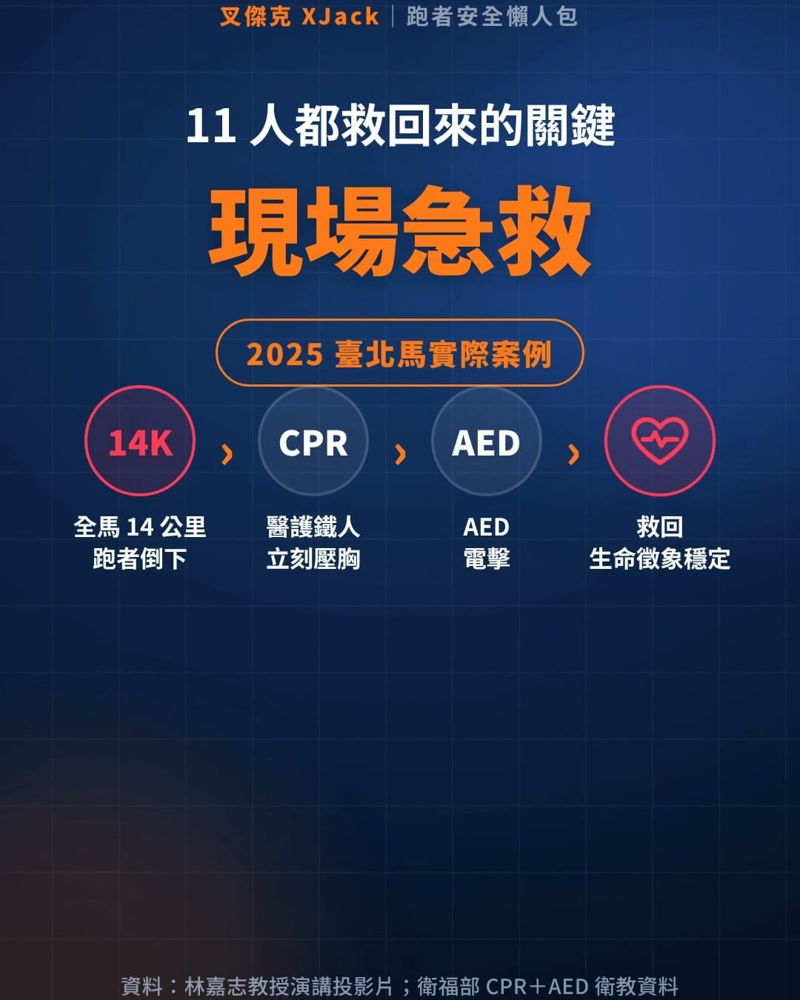

[到 Facebook 看這支影片](https://www.facebook.com/reel/1152031967156090/)

上週一位 25 歲的韓國跑者，在半馬終點前約 500 公尺倒下，搶救後仍不幸離世。

這種新聞每看一次，心裡就揪一次。

剛好看到 RQ 顧問林嘉志教授分享他 6 月的演講〈馬拉松心因性運動猝死預防之道與國家政策管理的必要性〉，裡面有一頁數據我看了很久：

2021 到 2025 年的臺北馬拉松，媒體報導至少有 11 位跑者在賽道上心跳停止（OHCA）。5 屆加起來 13.2 萬人次，平均每 1.2 萬人次就有 1 人倒下。

但更重要的是，這 11 位最後都被救了回來。像 2025 年那位在全馬 14 公里處倒下，醫護鐵人當場 CPR 加 AED，把人救了回來。

電擊每晚 1 分鐘，成功率就少 7～10%，旁邊的人敢不敢馬上出手，差別就在這裡。

哪些人更該把完整演講看完？

林教授引用美國運動醫學會（ACSM）的心血管疾病危險因子，請對照一下自己：

・男性 45 歲以上、女性 55 歲以上\
・爸爸、兄弟或兒子 55 歲前，或媽媽、姊妹或女兒 65 歲前，曾心肌梗塞、裝心臟支架、做繞道手術或猝死\
・抽菸、戒菸未滿 6 個月，或常吸到二手菸\
・每週中高強度運動不到 75～150 分鐘\
・BMI 27 以上，或腰圍男性超過 90 公分、女性超過 80 公分\
・血壓 130/80 mmHg 以上（兩次量測），或正在吃降血壓藥\
・LDL 壞膽固醇 130 以上，HDL 好膽固醇男性低於 40、女性低於 50，或正在吃降血脂藥\
・空腹血糖 100 以上，或糖化血色素 5.7% 以上

中了任何一項，都很值得花 40 多分鐘把演講看完、學起來。

林教授也建議跑者要清楚自己冠心病、腦中風的 10 年罹病風險。國健署有免費的「慢性疾病風險評估」，35～70 歲把健檢報告的數字填進去就能算。

我把重點做成 1 分鐘動畫。教授特別提醒：恢復用的氣壓腿套，跟演講裡推廣的「遠端缺血預處理（RIPC）」有很大的不同。腿套常見的壓力大約 80 mmHg，血流照常流動；RIPC 則是刻意把血流短暫阻斷，用來做預防性的心血管保護。

怎麼做才對，請看教授的完整演講。

動畫裡也補了兩件每個跑者都該會的事：看到有人倒下，記住「叫叫壓電」；自己跑步時出現胸痛、異常的喘、心悸、頭暈，就立刻停下來。成績可以再拚，心臟只有一顆。

林教授最後也建議，衛福部、消防署、運動部和專業學會加強合作，建立全國馬拉松賽事的 OHCA 通報系統，把每一次倒下的原因弄清楚，才能真正做好預防。

做 RQ 跑力 這些年，我一直在推科學化訓練。但再好的課表，前提都是你能平安站上起跑線，也平安跑回終點。

多一個人知道自己的風險、會叫叫壓電，就多一分機會。
