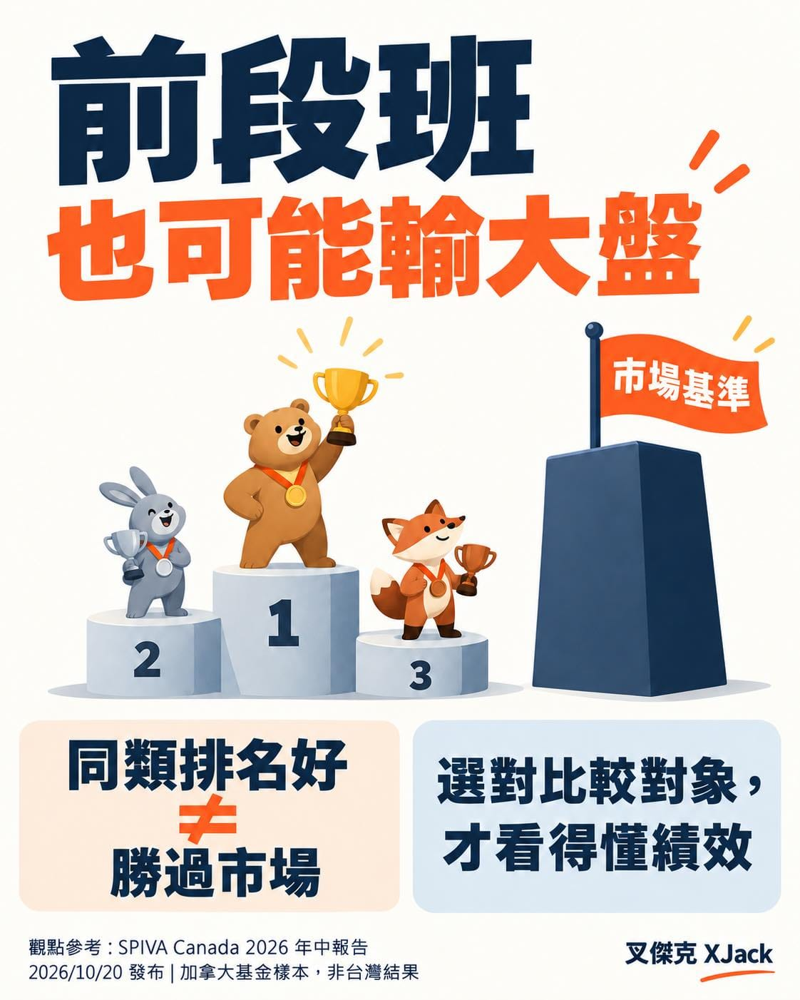

「排名前 25%！」

聽起來很厲害，已經是前段班了耶～

但先等一下。

這張成績單，有把全校放進來一起考嗎？

S&P 最新公布的加拿大 SPIVA 報告，整理了 2026 年上半年主動基金的表現。

其中 7 個類別，有 5 個類別的「前 25% 門檻」，仍然落後各自的比較基準。

意思是：就算擠進同類基金的前段班，也還不一定贏過基準。

注意，不是說前 25% 的基金全部都輸，也不是把加拿大結果直接套到台灣。

只是看投資排行榜時，值得多問一句：

「我到底在跟誰比？」

贏過其他基金，和贏過同期間、適合這項投資的基準，是兩件事。

期間一不一樣？幣別一不一樣？配息有沒有算回去？費用有沒有扣？承擔的風險又差多少？

不然拿不同考卷比名次，很容易越看越有信心！

當大盤市值仔，不用每天找下一張冠軍榜單，還是有功課要做。

知道自己在投資什麼，分散配置、留意成本，讓投入金額符合自己的生活與承受能力，再把長期持有的紀律維持下去。

你猜對了，最近大盤跌很大，需要找一點文獻來增加信心！（誤
