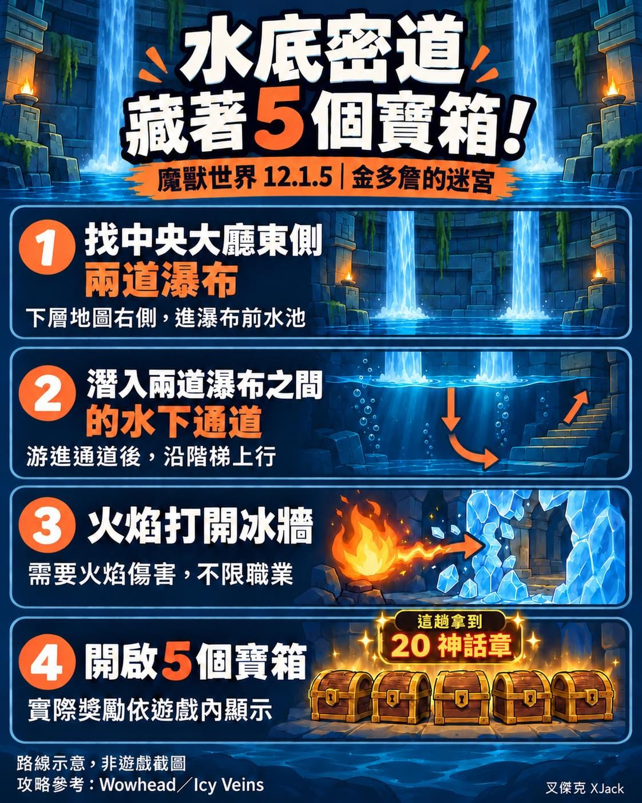

金多詹的迷宮裡，中央水池不是裝飾這麼簡單。

潛下去，後面還藏著一間寶庫！

今天找到入口、打開冰牆，裡面整整五個寶箱，我這趟還拿到 20 個神話章。

感謝昨晚打 M+ 的網友提醒，特別做一篇來分享。

想找的朋友，照這個方向走：

1\. 回到迷宮中央大廳下層，找東側，也就是地圖右邊的兩道瀑布。

2\. 進入瀑布前方的水池，潛到兩道瀑布之間，找到水下通道並游進去。

3\. 沿通道、樓梯往上走，會看到一面冰牆。

4\. 用火焰傷害打冰牆，打開後就是寶庫！

重點是「火焰傷害」，不是一定要火法。

本身有火焰傷害技能就能用；沒有的話，迷宮旅程等級 2 之後，也可以在迷宮裡尋找 Fiery Hexmask 火焰面具，取得後用它的火焰攻擊破冰。面具的位置不固定，要找一下。

說到法師，我本來主要玩德魯伊，但我們團裡德魯伊太多，又缺「智力」很久了，想想之後我就決定改玩法師！

是缺法師的增益智力，我不是在罵隊友喔。

想想高中玩第一款線上遊戲《天堂》時，我也是玩法師。繞了大約 25 年，又回來了。

還沒開過的朋友，下次經過中央水池，記得下去看看嘿～

補充：有網友說「萬象儀的火焰就可以了」「飾品賈納雷之息😌」
