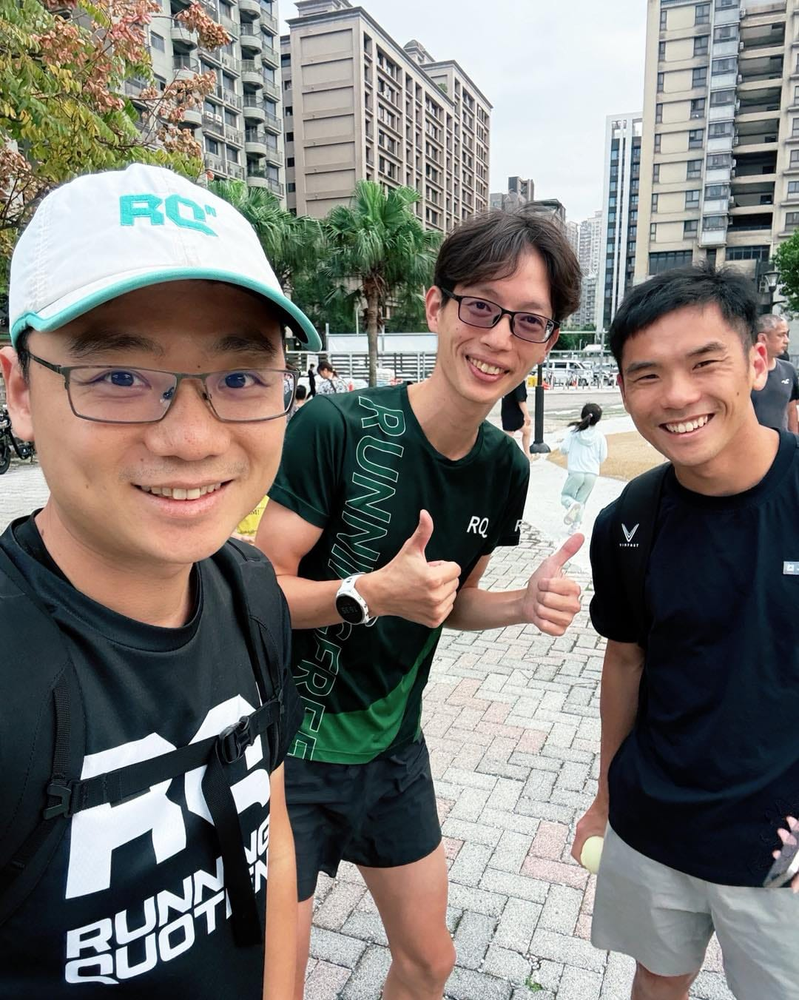

今天帶孩子出去玩，順便約了住附近的 羅譽寅 LO U IAN 教練見面。他也是 RQ 跑力 的共同創辦者。

譽寅最近用 AI 做了不少網站和服務，我們聊得正起勁，突然看到遠遠有個人穿著 RQ 的衣服。

再仔細一看，竟然是 張恪銘 CHANG KE MING！

是當年 RQ Project 贊助的選手之一。

2019 年，譽寅提出了 RQ Project，希望透過完整的教練指導與科學化訓練，幫助市民跑者往更高的目標前進。

那時候不只是提供課表，也把選手的訓練過程公開，讓大家可以看到：一個有工作、有生活的市民跑者，是怎麼一步一步累積、調整，挑戰自己的成績。

恪銘就是第一屆參與的跑者。

沒想到，七年後，我們會這樣在淡水的公園碰到。

我跟譽寅是約好的，恪銘則是完全巧遇。而且這次大家都帶著自己的孩子來公園玩。

當年的共同話題是課表、跑力和比賽，今天除了聊 AI，還多了身邊一起來玩的小孩。

RQ Project 公園版，這次不用排課表，行程由小孩決定。

神奇了，原本只是來淡水玩、找朋友聊聊天，竟然因為遠遠看到一件 RQ 衣服，就把當年一起做的事情又接了起來。

這張合照，還有一段從 2019 年延續到今天的故事啊～

話說，開始講古是不是初老的症狀啊？（汗
