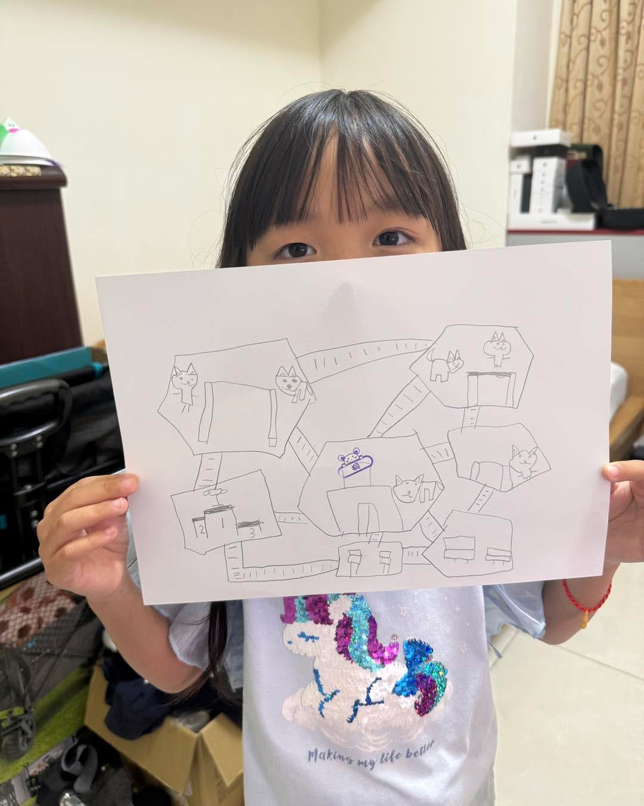

前幾天颱風天，桐桐拿了一張鉛筆畫來找我，說她要一座自己的島。

紙上有貓貓之家、高中低三座跳臺、兩座公園，還有一個排行榜。

我就帶著 AI，照她的圖一座一座蓋出來，連木板橋接在哪裡，都照她畫的。

第一版蓋好沒多久，她又在同一張紙上加了表演區、多多紙箱區、日記區、合體公園，還多了一隻額頭綁頭帶的貓貓教練。

再過沒多久，又說要一座學習數學島。

規則她也都想好了：

點黑板，是貓貓老師上課。\
點講台，是桐桐老師改作業。\
每隻貓一天只寫一張，改完就下課。

才上小一沒多久，她最想當的居然是改作業的那個人。😂

日記區跟學習數學島的字都有注音，讓小一生也能自己讀，也太貼心了吧。

會有這座島，是因為桐桐很愛貓。

她知道有些人養貓養一養就不要了，家貓就這樣變成了流浪貓。

所以島上這 50 隻貓，都是她接回來照顧的。

牠們的名字從雞蛋糕、米漿、肉圓到車輪餅，每天一起比跳高、上臺表演、寫日記，現在還多了寫作業。

島主兼設計師：桐桐\
施工：桐爸和 AI

網址是 [tong.xjack.tw](https://tong.xjack.tw/)，不用下載、不用登入。

有空可以來島上幫忙改作業，這群貓錯得還真不少。
