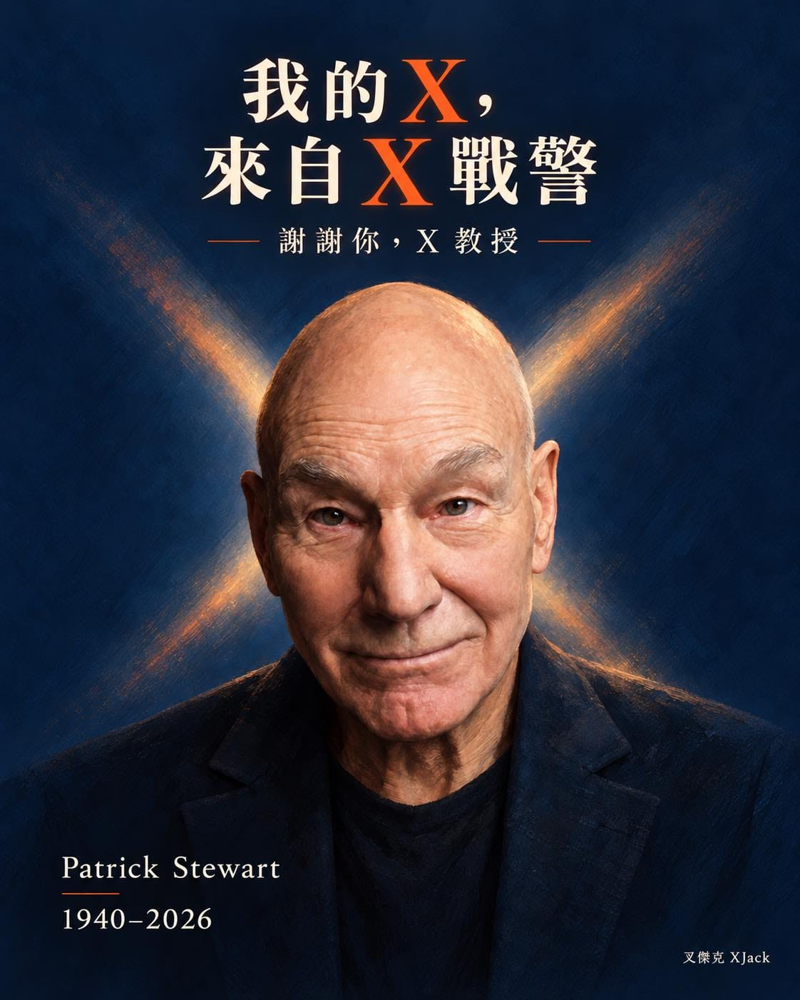

「叉傑克 XJack」的 X，其實就是從《X 戰警》來的。

而我以前，也曾以當教授為目標。

所以提到 X 教授，對我來說，還多了這麼一點自己的連結。

飾演他的派崔克・史都華，在 10 月 28 日辭世，享壽 86 歲。

X 教授很特別。

在一群能飛、能控制天氣、能伸出鋼爪的人裡，他坐在輪椅上，辦了一所學校，教那些還不理解自己力量的人，學著認識自己，也學著與別人相處。

超能力的故事裡，居然有一個這麼重要的位置，是留給老師的。

現在的我做著 RQ 跑力，名字裡也還留著那個 X。

一個角色的影響，有時候就是這樣。電影看完了，卻有一小部分，繼續留在自己的生活裡。

謝謝你，Patrick Stewart。

謝謝你演出了那位 X 教授。
