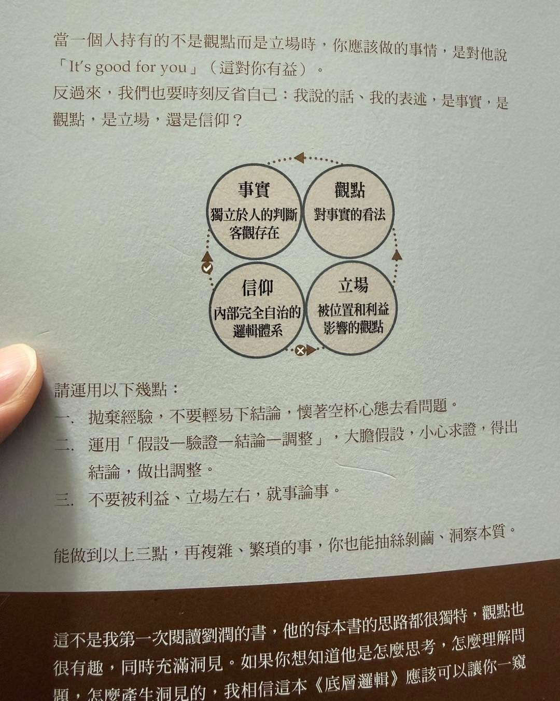

昨天台北市長辯論結束了。

比起誰辯贏了，我更想問：

到底什麼樣的回答，能讓我們重新思考自己支持的人？

如果無論他說什麼、做什麼，我們都能找到理由支持，那辯論還有多少意義？

台灣的選舉，有時真的讓人覺得已經到了信仰的程度。

對手改口，叫反覆無常。\
自己人改口，叫懂得調整。

對手強硬，叫傲慢。\
自己人強硬，叫有魄力。

同一件事，先看是誰做的，再決定要拿哪一套價值觀出來用。這樣價值觀也太忙了吧～

這張圖把「事實、觀點、立場、信仰」放在一起，剛好很適合拿來想這件事。

我們可以有不同的觀點，也可以支持不同的人。但如果連事實都得跟著支持對象改變，討論就很難有交集了。

不過，這張圖也不能只拿來指著別人說：

「你看，你就是這樣！」

最難的，其實是問自己：

**如果今天換成我支持的人做同樣的事，我還會用同樣的標準嗎？**

能不能承認自己支持的人也會錯，可能比證明對方很爛，更值得練習。

對，我是不懂，但我願意持續學。
