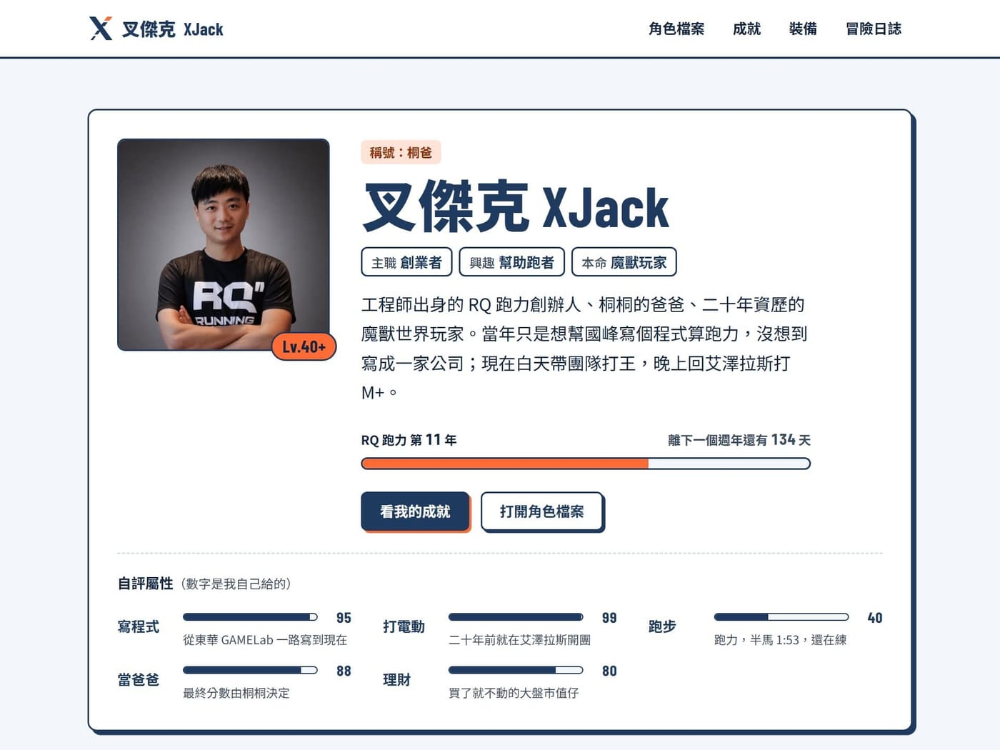

xjack.tw 這個網址，以前一直掛在 RQ 官網的系統底下。

前幾天終於把它搬出來，變成獨立的個人網站。

既然要重做，乾脆做成我最熟的樣子：魔獸角色卡。

Lv.40+，稱號「桐爸」。\
主職創業者，興趣幫助跑者，本命魔獸玩家。

自評屬性也順便填了。\
打電動 99，寫程式 95，當爸爸 88。

跑步 40 （跑力，半馬最佳 1:53）

做跑步 App 的人，跑步分數最低 xDDD

人生大事做成「成就」，從 2003 年進東華開始，一共解鎖 128 個、1,560 點。

做過的東西放進「裝備」，傳說級只有一件，就是 RQ 跑力。

以前散在運動筆記、Blogger、Medium 和粉專的長文，全部搬進「冒險日誌」，從 2014 年寫到現在，119 篇。

整理成就的時候算了一下，我在東華待了至少 12 年，大學、碩士加博士班。

新手村待這麼久的玩家應該不多.....

當爸爸那欄的備註寫著「最終分數由桐桐決定」，之後再請她來評分。(遠目

歡迎批評指教！
