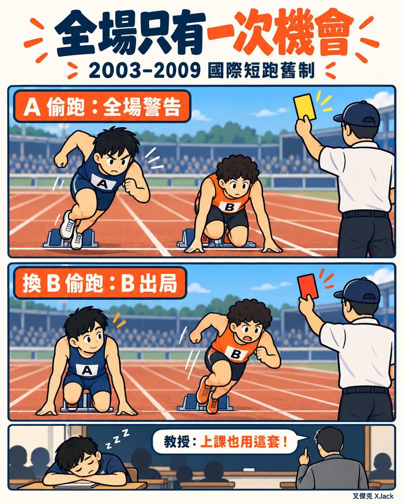

今天跟運科大神林嘉志教授諮詢，聽到他說到一個很有趣的上課規則。

上課不能睡覺。\
第一次，警告。\
第二次，算曠課。

看起來很普通對吧？

等一下，重點來了。

不是「每個人」都有一次機會。\
是「全班」共用一次機會。

前面已經有人睡著、被警告過了，下一個睡著的人，就算是自己第一次，也算曠課。

教授說，這叫「田徑規則」。

查了一下，還真的有這個舊制！

2003～2009 年的國際田徑短跑，全場共用一次偷跑警告。之後不管換誰偷跑，犯規的那個人就直接取消資格。

A 先偷跑，全場警告。\
重跑時換 B 偷跑，B 出局。

「可是老師，我才第一次睡耶！」

放到這套規則裡，這個理由還真的不成立啊。

這下同學之間的團隊精神，可能會變成：

「欸，醒醒，不要把全班那一次用掉！」

小補充：這是舊制喔。2010 年起，一般單項已改為首次偷跑就取消資格，全能項目另有規定。
