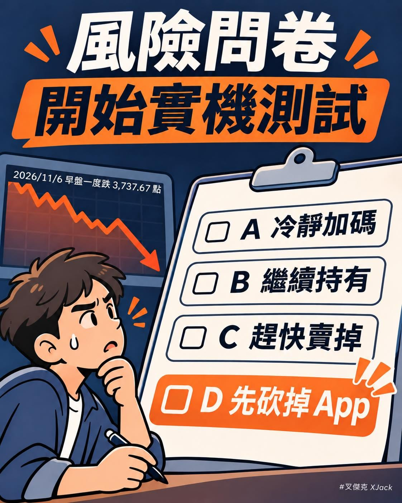

平常填投資風險問卷的時候：

「如果資產下跌 20%，你會怎麼做？」

A. 冷靜加碼\
B. 繼續持有\
C. 趕快賣掉

大家填問卷的時候，應該都蠻勇敢的吧？

結果今天台股早盤一度跌超過 3,700 點，打開帳戶的那一刻，才發現問卷沒有提供選項 D：

先把 App 砍掉，假裝今天沒有開盤。（誤

不過，大跌的時候其實很適合重新認識自己的風險承受度。

第一個問題是：這筆錢什麼時候要用？

如果是近期要付的房款、生活費，或借來投資的錢，遇到下跌時，可能沒辦法等到自己覺得「適合賣出」的那一天。

心裡覺得自己能承受，和資金安排真的承受得起，是兩件需要一起考慮的事。

第二個問題是：你真的有分散嗎？

買了五檔基金或 ETF，不一定就是分散。如果它們背後都重壓同一群公司，市場跌起來還是可能一起坐溜滑梯～

大盤 ETF 也會跌，只是它把資金分布在一籃子公司，而不是押在單一公司身上。至於分散到什麼程度，還是要看買進的內容。

第三個問題是：跌下來以後，要漲多少才回得去？

100 萬跌 20%，剩下 80 萬。

這時候不是漲回 20% 就好了，而是要從 80 萬漲到 100 萬，也就是漲 25%，才回到原點。

所以「已經跌很多了」不會自動等於「接下來一定會漲」。跌深可能帶來機會，也可能代表還有風險，沒有人能光看跌幅就保證答案。

今天不用急著替自己選 A、B、C。先看看配置、現金需求和自己能承受的波動，再決定要不要調整，通常比盯著每一分鐘的指數更有幫助。

畢竟投資最怕的，可能不是忘記帳戶密碼，而是上漲時選了積極型，下跌時才發現自己其實是定存型啊～ xDDD

對，我最愛上班了！
