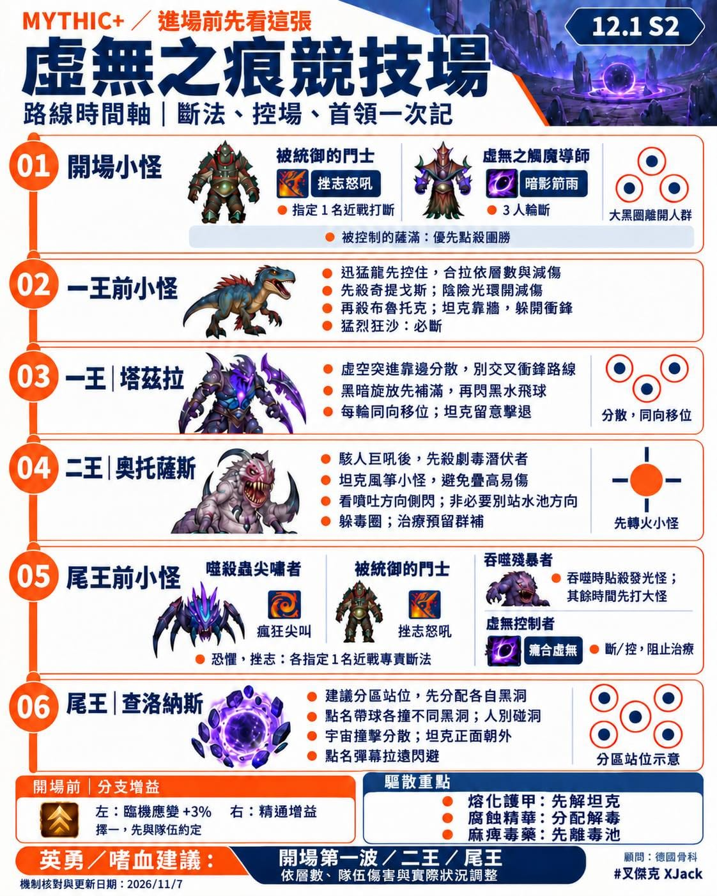
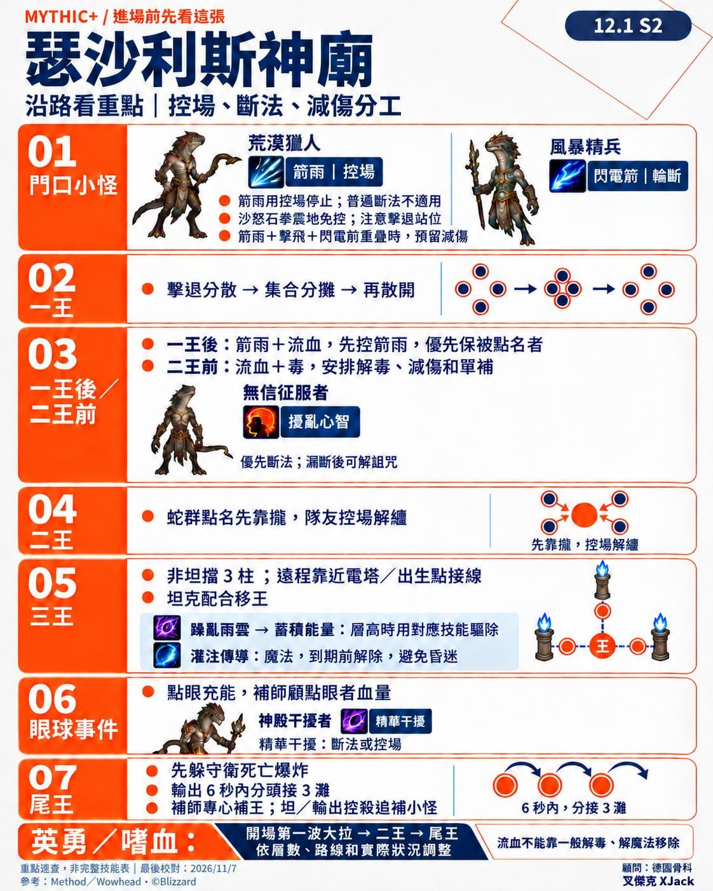
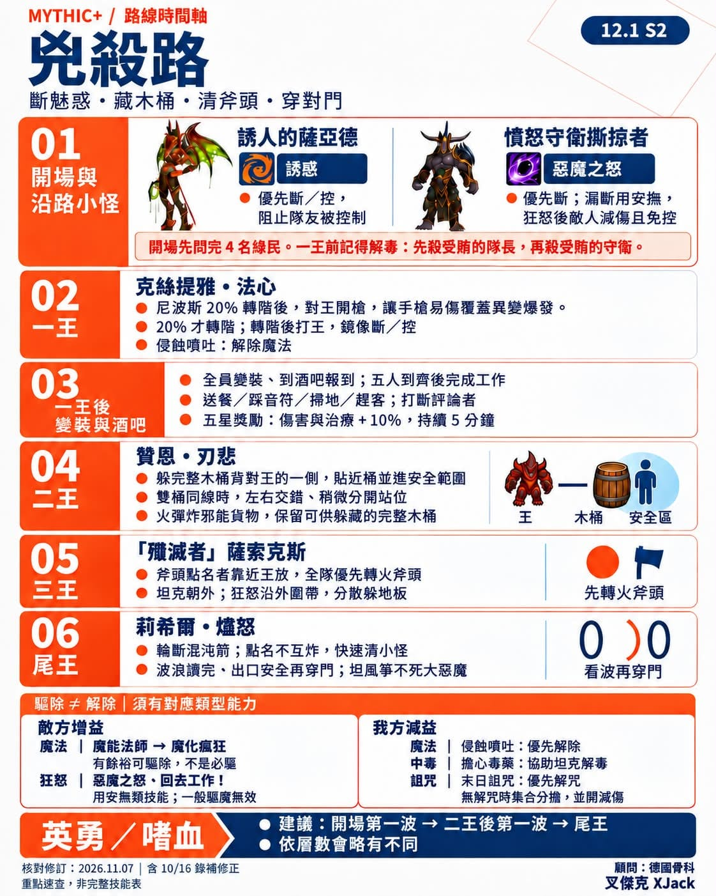
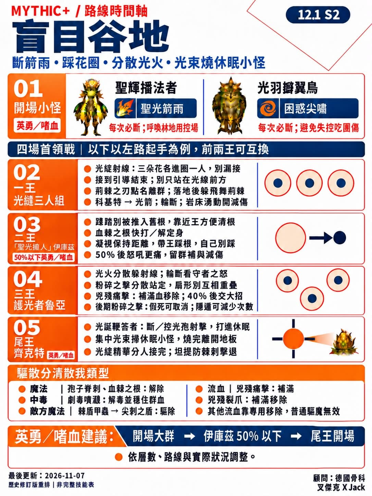

我們很想把 魔獸世界 M+ 打上 3600 分，結果我這個大齡玩家，手速跟反應都不行了，只能來做功課。

年紀有了，每個副本的重點真的很容易忘。哪隻怪要斷法、王的技能怎麼處理、嗜血什麼時候開，還要一邊顧自己的輸出循環，腦袋常常忙不過來。

副本明明都打過，重點卻不一定有跟著存進腦袋~ xDDD

所以乾脆把這些資訊整理成圖卡。要打哪個副本，就先看那張，進場前複習一下，至少不用打到一半才想「欸，這招要幹嘛？」

今天先分享四個傳奇副本的重點：

1\. 瑟沙利斯神廟\
2\. 兇殺路\
3\. 盲目谷地\
4\. 虛無之痕競技場

也謝謝骨科提供建議，幫忙把重要的地方補進去！

圖裡主要整理了斷法、王的機制、建議打法和英勇時機，方便沿著副本順序看。原本是做給自己開打前複習用的，也分享給跟我一樣常常需要提醒一下的玩家～

如果有寫錯、漏掉，或有更好的處理方式，都歡迎糾正、補充！

順便記錄一下，昨天我終於打上 3600 分了！老婆還差最後 45 分，就快一起達標了 😆
