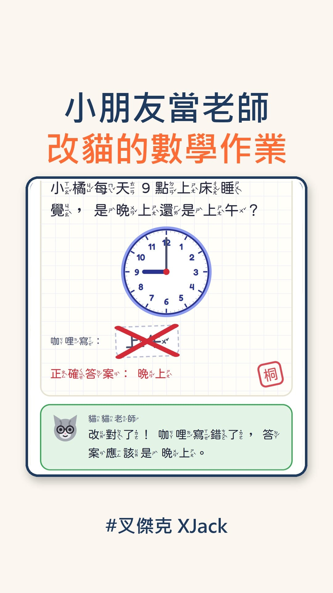

貓貓島蓋好以後，桐桐又說要一座學習島。

我們就蓋了一座學習數學島。

點黑板，貓貓老師上課。\
點講台，換小朋友當老師改作業。

每天有 20 隻貓來交作業，一隻一張，\
題目照一年級上學期的 9 個單元出。

貓咪是會寫錯，要認真改貓咪的作業喔！

改錯了也沒關係，\
貓貓老師會先給提示，再錯就一起看一次。\
每個字都有注音，題目也能按一下唸出來。

20 張改完，明天換別的貓來上課。

網址是 [tong.xjack.tw](https://tong.xjack.tw/)，不用下載、不用登入。\
這群貓的作業，就交給你家的小老師了。😆
