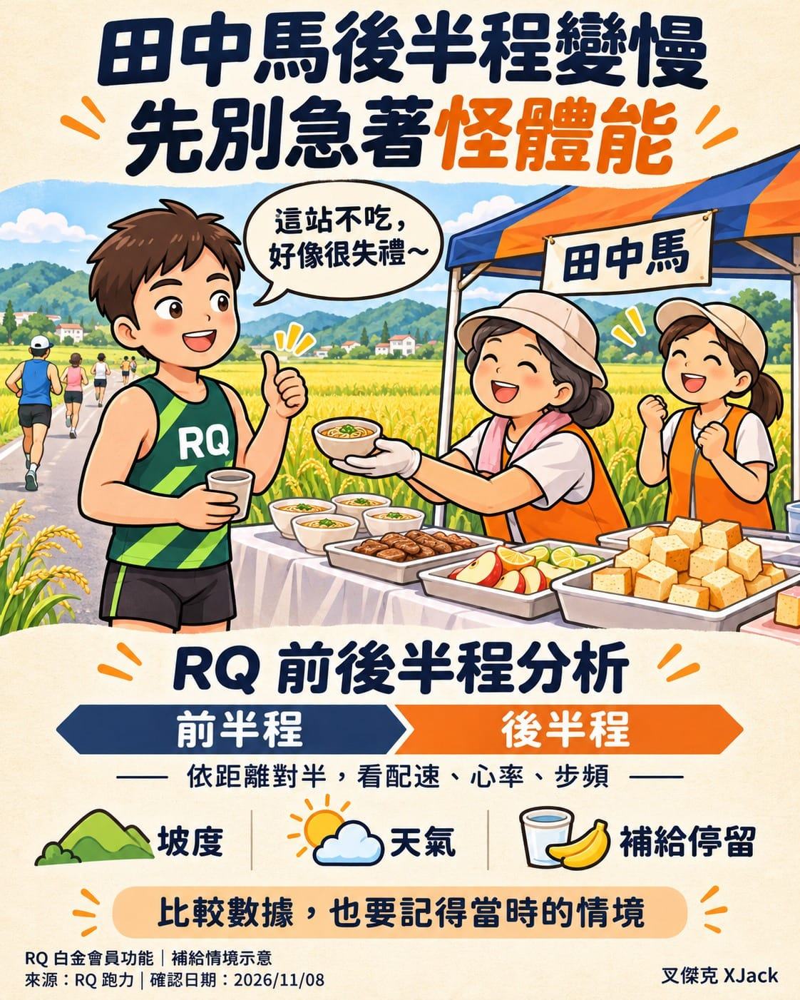

今天跑田中馬的朋友，完賽之後除了分享成績，也歡迎交一下美食報告：

到底跑了幾公里、吃了幾站？

田中馬的補給和鄉親熱情，很容易讓「我要穩定配速」，變成「這站不吃好像很失禮」啊～

吃飽、休息好之後，也可以打開 RQ 的「前後半程數據分析」，回頭看看這場跑得怎麼樣。

它會依距離把紀錄切成兩半，比較前後段的配速、心率和步頻，幫你多看一點總成績以外的細節。

不過，後半程比較慢，先別急著判定自己耐力不夠。

是不是爬坡比較多、天氣變熱，還是多停了幾站補給？都要一起看。

RQ 會幫你整理數據，但不會知道你剛剛是在喘，還是在等好吃的～（誤

功能在這裡：\
・App：單筆紀錄 → 分段資訊下方「查看前後半程分析」\
・網頁版：單筆紀錄 → 分析圖表「前後半程分析」

這是白金會員功能，詳細介紹可參考文章：\
https://www.runningquotient.com/article/single/299

今天拚成績的，可以看看配速安排；今天來享受田中的，也不用為了數字漂亮而懊惱。

美食照值得分享，跑步的過程也要回頭看看喔！
