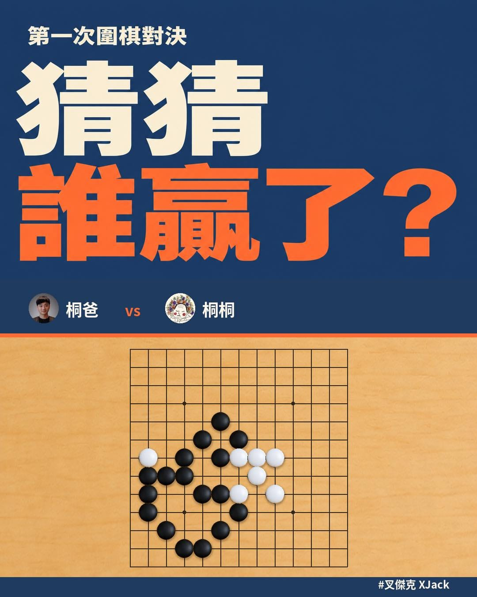

一邊是國小拿市長獎畢業，參加過棋藝社、象棋社的爸爸。

另一邊是剛學圍棋沒幾堂課的六歲女兒。

第一次交手，大家覺得誰會贏呢？

說到那天，桐桐突然說要跟我下圍棋，我當然欣然接受。

雖然象棋跟圍棋是兩回事，但以前那些經歷，已經足夠讓我對自己產生一些不必要的信心。

我們玩的是「吃五子」。

我一邊看她下，一邊覺得，這個走法也太嫩了吧。

爸爸胸有成竹，覺得這場應該沒什麼問題。

結果，我漏看了一個地方。

然後就被她吃掉一大串。

第一場，大慘敗。

而且被吃掉的還遠遠不只五子，是超級、超級多。

原本以為自己在看女兒還有哪些地方不會，結果先被找出漏洞的是爸爸我啊！xD

圖裡的棋局，就是依照我們第一次對弈留下的照片重製的。

說起來，她會接觸到圍棋，是因為最好的朋友在學，她才知道有圍棋這件事。

當她說要學圍棋時，老實說，我第一個念頭是：

現在 AI 都已經能輕鬆贏過頂尖棋士了，學這個能做什麼？

後來想想，她只是想跟好朋友一起學下棋吧？

於是我去查了一下，除了棋下得好不好，學圍棋還能讓孩子練習哪些事情。

① 看清楚，再下手

輪到自己時，看看棋盤，注意對方剛剛做了什麼，再決定要下哪裡。

這點爸爸本人顯然還需要練習。

② 想下一步，練習做選擇

下在這裡，對方可能怎麼回？想吃掉對方的棋，自己的棋會不會也有危險？

每一步，都有機會練習觀察、預想和取捨。

③ 練習面對輸贏

贏了很開心，輸了也可以回頭看看，剛剛漏了哪裡。

這個練習，孩子需要，陪玩的爸爸也需要。

當然，不用急著說學了圍棋，成績或專注力就一定會變好。先陪她玩，看看她怎麼思考、怎麼面對輸贏，就有很多有趣的事情可以觀察了。

我從來沒想過，女兒的第一個才藝班會是學圍棋。

更沒想到，她才學幾個星期，爸爸就先被上了一課。（倒

好啊，我的自尊不容許這件事再發生，看到 黑嘉嘉 Joanne Missingham 圍棋有線上課程，我要來偷偷練了。
