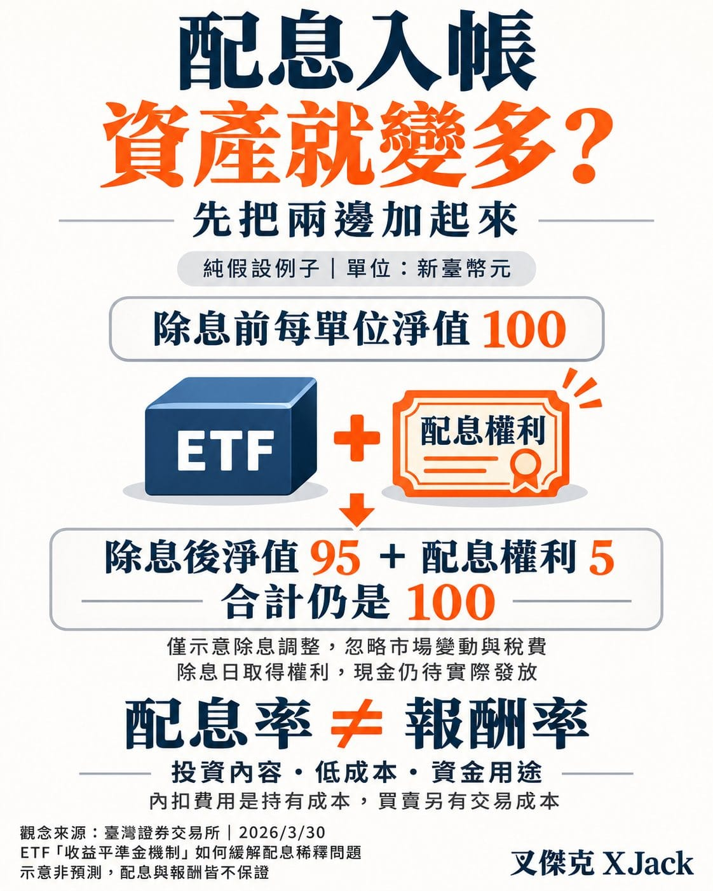

看到配息入帳通知，很容易有一種錯覺：

「這個月又多了一筆收入，可以加菜了～」

蛋幾勒～

加菜之前，我們把 ETF 那邊也打開來看。

不然只看銀行帳戶、不看投資帳戶，就像量體重只把一隻腳放上去，數字很療癒，參考價值另當別論。

最近又有一批 ETF 公布配息資訊。

每單位配多少、配息率多高，當然可以看。但對大盤市值仔來說，還有一道不能跳過的加法：

投資現在值多少，加上已領到的配息，合起來是多少？

原本放在投資裡的一部分資產，配出來變成你手上的現金。錢換了位置，配息這個動作本身，並沒有讓總資產憑空增加。

左手交給右手，右手很開心。

但兩隻手，都是我的啊！xDDD

用一個純假設的例子說明：

某檔 ETF 除息前，每單位淨值 100 元，分配 5 元。

先忽略市場漲跌與稅費，只看除息調整：

淨值變成 95 元，加上 5 元配息權利，合計還是 100 元。

不是原本的 100 元原封不動，又憑空多出 5 元。

而且，除息日取得配息權利，不代表那天現金就已經進帳，還要等實際發放。

這也是為什麼，不能看到「配息率 5%」，就直接翻譯成「我賺了 5%」。

這裡講的是配息這個動作，不是說企業獲利沒有價值。

企業賺錢、資產增值，和把一部分資產分配成現金，是不同的事情。投資到底賺多少，要把價格變化與收到的配息一起算。

再換個持有期間的例子。

假設以 100 元買進，期間領到 5 元配息，最後市價剩 90 元。

沒有其他買賣，也先不計稅費，合起來是 95 元，這段期間的總報酬其實是 −5%。

配息通知很開心，總資產可能還在旁邊默默嘆氣 xDDD

所以，挑 ETF 時，我會把這幾件事放在一起看：

① 裡面到底買了什麼？

投資範圍、集中程度、選股規則，決定了自己承擔什麼風險。不能只看名稱裡有 ETF 三個字，就當作全部都一樣。

② 持有這支 ETF，要付多少內扣費用？

過去績效不代表未來。我們大盤仔要推廣的，是低成本，不是追著去年的冠軍跑。

經理費、保管費，以及基金運作產生的其他費用，會從基金資產中扣除，反映在淨值裡。

你沒有另外收到一張帳單，不代表沒有付錢。

總費用、手續費、交易稅等等，都是要考慮的交易成本。

在投資範圍與追蹤目標相近的前提下，能少付的成本，就值得認真比較。

未來市場會漲多少，我不知道。

但費用少扣一點，就能少一點成本拖累。

畢竟我想長期持有的是資產，不是長期供養費用啊～（誤

③ 領出來的錢，接下來要做什麼？

需要生活費，就把它納入現金流規劃；還在累積資產，就先想好再投入的安排。

以我來說，現在還有固定收入，當然盡量都投資不配息的市值 ETF，有配息的也全部設定股息再投入。

只是基金會不會配、能配多少，都不是保證；把配息再投入，也不代表就不會虧損。

長期投資要顧的，還是投資內容、分散、成本，以及自己做得到的紀律。

領息通知可以開心看。

但要確認自己有沒有更接近財務目標，記得把整份資產一起看。

畢竟我們想增加的，是未來生活的選擇，不只是手機通知的數量！
