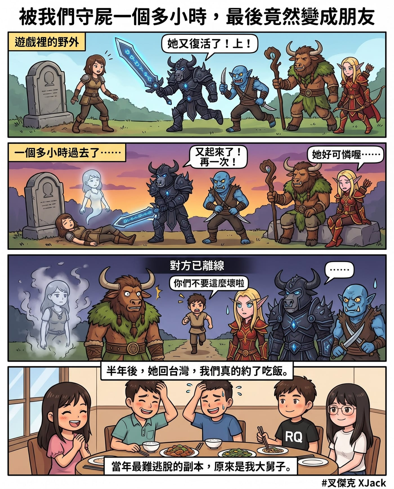

最近 魔獸世界 永恆開服，喚醒一堆老玩家的記憶，讓我想到一個故事。

以前玩魔獸的時候，我跟桐媽、她哥哥，還有她哥哥的朋友們，一起在 PVP 伺服器玩。

所謂 PVP 伺服器，就是不同陣營在路上遇到，可以直接開打的那種。

不得不說，我大舅子跟他的朋友們真的很白目，總是想一些有的沒的 xDDD

有一天，他們不知道為什麼盯上一個玩家，然後就開始守人家屍體。

對方一復活，他們就立刻衝上去把人家打倒。

對方也沒有放棄，一直想盡辦法復活、逃走，但每次都被各種花式殺害，讓他根本沒辦法玩下去……

就這樣，一方努力逃跑，一方負責把人家送回靈魂狀態，持續了一個多小時。

最後，對方終於下線了。

正當大家覺得差不多要散會的時候，收到了一位玩家的密語：「你們不要這麼壞啦！」

後來聊了一下，才發現對方是一位住在德國的台灣女生。

大概半年後，她回台灣，我們還真的約了一起吃飯、出去玩。

現在回頭想想，她還真的很放得下欸！真神奇~

換成是我，被一群人守屍守了一個多小時，復活畫面看到都滿肚子氣了，大概很難立刻開啟交朋友模式吧 xDDD

PS：十幾年過去，我怎麼覺得我大舅子跟他朋友們還是一樣屁孩啊（遠目
