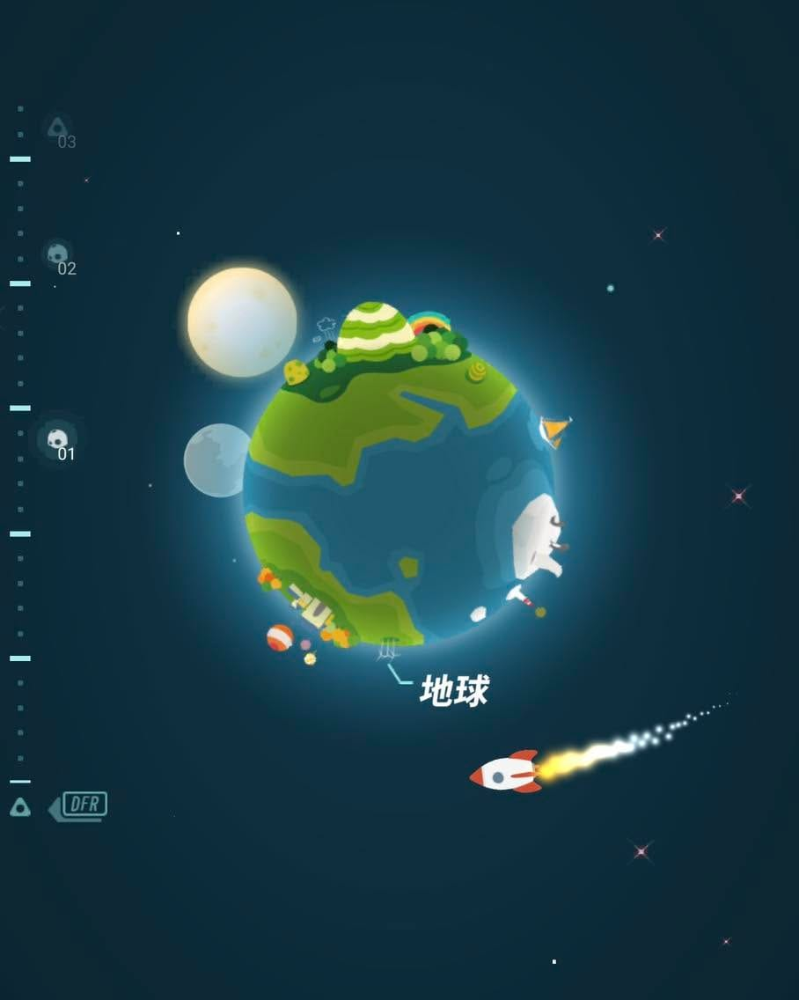

我也砍掉皮克敏 APP 啦！

這款遊戲玩了大約十個月，這次事件我的每週隊友們都退坑了，老實說也玩得差不多了，乾脆趁這次風波一起刪除遊戲資料了。

只是刪掉之後突然覺得：

每天走路少了這些小傢伙，好像也少了一點樂趣。

然後我就想起了我們當年玩過的《Walkr》🚀

它也是一款結合走路的遊戲，不過這次不是帶皮克敏出門，而是把步數變成太空船的能源，探索各種可愛的星球、照顧星球上的生物，還能和朋友組隊完成任務。

以前跑步是為了種花，現在改成替太空船加油～

地球逛完了，接下來換去宇宙走走吧！Go～
