「年底報名了台北馬半馬，可以麻煩你們訓練嗎？」

自從開始在我的臉書分享創業做跑步訓練APP後，其實常會收到這類訊息，但是定神一看，居然是恩師 [Mr. Jamie](https://www.facebook.com/mrjamielin) 傳來的，心裡是又驚又喜，當初是他的團隊幫助我們加速孵化出 [RunningQuotient](http://bit.ly/2sR9QNi) 這個夢想，現在，終於可以換我們RQ團隊幫助他達成目標了。

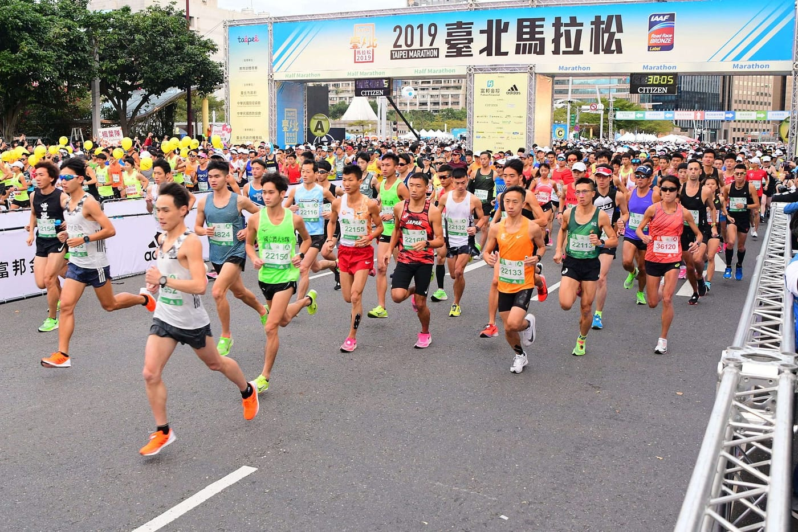

碰面聊過一次後，二話不說便立刻接下此任務，由國峰教練負責這為期十二週的訓練規劃，我負責打雜，還有偶爾陪跑課表。

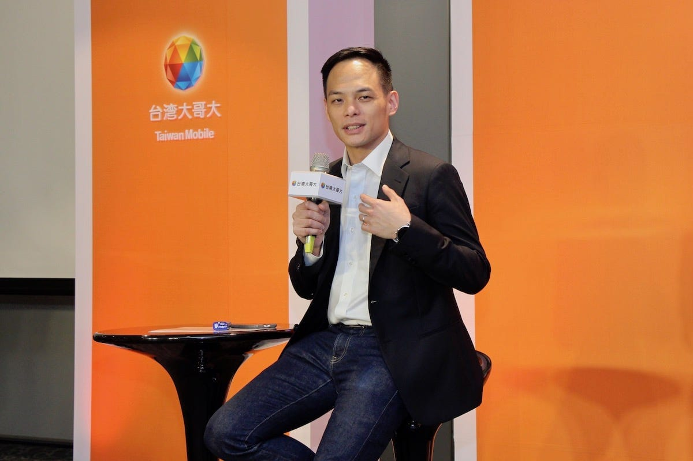

*台灣大哥大總經理林之晨 Mr. Jamie（圖取自網路新聞）*

身為台灣大哥大總經理 aka AppWorks創辦人 aka KOL網紅，工時相當相當長，還常有出差需求，有妻有子，光是想像就覺得根本分身乏術。真正能訓練的時間，僅有每日清晨一小時，加上有氣喘病史以及舊傷，訓練架構規劃上真的需要非常注意，不過，這就不在我負責的範圍內，略過。

[大安森林公園與Mr. Jamie一起跑課表](https://www.youtube.com/watch?v=vIjZ96ckRQ4)

*最常練課表的地方-大安森林公園*

這三個月來的訓練，我們曾一起在大安森林公園跑過好多課表，不斷刷新了三公里PB、五公里PB、十公里PB，Jamie的跑力也直直提升，甚至在訓練尾端的調整期還一度追過已經跑三年多的我咧（怒。

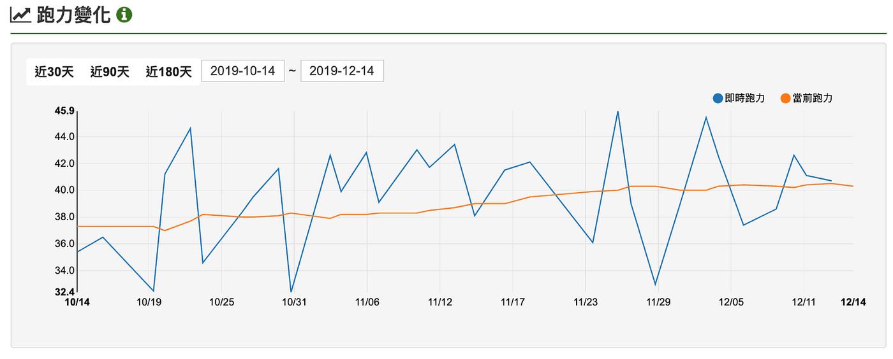

*Mr. Jamie 進入訓練期的[RQ跑力](http://bit.ly/2uiLj47)變化*

最終目標賽事咻一聲就到了，2019臺北馬拉松-半馬組，我們終於要來驗收了！

前兩年台北馬都是我的半馬目標賽，而這次，我的任務就是要緊跟在Jamie後方，觀察他在這場目標賽事上會如何應對每一個水站、每一段坡度、每一個轉彎，過程中「完全不」協助配速，或是給予任何於賽事中的建議，我相信，想真正探尋自己的極限在哪，每段過程每個速度都是全權由自己決定更是挑戰的一環，不要預設成績，沒有領航配速員，用當下的知識去找到自己究竟能跑出多少成績。

啊，在這邊偷偷分享一部國峰特別在比賽前錄給Jamie的一段話，聽得我都想趕快找一場比賽來好好跑呢。

[給Mr Jamie](https://www.youtube.com/watch?v=Dlyw9oICDvQ)

比賽日當天，跟著Jamie當然是直接進到富邦VIP室，隔壁間就是大會邀請的菁英選手們，暖身時，一直想偷偷注意菁英選手們到底比賽前會做什麼事，上廁所時與他們擦身而過，還忍不住流露出敬佩的眼神吶。

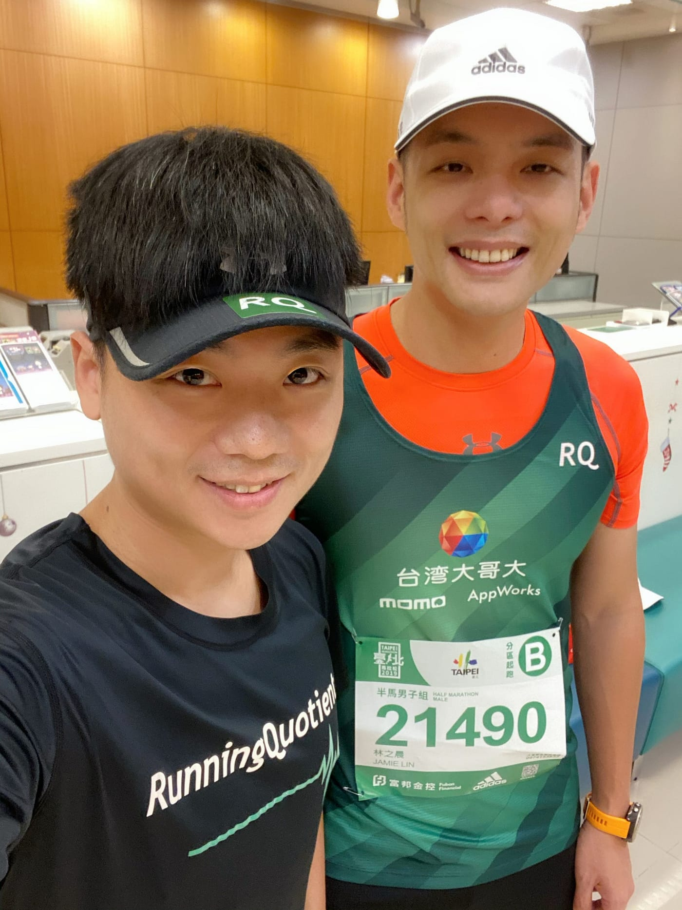

起跑前半小時，我們提早進半馬B區準備區，僅穿著跑衣短褲卻絲毫不會感到冷的12月天（後來得知起跑時就已經19.8度），我就已經隱約感受到今天會是場硬戰，特別是對於初半馬挑戰者。在等候時，我最後叮嚀一句千萬注意萬惡的貓眼石後，便開始靜心養息，準備享受這場我的新挑戰，一個很純粹的陪跑員。

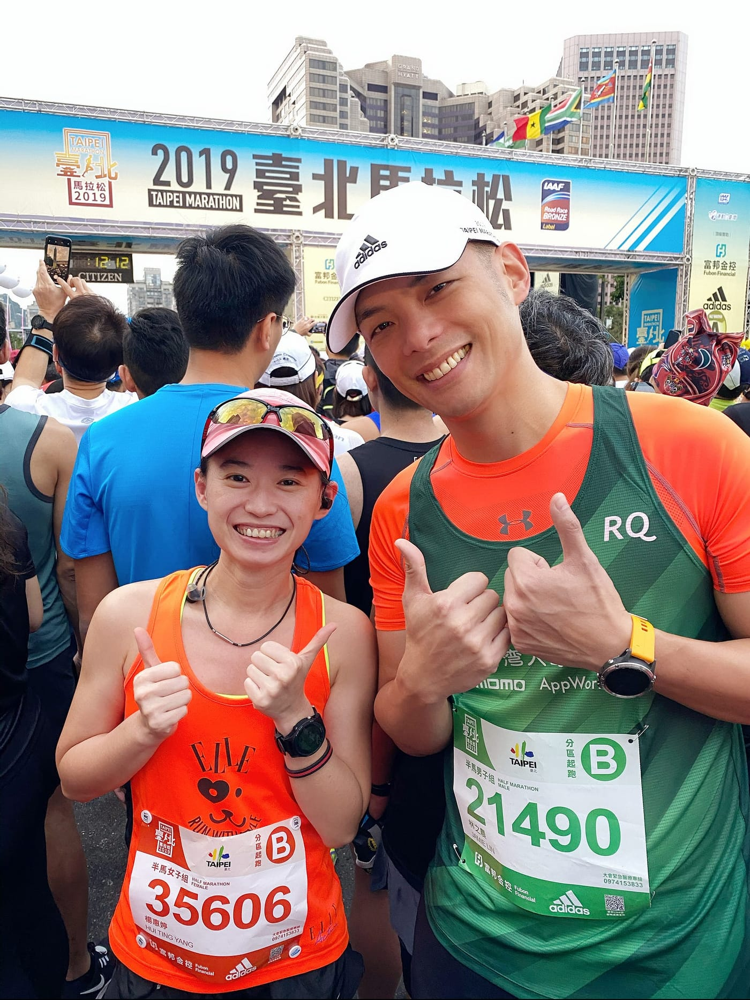

*在起跑前遇到美美的粉絲要求合照*

鳴槍起跑後20秒抵達起跑線，準備台北半馬第一個挑戰「人群繞圈圈大賽」，才想著穩穩跟著人流先暖開身體，卻發現Jamie已經開始在人群中鑽來鑽去，試圖直接進到平常訓練的體感半馬配速，由於人太多，我們之間的距離也慢慢被拉開。

我盡量保持著視角能夠看到他背影的距離，也開始嘗試於人群中尋找突破口，一來一往根本是在練間歇跑，心率馬上拉到三區，心裡默默想著這次任務失敗肯定無顏面對團隊夥伴啊。

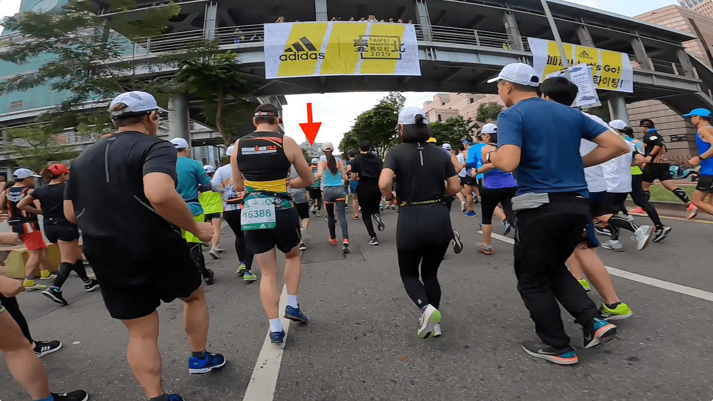

*努力保持視野還可以看到Jamie的距離*

好佳在進入台北半馬第二個挑戰「仁愛路貓眼石群」，還在視線範圍內，穩穩跟上並維持在他身後，心裡只心心念念千萬不要中陷阱，有聽進去我叮嚀的Jamie也都確確實實地跑在道路正中央。

ＢＵＴ！誰會想到在公車專用道上，會有一個超凸的柏油路裂縫，我就這樣眼睜睜目睹他一腳踩下去，該不會要翻船吧！為了跟拍，其實我跟他之間距離不算遠，速度配在5:20左右，當時腦海中已經閃過好幾種可能，要用跳的閃、立刻停下、還是切出去外道，兩旁跑者不少，會不會變成連環撞呢。

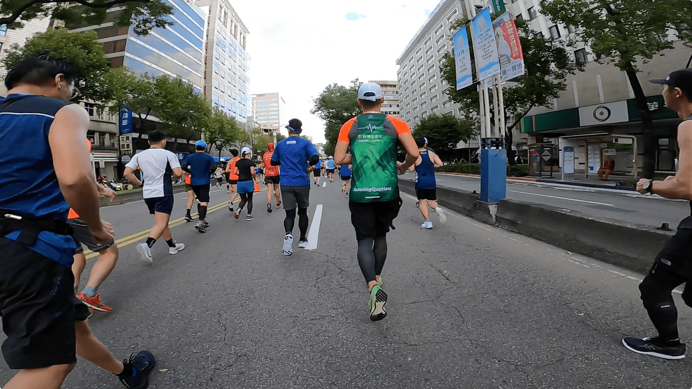

*似乎無異狀繼續跑的Jamie背影*

大概是練過籃球的身體已經知道如何反應，Jamie的下一步居然撐回來了，好似沒有任何異狀的又恢復原本速度，我也放下心中大石，但是，事後才知道這一拐已經是隱隱作怪，也極有可能是導致後續狀況的重要原因之一啊。

再來就是任何賽事都有的挑戰「進水站」，對於完全沒有路跑經驗的Jamie來說，表現得就非常可圈可點，稍微放慢速度略過前幾站，鎖定好拿了就走，很難想像他是完全沒水站經驗的跑者。至於我，還是撞了幾次…可能運氣也很重要吧。

台北半馬第三個挑戰「中山橋漫長緩坡」，原本以為我們前面配的速度已經不算慢了，一眼看過去上坡還是滿滿人頭，台北馬大拜拜果然不是浪得虛名啊。

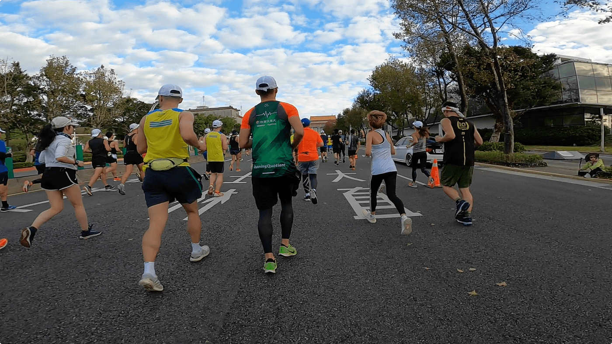

接下來就進到河堤旁的道路，挑戰即將過半，不過，這時候也陸續看到有跑者停下來伸展，我們的配速也稍微慢了些，開始有點擔心Jamie的身體狀況。

就在一位跑友來搭訕Jamie，合照聊天過後沒多久，約略14公里處，Jamie他！停！下！來！了！完全出乎我的意料之外，看到他開始調息心率，我便立刻把手機從腰包拿出來準備。其實，這樣的狀況在之前一起跑課表也看過幾次，相信他可以克服的。

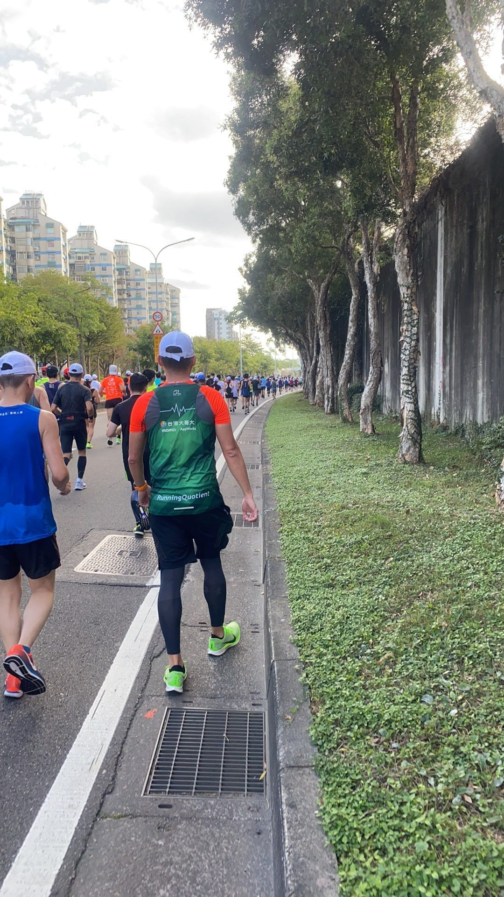

緩走2分鐘後，Jamie又再次跑了起來，但其實很明顯感受到他尚未完全調整過來，果不其然，恢復跑不到3分鐘又停了下來，這次，他應該是打算要完全調整過來後再開始跑。

而這樣的突發狀況，考驗著他的判斷能力，我完全只是擔任旁觀者，整場賽事中完全沒有跟他說過任何一句話。

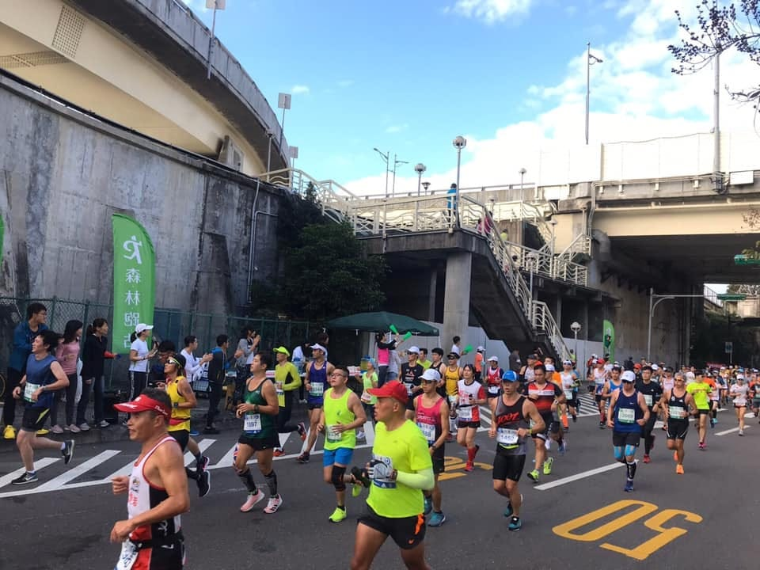

*台北馬的森林跑站補給站令人印象深刻（圖取自[森林跑站](https://www.facebook.com/runbasetw/)）*

接著，Jamie持續採取跑走策略，直到進到下一個補給站，這次，看他一次抓兩杯水喝完後，又抓了一杯，補充了能量包，再度繼續採用跑走策略，直到台北半馬第四個挑戰「麥帥二橋小陡坡」，上橋過後，開始用七分速左右慢跑，似乎打算維持這速度回到終點。

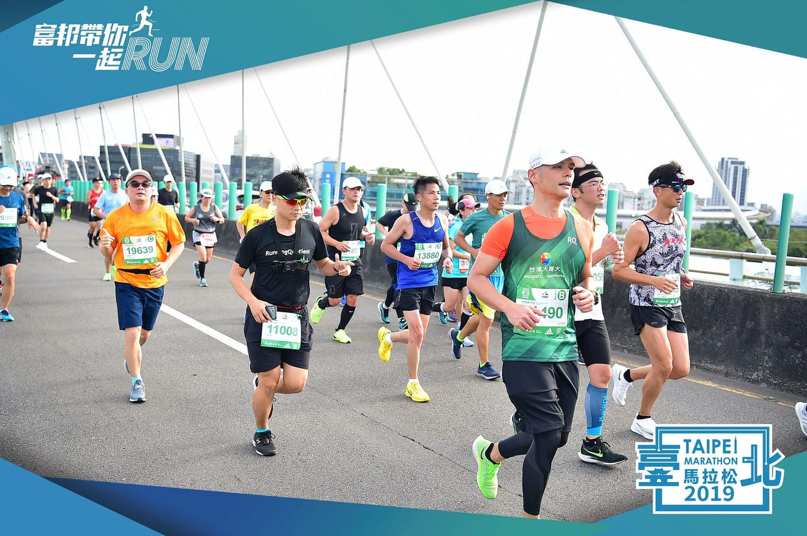

*拿著手機穿著GoPro帥氣的我*

台北半馬最終大魔王「基隆路地下隧道」悄悄到來，一個長下坡榨乾肌力，配上不見天日的大隧道，最後又送你一個大陡坡，頂著熱情陽光的我們（啊不是十二月？怎感覺有30度），看來只能當長距離課表慢慢晃回去吧。

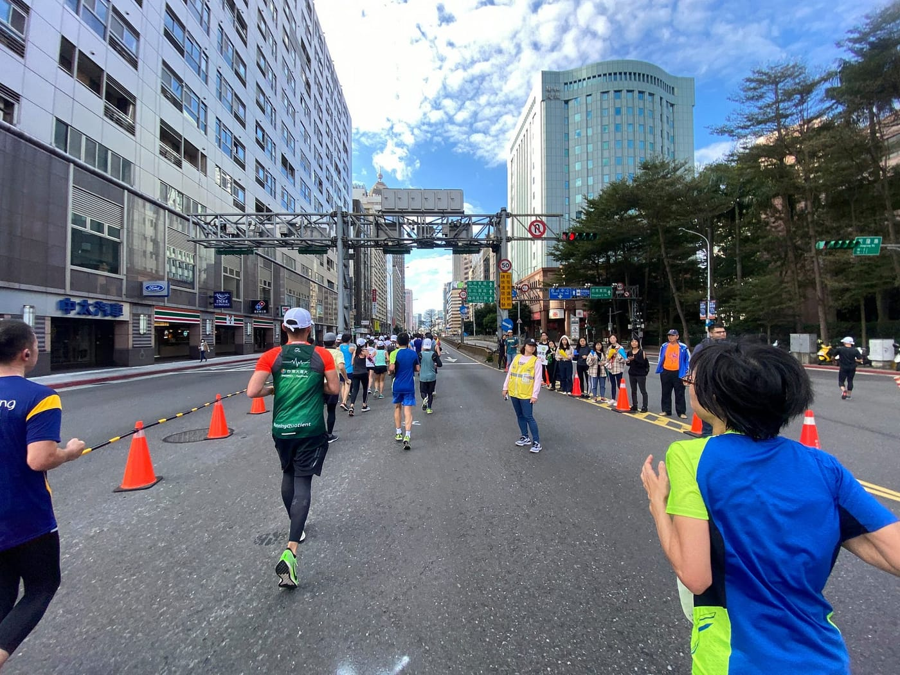

*基隆路地下道前，右邊第二棟就是AppWorks本部喔*

我果然不適合當編劇，一進到地下道後，Mr. Jamie 他，他回來了！不知道哪來的神力，他開始恢復起跑時的5:20配速，一路在隧道內鑽來鑽去刷卡。還以為我能慢慢晃回去，在終點前找RQ加油團夥伴們來個賽道內外大合照之類的，完全不給我這機會啊。

為了跟上Jamie，我心率一度飆到200，就這樣他一路開回終點，以2:12:33完成他的人生初半馬。氣喘舊傷、剛開場就翻船、老天不作美、以及配速策略明顯失算的情況下，初半馬直接屌打我苦練四個月的初半馬一個多小時啊！！！這世界真的公平嗎？Q\_Q

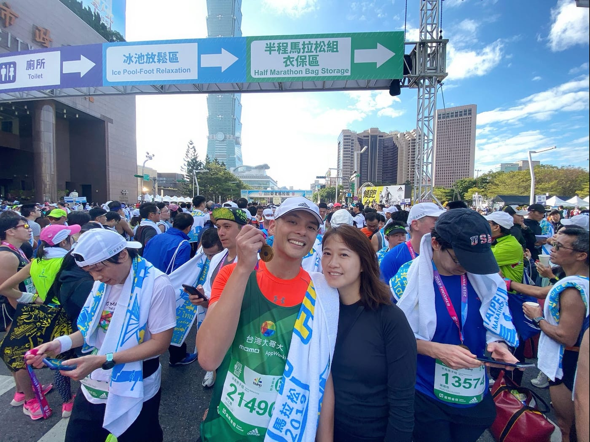

*一進終點立刻出現的「真」CEO大大*

僅以此篇紀錄文獻給幫我們良多的Mr. Jamie，也預祝在2020臺北馬拉松的賽道上，你將再次突破極限，看見更強大的自己。

最後，送給所有想挑戰台北半馬的跑者，面對關卡時的建議應對策略：

**第一關「人群繞圈圈大賽」**

與其起跑才開始鑽人群試圖突破，寧可早點進自己配速的起跑區等待，若真的排在後面，就跟著人流順順繞圈圈吧，左右平移、鑽人群又忽快忽慢的跑法可是會相當耗費大量體力的。

**第二關「仁愛路貓眼石群」**

其實不止仁愛路有貓眼石，前兩次參加台北半馬都親眼看到有人摔倒，請隨時注意避開道路線，高架橋上也會有貓眼石，用眼角餘光注意路面狀況，專注於自己跑步動作。

**第三關「中山橋漫長緩坡」**

跑到這邊還不到一半里程，理論上體力應還算充足，此緩坡難度也不高，只需要放慢些速度，將步頻拉高步幅縮小些，儲備力量等等下坡可以放一點速度出去。

**第四關「麥帥二橋小陡坡」**

面對此坡道處理方式與上一關雷同，但是體力肌力應該都已經剩餘不多，挑戰時要格外小心，同時，也可以認知到這場比賽即將進入尾聲，開始衡量剩餘體能，平均分配在最後不到的五公里。

**第五關「基隆路地下隧道」**

令人聞風喪膽的最大魔王，一開始的長陡下坡，請想像自己是在高步頻原地跑，讓地心引力直接帶你往下跑，若速度承受不住就控制身體重心，以可掌握的速度為最高原則。進到隧道內，建議可以將墨鏡取下，體力留在出隧道後再開。出隧道的陡上坡，如果肌力體力都已經無法輕鬆用上述方式處理，建議可以直接步行，寧可利用這幾十秒的時間恢復，思考進終點的姿勢。

好，下一場目標賽事就決定是2020臺北馬拉松-半馬組了。

[「再忙，也要挑戰自己」台灣大哥大總經理 2019臺北馬拉松-初半馬挑戰](https://www.youtube.com/watch?v=nfdwI1U8qm0)
