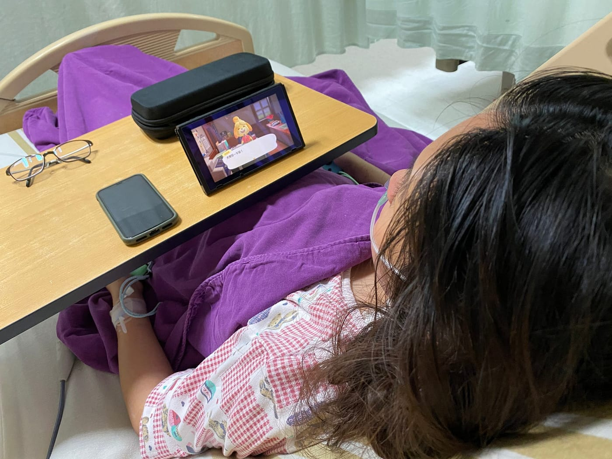
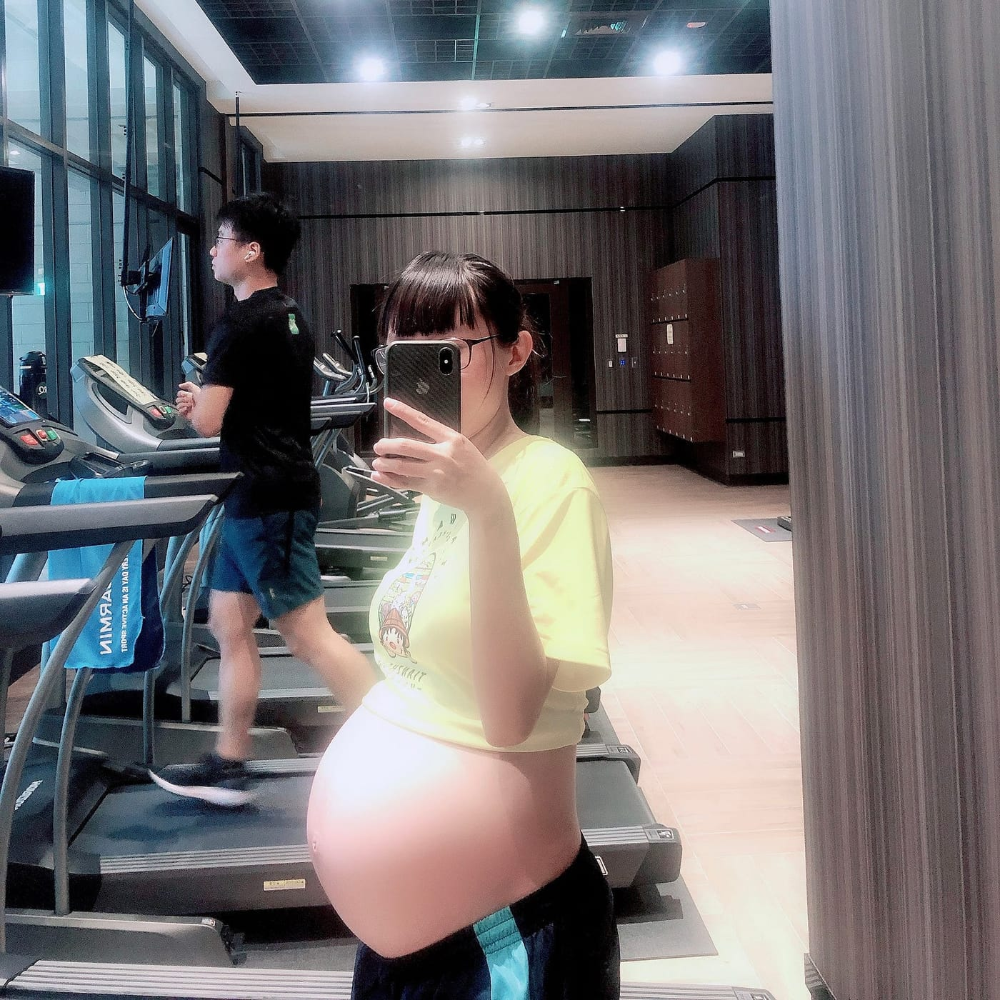

我以為我已經準備好了，但這陣子每次動筆寫生產當天紀錄文章時，總會讓我再次回到當下的情緒，眼淚決堤而久久不能自己。只好單純分享這事件我的結論，當天故事就留在心中了。

（這裡原本有一張桐桐露臉的照片，為了保護她的隱私，搬家時先拿掉了。）

**【產後狀況更要注意】**

縱使生產過程順利，當下沒有任何狀況，也要密切注意產後併發症，可能生產後一天甚至數天出院後才有狀況，特別是高居產後死亡率第一名的「產後大出血」，當然是越早發現狀況越好。

身為伴侶應盡最大可能陪伴，萬一命運不站在身邊，也比較不會後悔。

*轉普通病房努力玩動物森友會中*

**【跑步（有氧）運動很重要】**

動手術前，主刀醫師跟我說她已缺氧很久，身體內近乎沒血，即使命救回來也要有「不是她」的準備。結果手術完沒幾小時就醒來，還能使用眼球轉動跟我溝通，到現在也能開始慢跑，恢復狀況相當良好。

那時，在加護病房就成為一堆醫師護理師來探討的個案，大致上認為能撐過這關，除了夠年輕外，主要是她有長跑（用氧能力）訓練，孕期也有刻意加入運動的關係。

*孕婦安全地運動也很重要*

**【重新審視每件事的優先權】**

基本上我的工作與生活是結合在一起，沒有真正的下班時間，奉行接近九九六制度。在手術室外這漫長的六小時，出現在腦海中的盡是還沒有拍孕婦寫真、還沒有捧著大肚子參加路跑、還沒有回花蓮看海、還沒有蜜月旅行、各種答應過妳的每件事情，我總是說我們未來還有很多時間可以去完成。

進加護病房簽下那張病危通知，似乎在嘲笑我時間並沒有你想像中的那麼多，在不違反自然界法則下，我們註定無法再有下個孩子了，但其他的每一件事情，我們已經開始很努力規劃一個一個去達成。

（這裡原本有一張桐桐露臉的照片，為了保護她的隱私，搬家時先拿掉了。）

一切都是最好的安排，我還是那位非常幸運的我。老天爺給我們的各種巧合，讓我們關關難過關關過，這次我看到自己比想像中的更加強大。

未來我將會優先把時間給最重要的家人，每天都當成只剩下最後一天努力地生活著，也會將推廣跑步運動列為志業，讓每個想跑步的人都能獲得樂趣，進而擁有更健康的身心靈。

（這裡原本有一張桐桐露臉的照片，為了保護她的隱私，搬家時先拿掉了。）

特別感謝黃彥華醫師與夫人，陪著我了解所有狀況並給予我最強的後盾。\
感謝林口長庚的詹耀龍醫師，讓我們可以坐在這取笑彼此文筆有多不好。\
感謝我們最愛的家人們，投入金錢與時間陪著我們一起面對這一切。
