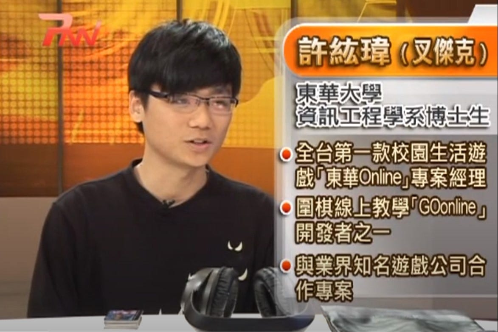

在親身親歷過生命的脆弱後，我重新審思還有哪些承諾過的事還沒完成，除了答應陪伴家人的遊山玩水外，第一個浮現出來的居然是「取得博士學位」。

剛考上東華資工博士班後第一次回雲林老家圍爐過新年，記得阿罵那時緊緊抓住我的手，很興奮地跟我說「咱扣嘎阿謀波速，哩係桃幾勒！（我們許家還沒有出過博士，你是第一位！）」我只能笑笑地回應說「阿姆系波速啦！挖壓溝系哈辛。（還不是博士啦，我只是學生）」就這樣每次過年都要上演相同的戲碼。

*與阿罵過年合照*

念到第四年取得博士候選人資格後，卻在因緣際會下創業，當已經投入了全部的積蓄，肯定是要百分百投入所有時間，不計成本為了公司打拼。想當然，完全無法同時兼顧學業，只好先暫時停下原本的學術研究論文。

那年回老家，阿罵卻出現跟往年不同的問法，變成是要我答應她，一定要把博士學位拿到，成為許家第一位博士。我心裡雖然是想著等我事業有成後，再回來念博士也不遲啊，但嘴巴上還是承諾阿罵我一定會拿到博士。

沒幾個月後，阿罵就離開我們了。

創業的分秒必爭很快就把這事情淡忘了，但卻在手術室外等候時冒出來。對啊！這是一直深埋在我內心深處很想完成的任務，卻因為繁瑣的公司事務，遲遲沒有辦法進行，如果現在不做，以後還有機會能夠完成這個承諾嗎？

逐一將身邊資源好好審視，除了原本資訊工程相關領域的指導教授、資訊學業界同學與程式設計技能，兩位一起創業的夥伴都是熱愛鑽研耐力訓練數據的狂人，還有數十位合作跑步教練的知識，幾位運動科學界權威的顧問與教授，以及擁有千萬筆以亞洲人為主的大數據庫，一些跑步科學分析應用的演算法，自由彈性的雲端工作，不用看老闆臉色，啊，還有可愛的老婆跟女兒。

（這裡原本有一張桐桐露臉的照片，為了保護她的隱私，搬家時先拿掉了。）

這些湊在一起，應該可以完整地跨領域結合資訊工程與運動科學，打造出一篇能夠真正實務應用並且擁有學術價值的論文。而且研究數據都是以生活在台灣的跑者為主，肯定能實實在在對在地跑者們有最直接的幫助呀！

現在，要正式開啟第一步，除了規劃要進行大量的論文與書籍閱讀外，也需要收集在跑步上會遇到的問題，若能夠應用相關論文上的知識轉化成實際問題的解決方案，變成一篇又一篇的文章分享，相信在完成一百篇後，我的論文應該也能夠完成了吧。

在此邀請您，如果在跑步上有遇到問題或是對於跑步運動科學有所疑惑，都歡迎填寫此表單分享給我喔！ → [https://bit.ly/37ieofP](https://bit.ly/37ieofP)

*創業前上節目聊聊「電玩」與自己的論文研究*

預計每週一會挑選一個主題或是一個問題，與您分享我的看法。被選中問題的朋友，我還會贈送一個[小小禮物](https://line.me/S/sticker/13770493)以示感謝。

*RQ 賴貼圖範例 - 耶誕節也要跑步*
