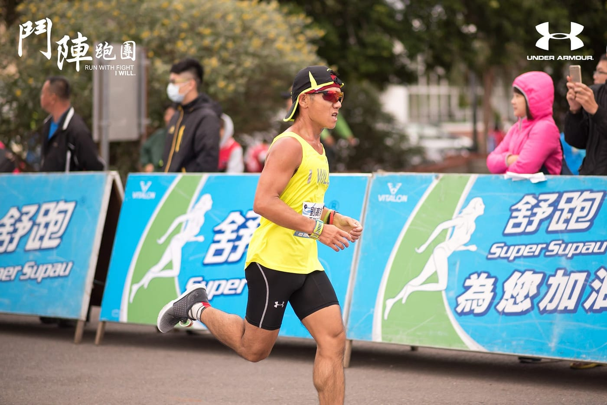
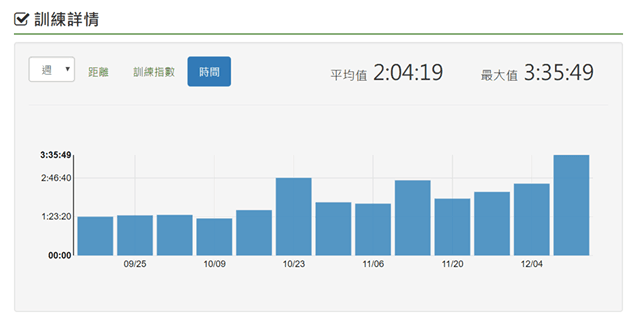
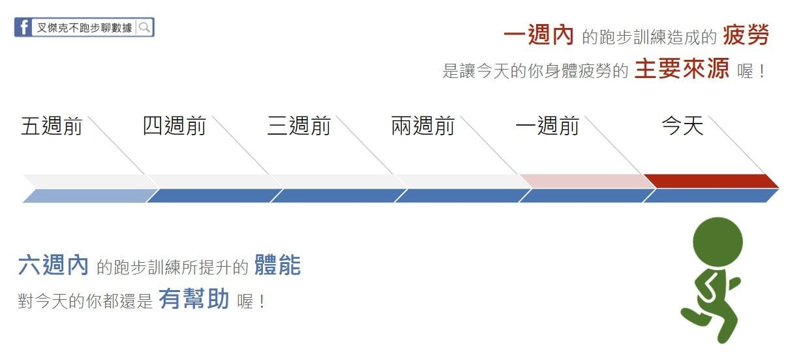
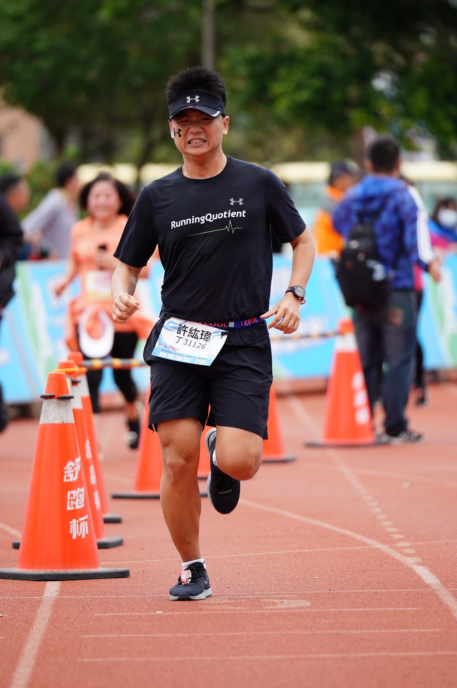

不小心被朋友推坑報名了人生第一場半程馬拉松，照著網路上各種課表與訓練建議東練一點西練一些，也練了好一陣子，但有什麼方法可以判斷我練夠了沒？準備好完成初半馬了嗎？

在討論這個問題之前，我們先來了解一場半程馬拉松的標準距離為 21.0975 公里，如果本來就有規律運動且沒有任何身體狀況的話，要「完成」半馬並不是個困難的挑戰，但是仍有可能因為練習量不足，比賽中動用到太多意志力，不但到了終點前會無法好好享受第一次衝線的快感，還可能導致賽後鐵腿數天、發生運動傷害的窘境，所以在此先縮小問題，聊聊如何「無傷完賽人生初半馬」。

*終點前好好享受衝線的快感*

這裡提供兩個簡易又客觀的衡量方式，讓你有基本的參考依據，增強比賽前的信心。

## 方法1：放棄里程數，專注跑步累積時間

人的身體是非常精密且強大的，它能夠自動逐步適應外來的刺激，進而調整到能完成各種挑戰。半馬的距離根據每個人程度不同，約需連續跑 100–180 分鐘，所以訓練目標就是要讓身體能夠適應連續跑步這麼長的「時間」，透過逐步增加跑步訓練時間，慢慢讓身體強化並適應長跑這個刺激。

根據上述觀點的客觀衡量方式為：\
1\. 一週內跑步總時間有達到 150 分鐘以上，並且在近三個月內有六週以上達成。\
2\. 賽前一週將跑步時間減量一半，好好睡覺，讓身體能夠充分恢復。

達成以上條件，基本上就具備無傷完賽初半馬的體能了。

*規律吃初半馬課表的每週累積跑步時間（[參考文章](https://bit.ly/2JMG5W9)）*

「可是我聽別人說月跑量要ＸＸ公里以上才夠跑完初半馬耶！」我們都知道，里程數是「速度 × 時間」的結果，而同樣的速度對於不同人而言代表著截然不同的意義，舉例來說：五分速（每公里花五分鐘跑完）對目前的我來說，已經是相當快的速度，用這個速度跑個二十分鐘就會氣喘吁吁，需要停下來休息，但對於長跑選手來說，可能連暖身跑的速度都稱不上，甚至連續跑三個小時都不是問題。所以，不同人之間相同的跑步里程數，所承受的壓力完全不能比較，當然也就不能當成通用的參考依據了。

## 方法2：將「體能」練到三以上

跑步練來的體能，能夠像電玩遊戲一樣直接顯示數值嗎？

「量化」是做科學研究很重要的環節。在體能預估的方面，已經有不少論文都提出各種不同的數學模型去模擬計算，各種耐力運動類型也都有相對應的公式可以去分析計算。而大部分研究都是環繞在同一個觀念：

一次跑步訓練會對身體帶來體能提升，同時也會對身體帶來疲勞。

*體能疲勞累積圖*

體能提升與疲勞累積都會被一個重要關鍵所改變，這個關鍵就是「時間」。隨著時間流逝，過往跑步訓練所帶來的效果會逐步減少，跟電玩遊戲不同的是，體能提升就像是逆水行舟，不進則退。特別的是，每次訓練讓體能提升有限，但效果卻可以持續很久；相反地，疲勞累積是來得快去得也快。正常來說，今天的你已經不會感覺到兩星期以前跑步訓練帶來的疲勞，但是那次跑步訓練所帶來體能提升的效益，約可以持續長達六週。

市面上，跑步訓練App「[RQ](https://bit.ly/3qD8ChG)」將這複雜的概念轉換成三個數值，分別為「體能指數」、「疲勞指數」與「[狀況指數](https://bit.ly/3qx2d7L)」，今天的狀況指數就是昨天的體能指數扣掉昨天的疲勞指數，利用這些數值，就可以更簡單的了解自己，對於想要好好享受、無傷挑戰初半馬的你，只要在比賽當天把體能練到 3.0 以上，並且狀況指數大於零，就可以放心去跑啦！

*鹿港馬首次半馬破二衝線照*

你有什麼客觀衡量比賽前狀況的方式嗎？或是在跑步上有遇到什麼問題嗎？歡迎[留言](https://bit.ly/36KCbG1)告訴我，還有機會獲得小禮物呢！
