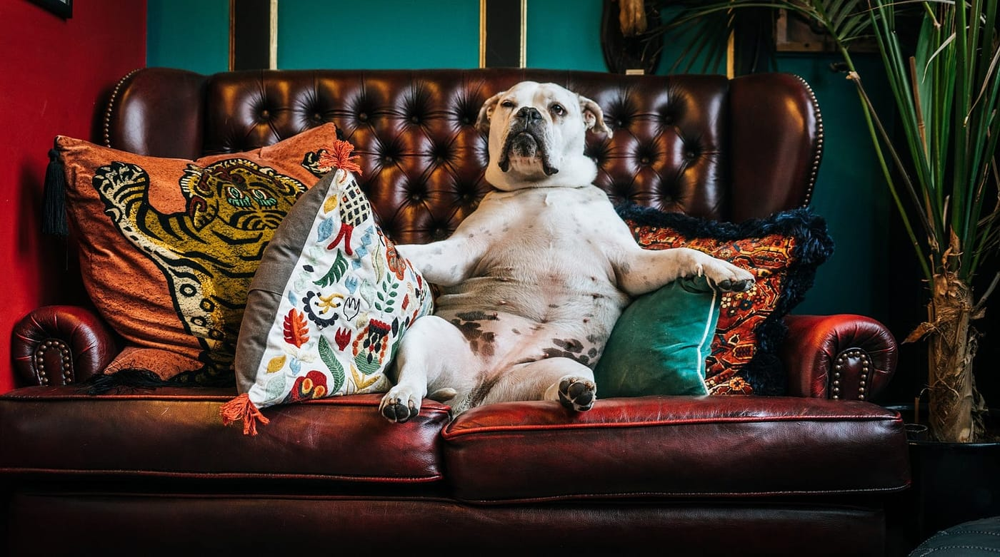
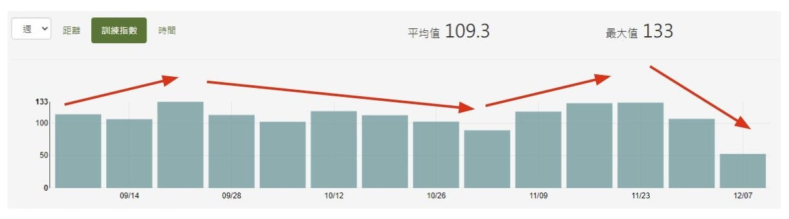
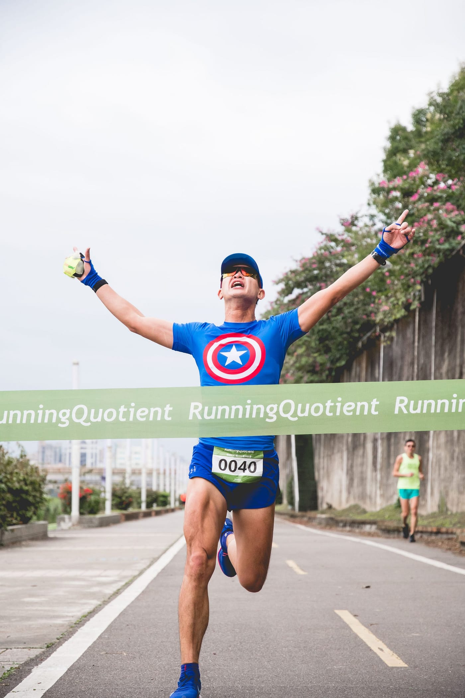
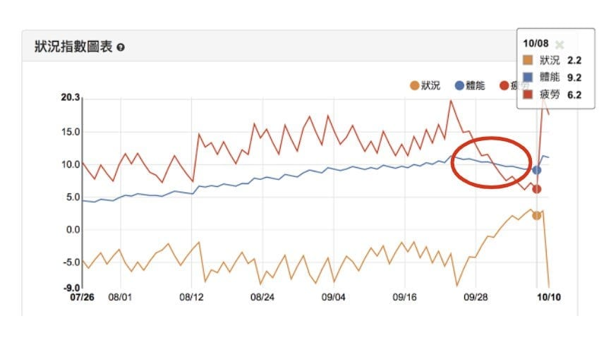

終於進入課表最後一個週期比賽期的「減量（tapering）」週，身為跑者的你聽起來一定完全不陌生，幾乎所有訓練計畫中都有將此元素規畫進去，真的有其必要性嗎？根據研究顯示，如果能正確地執行減量的話，平均將提升跑步表現約 3%，也就是跑完一場全馬將可以快 5–10 分鐘抵達終點呢！

不用練跑還可以變強，天底下居然有這麼好康的事情，到底該怎麼做呢？在這篇文章裡，我會根據身邊教練團的實務經驗，搭配上近期念的論文與書籍，彙整出三個賽前減量的重要心法，希望讓你能夠減好減滿，找出最適合自己的減量方式，再次站上巔峰。

（這裡原本有一張桐桐露臉的照片，為了保護她的隱私，搬家時先拿掉了。）

## 先有量，再來談減量

你我的身體都是非常精密且強大的，它能對不同的外來刺激逐步去適應。而跑步訓練就是在增加刺激，踏出舒適圈外，讓身體知道原來不是只有躺在沙發上吃洋芋片的休閒時刻，還需要徵召全身一起去適應你的跑步訓練，而日復一日的訓練會累積疲勞，這時就需要透過休息讓身體「超補償」，變得更加強大。但如果你是三天打魚，兩天曬網，聰明的身體會認為這只是「偶爾」才會用到的能力，就不會去適應並提升跑步所需的一切技能啦，所以，擁有足夠的訓練量是基本，沒有量，哪來的減量可言？

*要讓身體知道原來不是只有躺在沙發上吃洋芋片的休閒時刻 Photo by Paolo Nicolello on Unsplash*

那該如何客觀衡量自己是否夠量了呢？請打開自己的跑步紀錄 APP，目標是半程馬拉松的你，至少過去六週的每週平均總訓練時間需達到 2 小時以上，或是體能指數（註 1）有累積到 2.5 以上；而如果目標是全程馬拉松的話，過去六週的每週平均總訓練時間至少要達到 5 小時以上，或是體能指數累積到 6.0 以上，才算是具備基本的訓練量喔。

若還沒有足夠的量，距離比賽又剩下一週，其實就不需要考慮執行減量，維持目前訓練方式，注意吃好睡飽不要感冒，前三天全休養足精神，讓身體疲勞盡可能排除後，就可以站上起跑線並小心應付這場比賽。

## 減的是訓練量而非質量

減量有三個核心元素，分別是訓練量、訓練頻率以及訓練強度。

訓練量指的是跑步訓練的總時間或里程數，當然也可以用更客觀的訓練指數（註 2）來當指標；跑步訓練通常都是以週為單位，訓練頻率指的是「一週練幾次」，馬拉松課表通常會要求到每週跑五到七天，能力逼近選手等級的跑者還會有一天兩練，一週練 11 次都是有可能的；而訓練強度一般指的是配速，在無風的平路上是最客觀的指標，當然也有人會用心率甚至是功率（註 3），當成衡量訓練強度的標準。

*除了賽前的減量外，平常訓練約每兩到三週也會進行減量，讓身體恢復得更好*

根據研究指出，需要減量的重點為訓練量，如果只跟自己比較的話，直接看週跑量即可，減量週可以從一至四週不等，而所需減的量以最大訓練量該週為 100% 來算，可以逐步從 85 ~ 65% 降至比賽當週的 40 ~ 20% 訓練量，當然，每個人的恢復能力不同，確切所需要減的量與週數還是會有個體差異。

而訓練頻率可以繼續維持相同次數或是減少，把時間花在主動恢復上，譬如：伸展、按摩或是睡飽飽。最重要的是訓練強度必須維持住，在短時間下還可稍微提高一些，將能夠維持比賽配速體感、增強自己的信心。

## 不只相信感覺，請搭配數據

如果想要透過優化減量的方式來不斷地提升成績，一定要對自己的身體有更深入的了解，最重要的第一步就是留下數據。

無論是比賽當天的溫度濕度、起跑時間、距離、爬升或是道路類型，或是準備比賽執行訓練計畫的每週狀況、里程數、總時間與課表類型，賽前減量的安排週數、減量百分比、頻率與強度，擁有越多的客觀數據，將可以大幅降低自我感覺太過良好而有認知偏差的情況。透過這些數據再搭配自覺感受，加上每次目標賽事成績，一次次地逐步優化減量的執行方式，相信絕對能提高突破最佳成績的機率！

*想要享受突破個人最佳成績的快感，更科學的減量方式也是一個關鍵*

數據這麼多好複雜，有沒有一個數字就可以代表我的減量情況呢？跑步分析 APP RQ 就有提供一個衡量減量的好用工具「狀況指數」（註 4），此數值的概念就是透過分析你過往所有的跑步訓練所累積到昨天的體能，去扣除過往所有紀錄累積到昨天的疲勞，就是你今天的狀況。

假設狀況指數於賽事當天恢復到 +1 到 +3 之間，就代表你目前的體能已經大於疲勞，進入黃金交叉期，並且還保有訓練的體感，就是個適合比賽的狀態。狀況指數過低或過高都不好，至於具體要恢復到多少呢？會根據目標賽事距離以及個人的恢復能力而異，但是透過觀察每次比賽的狀況與其表現，相信一定能夠更快地找到最適合自己的賽前減量方式喔。

*目標賽事前的體能與疲勞黃金交叉，讓狀況回到 +1 至 +3 之間。[參考文章](https://www.runningquotient.com/article/single/64)*

## 結論

訓練是科學也是藝術，如何安排減量更是如此！要先有足夠的訓練量，再來談怎麼執行減量；減量的重點請著重於訓練量，訓練頻率可以維持或降低，但是訓練強度需維持或可以小幅度提高；不要只相信自體感覺，科技化的時代就讓隨手可得的數據，像是 RQ 的狀況指數，協助你找到最適合你個人的減量方式。

掌握住這三大原則，相信你一定可以透過減量來獲得身心靈明顯地提升，在充份恢復後站上起跑線上的那一刻，有如完整補滿血後的遊戲角色，好好發揮自己最好的身體狀態，盡情在賽道上奔馳吧！

後記：在閱讀關於減量的研究時，其實我也有看到兩篇論文（註 5）指出，減量對於提升長跑運動表現並沒有顯著地幫助，但該研究對象是針對菁英級的選手，且所謂的「長跑」也只是 5–10 公里的目標距離，針對馬拉松的研究雖然不多，但都是非常支持著減量帶來的效益喔。

註 1：[如何定義體能、疲勞與狀況指數](https://www.runningquotient.com/article/single/99)

註 2：[衡量每次訓練的壓力：訓練指數](https://www.runningquotient.com/article/single/105)

註 3：[跑步科學的新里程碑：Stryd 與功率訓練](https://www.runningquotient.com/article/single/188)

註 4：[狀況指數的應用：更客觀地減量，在賽前達到最佳狀況](https://www.runningquotient.com/article/single/27)

註 5：Gerasimos G., 2018, The Effects of Tapering on Performance in Elite Endurance Runners: A Systematic Review. International Journal of Sports Science, 8(1): 8–13

你有什麼減量的撇步或是方法嗎？或是在跑步上有遇到什麼問題嗎？[歡迎留言告訴我](https://bit.ly/2LE8Jtr)，還有機會獲得小禮物呢！
