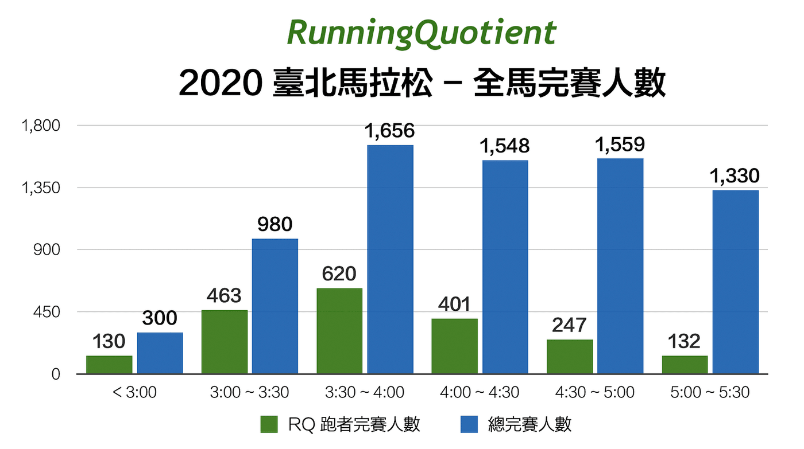
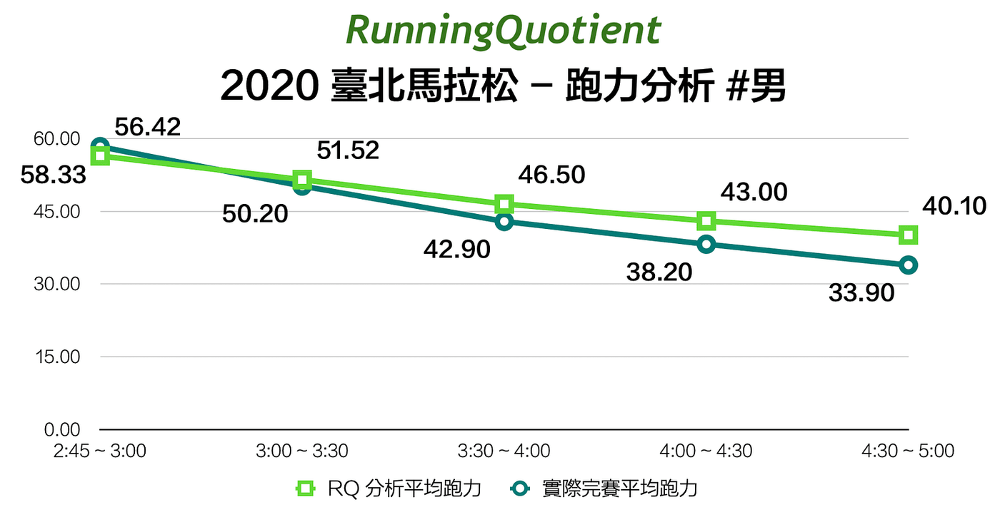
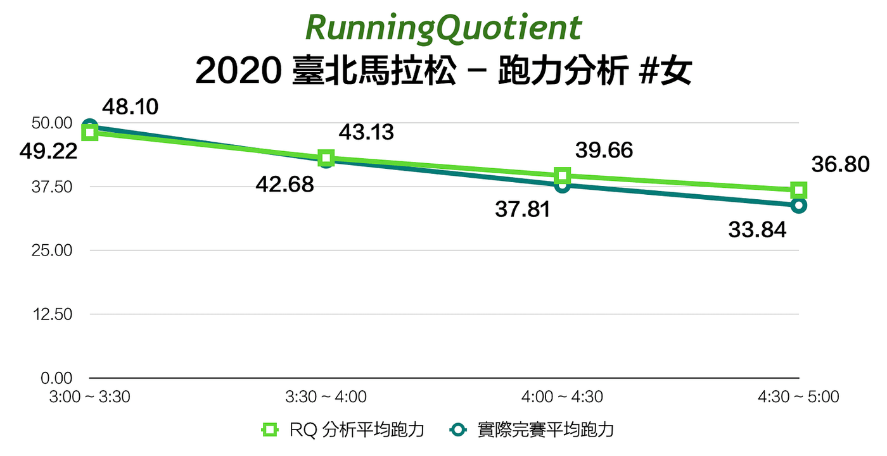
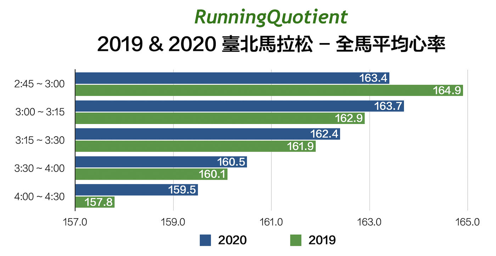

讓全世界都羨慕的 2020 臺北馬拉松如期於 12 月 20 日早上鳴槍起跑，來自各地的 7,373 位跑者聚在一起「勇感呼吸」，奔馳在國內唯一擁有世界田徑總會銅標籤認證的城市賽道，完成了全程馬拉松的挑戰。

其中特別值得注意的是，今年淨完賽成績（註 1）於三小時內的跑者就高達 300 人，比起去年 135 位足足高出兩倍多，除了賽道優化去除令人厭惡的終點前大魔王基隆路地下道與起跑繞圈圈外，起跑溫度比去年低了 6 度，而且一直維持陰冷的 13 ~ 15 度，扣除小雨的不適與部分路段逆風，絕對可以算是在臺灣難得一見的突破 PB （個人最佳成績）氣候。在此也特別恭喜前跑班教練、同時也是菁英選手曹純玉，以 2:32:41 再次打破自己於柏林馬拉松創下的 2:34:18 全馬女子國內最佳紀錄。

以下將針對完成此場賽事的 RQ 跑者完賽成績分布進行探討，提供你訓練上的參考依據。

## 用了 RQ 就會跑得更快

這次共有 2,107 位 RQ 跑者一起參與了這場年度盛事，較去年多了 577 位，占全部完賽者的 29%，平均完賽成績為 3:58:54 。速度越快的跑者使用的比例越高，其中，前兩年都是破三跑者使用 RQ 比例最高，但今年最高比例區間是在 3:00 ~ 3:30，而人數最多的依然是落於 3:30 ~ 4:00 區間內，整體使用 RQ 比例提升了 7.1%，可見得在準備一場馬拉松，RQ 越來越是必須的訓練分析服務了。

特別值得注意的是，相較於免付費的基本會員，有購買「白金會員」服務（註 2）的跑者，平均完賽成績為 3:51:31，足足快了 7 分多鐘呢。

## 跑力越高越快完賽

跑力代表著綜合考量你跑步相關的各方面能力，包含最大攝氧量、體能、技術、意志力、溫度、環境等因素，最終所表現出來的跑步實力，最真實的跑力當然就是「實際下場去盡力完成比賽的成績」所對應的數字。但對於馬拉松跑者來說，並沒有辦法很頻繁地盡全力去測驗，所以 RQ 透過各種跑步訓練數據，自動分析出最能夠代表你現在的跑步實力，如此一來，在訓練期就可以掌握自己的變化，也是一個讓跑者能夠客觀判斷訓練配速區間的重要指標（註 3），不用再只單獨依靠體感或是猜測了。

圖表中的 RQ 分析跑力為用戶在比賽當天的當前跑力，而實際完賽跑力就是使用成績去換算的跑力，譬如：完賽時間介於 3:00 ~ 3:30 男性跑者的 RQ 平均分析跑力為 51.52，而同樣這些人平均完賽成績為 3:17:32.4，此成績對應的跑力為 50.2。很明顯地這兩者具備相當高的關聯性，跑力越高者實際表現就越佳，完賽時間也越快。

但是，這是首次出現分析出來的跑力比實際完賽成績還低的情況，在 2:45 ~ 3:00 區間內，RQ 分析平均跑力為 56.42，卻跑出平均 58.33 跑力的成績。也就是對於能力強的跑者，在擁有絕佳環境下比賽，RQ 的分析是稍微低估了些能力。

此外，完賽時間越久的區間，兩個跑力的差異越大，代表有不少訓練期數據分析表現好的跑者，在此賽道上並沒有發揮最佳能力。除了故意降低能力去擔任指定時間配速員外，相當多案例都是明顯的比賽配速失策，在還沒到終點前就耗盡體能，後段僅能硬撐回去。

恭喜 394 位女性 RQ 跑者完成臺北馬，讓我們有更多的數據可以分享，由於三小時內完賽的女跑者僅有 2 位，故我們僅列出三小時以後的完賽區間。從圖表中明顯看出，相較於男跑者，相同區間的跑力與完賽成績跑力更為接近，故意降速或是跑爆掉的可能性相對低些，整體來說，有氧耐力是優於男跑者的。

## 比賽溫度不影響心率高低

還記得 2019 臺北馬拉松的高溫嗎？鳴槍起跑時已經接近攝氏 20 度，甚至還出現近 30 度的高溫，相對今年臺北馬全程濕冷截然不同。但是從圖中可以看出兩屆賽事的 RQ 跑者平均心率非常接近，說明當跑了一段時間後，氣溫並不是影響心率的主因。而是完賽時間越短，平均心率越高，也代表同樣距離下越快完賽即可承受更高的綜合強度。

值得注意的是，每一個區間內的各跑者平均心率差異都相當大，以破三的跑者來說，有人可以用平均每分鐘心率 190 下跑完三小時的比賽，也有人平均心率是每分鐘 141 下完成。其他成績區間也有類似的情況，除了穿戴式裝置偵測的誤差範圍外，可以說明心率數值僅適合自己與自己比較，若想要跟其他跑者比較的話，建議是使用儲備心率區間（註 4）比較洽當。

## 結語

每年的臺北馬拉松常常被跑者當成年度期末考的目標賽事，大部分的跑者都會在此賽道上全力以赴，相當具備分析數據的指標性。我們也會盡力從中發現更多可能性分享出來，讓台灣跑者能夠更科學地不斷突破自我，看見更強的自己。

你有想要看到什麼臺北馬數據分析嗎？或是在跑步上有遇到什麼問題嗎？歡迎留言告訴我，還有機會獲得小禮物呢！→ [http://bit.ly/3rDqV6G](http://bit.ly/3rDqV6G)

註 1：一般大會成績都是指鳴槍起跑後到跑者抵達終點的成績，但起跑線前的第一排只限菁英選手，通常跑過起點可能已經過了幾分鐘，所以這邊的淨成績是指起點到終點的實際競賽成績。

註 2：RQ 是一個跑步科學分析與訓練的 APP，所有分析演算法都是獨立研發，並盡可能回饋給跑者免費使用，但如果你希望能夠使用更多進階分析與工具，你也可以選擇付費加入白金會員喔。[點我看更多白金會員介紹](http://bit.ly/3rf1mJ3)

註 3： [找到自己的配速區間](https://www.runningquotient.com/article/single/11)

註 4： [找到自己的心率區間](https://www.runningquotient.com/article/single/12)
