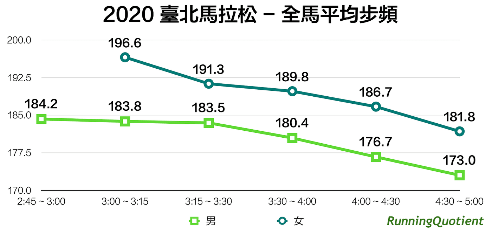
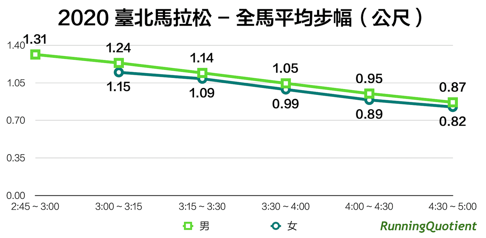
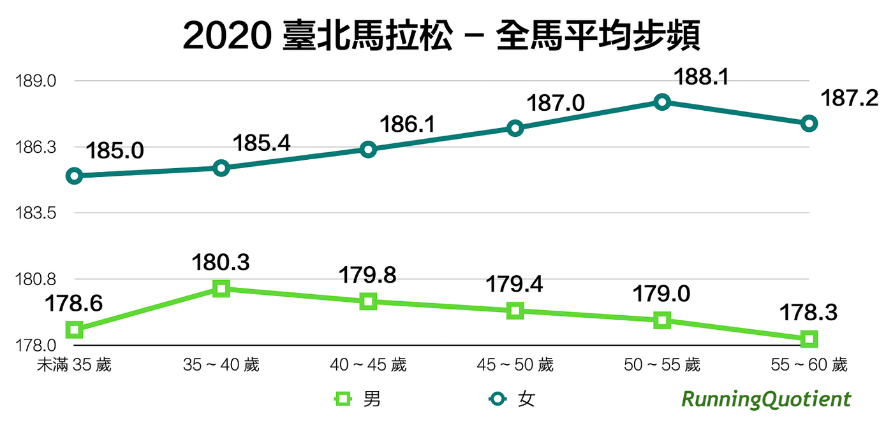
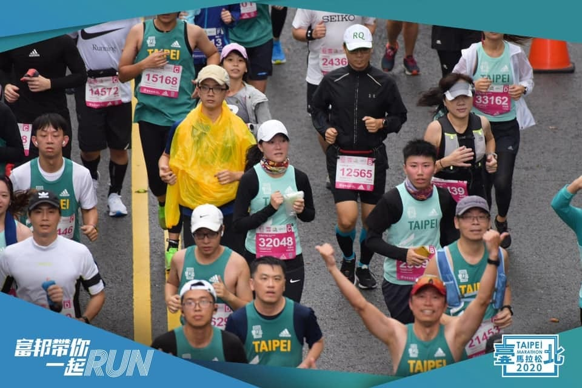

一位馬拉松跑者的技術越好，代表在其他條件相同下，身體能以最少的力氣用相同速度跑完全程。那麼哪些跑步技術對速度影響大？哪類跑者技術好呢？我們嘗試分析許多跑者視為目標賽事的臺北馬拉松數據，在影響跑速的關鍵數據－步頻與步幅上，發現了許多有趣又實用的現象。

2020 臺北馬的賽道大優化，加上老天給了很適合長跑的溫度，在全球疫情嚴峻下，各地菁英選手齊聚一起，讓整體成績大幅躍升，破三人數同時倍增，因此，針對此場賽事的數據格外有意義。而跑步技術以往很難量化，僅能透過經驗豐富的跑步教練，透過肉眼搭配經年累月的知識去評斷，但是，在各種穿戴式裝置普及的現在，光戴一隻跑錶就可以很方便地紀錄每秒的配速、心率、步頻與步幅，如果還有搭配動態感測器，還能獲得更多跑步技術數據。

透過了解指標性賽事中不同程度跑者的數據，逐步去找出最符合自己的跑步方式，是一個不錯的訓練方向。以下針對步頻、步幅等跑步技術數據做分析探討，提供你訓練上的參考依據。

## 速度越快步頻越快 180 是破四基本盤

步頻是跑步技術之母（註 1），跑者可以透過提高步頻來減少下肢關節壓力並提高敏捷性，但是要提高到多少才適合呢？上圖中為臺北馬全馬完賽的 RQ 跑者步頻分析，上方的數字為平均雙腳步頻，單位是每分鐘幾步。從圖中可以很明顯看出速度越快、步頻就會越快，而女跑者的步頻更快，在同樣成績區間內，平均都足足高出男跑者每分鐘 8 步以上。

在三個半小時內完賽的男跑者平均步頻僅略微提升，約在 183 ~ 184 之間，標準差為 6 ~ 7 左右，相較於 2018 年渣打馬（註 2）的步頻數據，降低了不少。而且，這是全程平均步頻，如果考慮加上進補給站或是當步兵的時間，平均步頻達到每分鐘 180 步以上，可以說是想要馬拉松跑進四小時內的基本條件。

其中，在 3:00 ~ 3:15 區間內的女跑者平均步頻相較於男跑者大幅提升，主要猜測是該區間女跑者人數僅有 8 人，可能剛好都是身材比較嬌小的高步頻長跑健將，導致數據有些許偏差。

## 步幅越大完賽成績越快

跑步速度是步頻乘上步幅的結果，所以想要跑得更快，除了提高步頻之外，還可以增大步幅。

上圖為臺北馬全馬完賽的 RQ 跑者步幅分析，下方數字是女跑者各區間平均步幅，而男跑者的平均步幅放在上方，這裡使用雙腳步幅，即單腳離地後到另一隻腳觸地之間的距離，單位為公尺。

步幅與步頻有完全一樣的趨勢，速度越快就越大，也代表著更快完賽的跑者們不僅僅是步頻比較高，步幅也同樣比較大。由於女跑者通常身高較矮且步頻較快，每個區間的每一步都略短 5 公分左右，但整體成長的曲線男女是相當吻合的。其中，3:00 ~ 3:15 區間內的 8 位女跑者在步頻提高非常多的情況下，步幅反而就跟同區間男跑者差異到接近 10 公分了。

## 年紀大小與步頻高低無關

依照波士頓馬拉松資格將 RQ 跑者們依照年齡分組如上圖，未滿 35 歲都在同一組，至 60 歲前每 5 歲一組，下方數字為男跑者數據，平均完賽成績從未滿 35 歲組的 3:39:54 至 55 ~ 60 歲組的 4:13:40，大致上趨勢是越來越慢，但其實差異並不大，說明年齡並不影響步頻。

而上方女跑者的數據們就更有趣了，平均完賽成績從未滿 35 歲組的 4:05:27 到 55 ~ 60 歲組的 4:30:25，反而平均步頻越來越高，除了 55 ~ 60 歲這組人數僅有 11 位外，其他組別最少都有 40 人以上，雖然差異很小，但整體趨勢與男跑者相反，這再次說明年紀並不是影響步頻的主因。

> 原本想進一步追蹤是否是因為身高越高步頻也就越慢，但發現大部分都沒有填寫身高因此作罷。呼籲看到此篇文章的 RQ 跑者們，歡迎到[個人資料](https://www.runningquotient.com/user/profile)內輸入一下身高與體重，讓我們能夠把更多數據分析分享出來，讓你我都能有更明確地訓練方向喔！

## 結語

無論是奧運跑步教練的觀察或是論文研究，都指出步頻達到每分鐘 180 步以上可以有效減少落地衝擊，避免運動傷害，而全馬成績在四小時內的跑者，在賽事上也都有每分鐘平均 180 步以上的表現，更別說女跑者們都是落在每分鐘 190 步的高步頻。對於無法達到此步頻的跑者，可以加入敏捷訓練，像是各種彈跳動作、跳繩或搭配節拍器跑步等，而到底要達到多少步頻或步幅呢？這就需要透過長期紀錄觀察找出最適合你的數字啦！

除了步頻與步幅外，如果你的手錶有支援並搭配其他動態感測器，還可以獲得像是垂直振幅、觸地時間或是左右平衡比例等更多技術數據，以及近期引進臺灣的跑步功率計 Stryd（註 3），還能取得跑步功率、姿勢功率、空氣阻力與下肢剛性等更進階的技術數據。

我相信科技越來越發達的現在，一定還會出現更多能衡量跑步技術的穿戴式裝置，如何靈活運用工具將會是下一個重要的議題。但是，在追求更多參考依據的同時，千萬別忘了本質上就是要「用更少的力去達到更快的配速」，技術無極限，不斷地探索出自己的無限潛能吧！

註 1：[步頻是跑步技術之母](https://www.runningquotient.com/article/single/89)

註 2：[2018渣打馬數據分析：跑步技術篇](https://www.runningquotient.com/article/single/145)

註 3：[跑步科學的新里程碑：Stryd 與功率訓練](https://www.runningquotient.com/article/single/188)
