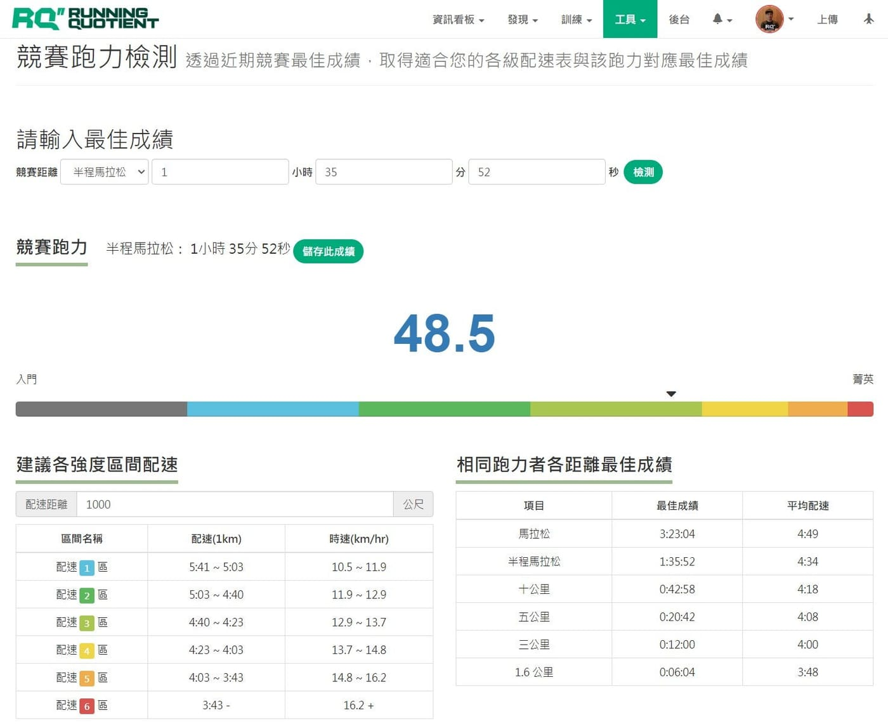
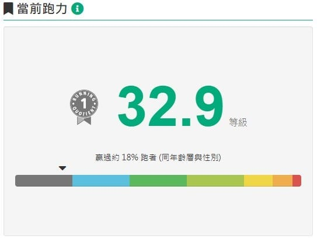
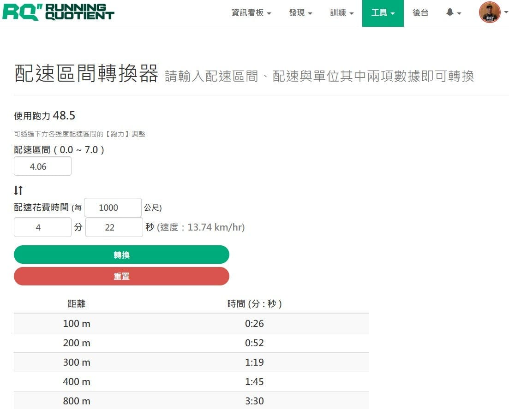
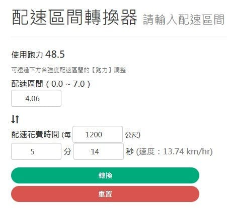
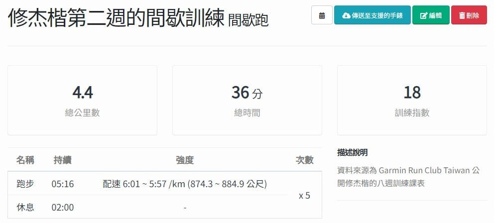

你是否看到別人的課表跑得津津有味，拿來自己跑卻食不下咽嗎？在此教你只要 3 個步驟，就能把任何網路或書中找來的課表，變成屬於你的個人化課表，而且，在體感上會跟他訓練起來很相似，就算是奧運選手的課表也可以吃得動呢。

日前修杰楷取得半馬佳績，[Garmin Run Club Taiwan](https://www.facebook.com/GarminGRC.TW/posts/pfbid03yzgavYasABD7NgC7iwedrVrBVHTJwVhzEizZ9GVhCcPzdA52eTMtc2XeDZssNGNl) 又馬上公開他的八週訓練內容。雖然長得沒有比修杰楷帥，也（暫時）無法跑得跟他一樣快，但至少要跟他一起吃體感相同的課表。以下就用他的課表為範例，轉換成你的個人化課表。

*修杰楷在 Garmin Run 創造佳績，圖片來源：Garmin Run Club Taiwan*

## 第一步：分析彼此跑步能力

分析跑步能力的方式有很多種，如果你沒有課表擁有者的平常訓練數據，可以最直觀的以競賽結果判斷，也就是用近期最佳比賽成績換算跑步能力。修杰楷這次半馬完賽成績是 1:34:57 ，但有不少跑者反應距離短少了 200 公尺，補回距離推估約是 1:35:52。利用 RQ 的競賽跑力檢測工具輸入此半馬成績，可以獲得他的跑力是 48.5，代表他在此場比賽表現出來的跑步能力。

*RQ 上的[競賽跑力檢測](https://www.runningquotient.com/tools/estimate)，可透過成績換算成跑力*

如果你像我一樣，平常訓練數據已經在 RQ 上，就可以直接用 RQ 的當前跑力代表當前跑步能力，以我來說就是 32.9，整整相差了 15.6 跑力呢。

*RQ 當前跑力會隨著訓練自動持續更新，可用來代表你當前跑步能力*

## 第二步：轉換課表內容

跑步課表的內容拆解下來其實就是強度（Intensity）與長度（Duration）的組合，跑者最常使用的強度單位就是配速，其他還有配速區間、心率、心率區間或功率等，而長度一般採用距離。為了讓課表能夠個人化，我們需要將課表內容都轉換成通用單位。

### 強度（Intensity）

一個指定的配速對於不同人來說，強度都不盡相同。以修杰楷的能力跑 5 分速不過是輕鬆跑，而我跑 5 分速已經是在練最大攝氧量的高強度了，所以要將配速轉換成通用的配速區間（註１）。以修杰楷第二週的週二間歇訓練為例，建議配速為每公里 4:22–4:25，從 48.5 的各強度配速表中，我們得知是在配速 4 區的下限，也就是約 4.0 配速區間。

如果想要更精確轉換，可以使用 RQ 工具中的[「配速區間轉換器」](https://www.runningquotient.com/tools/pace-zone)，修改跑力為 48.5 後，輸入配速 4:25 /km 獲得配速區間 3.90 以及配速 4:22 /km 的配速區間 4.06，代表強度是介於配速區間 3.9 ~ 4.06 之間。

*[RQ 配速區間轉換器工具](https://www.runningquotient.com/tools/pace-zone)能針對指定跑力，自由轉換配速區間與配速。*

### 長度（Duration）

一般看到的課表都是指定距離，然而，不同能力的跑者，用同樣體感跑了 10 公里，完成時間絕對不會相同，所以長度我們要採用同樣的衡量單位，也就是時間。可以用簡易的數學換算，或是直接用 [RQ 配速區間轉換器](https://www.runningquotient.com/tools/pace-zone)，在每多少公尺的地方輸入 1200，即可換算出每趟間歇花費的時間介於 5 分 14 秒至 5 分 18 秒，取中間值算 5 分鐘 16 秒。

*配速區間轉換器可以自訂公尺的配速，方便計算操場速度*

這個階段已經把週二 1200m (4:22–4:25 /km) x 5 的課表，轉換成 5 min 16 sec (3.9 ~ 4.06 配速區間) \* 5 趟的通用課表。

## 第三步：套用你的跑力

課表使用配速區間跟時間，對一般跑者來說較不直覺，所以最後一步要將自己的能力加入到通用課表內，換算出真正要跑的課表。我的跑力是 32.9 ，一樣用配速區間轉換器轉換 3.9 ~ 4.06 配速區間的配速為 6:01 ~ 5:57 /km；而距離用更精確計算，以配速區間 4.06 跑 5 分 14 秒至配速區間 3.9 跑 5 分 18 秒，介於 879.3 ~ 879.8 公尺之間，取中間值為 879.5 公尺。

最終，以我當前的能力，想要體驗修杰楷練此間歇課表的訓練壓力為何，就是跑 879.5m (6:01 ~ 5:57 /km) 5 趟就可以啦。

### 加速將跑力套用到通用課表

如果你有使用 RQ，在此提供一個更快速的方式，直接把第二步換算好的通用課表，輸入到 RQ 課表上，系統就會根據你當前的能力自動調整這份課表的強度，並自動傳送到你的手錶上，只要一鍵就能開始跑課表了。

*RQ 課表系統可以自動轉換配速區間為你現在能力的配速。*

## 總結

以上簡單三個步驟，就能夠把任何想嘗試看看的課表，都輕鬆轉換成屬於你個人能力的跑步訓練。我也花了些時間將[修杰楷公開的八週半馬訓練課表全部轉換成通用課表](https://docs.google.com/spreadsheets/d/e/2PACX-1vSMfQ093t2-Yhdr-H4FlyXIYBIFJkI62mJ5GgvlMp4bOGH7DqgeSf_bgCskhUGGz16qZ_FBfn8uknqO/pubhtml)，有興趣的跑者，歡迎跟著練看看吧！

還是要注意，雖然調整過後的課表，是使用你的個人化強度，對你的訓練量也會跟對他的很類似，但是，每個人能接受的訓練量與恢復能力還是有所差異，他吃得下去的訓練壓力並不見得你也可以。如果目標是要突破個人極限，時間有限的情況下，建議還是找專業的教練幫你量身打造，會更有效率喔。

第一週跑步課表轉換通用課表範例：

> 【D2 速度跑】

> (50秒 + 1分40秒 + 2分30秒 + 1分40秒 + 50秒 ) x 2

> 趟休 2 分 \\ 組休 5 分

> 配速區間 4.63 ~ 5.13

> 【D3 恢復跑】

> 40 分鐘慢跑

> 配速區間 0.88 ~ 0.95

> 【D4 節奏跑】

> 12分30秒 (配速區間 0.88 ~ 0.95)

> 20分30秒 (配速區間 1.66 ~ 2.11)

> 12分30秒 (配速區間 0.88 ~ 0.95)

> 【D7 長跑】

> 12分30秒 (配速區間 0.88 ~ 0.95)

> 31分30秒 (配速區間 1.27 ~ 2.11)

> 12分30秒 (配速區間 0.88 ~ 0.95)

其他週數的跑步課表轉換成通用課表[請點此查看](https://docs.google.com/spreadsheets/d/e/2PACX-1vSMfQ093t2-Yhdr-H4FlyXIYBIFJkI62mJ5GgvlMp4bOGH7DqgeSf_bgCskhUGGz16qZ_FBfn8uknqO/pubhtml)，完整的原始公開課表請以 Garmin Run Club Taiwan 的準。

*看到微笑客棧貼這張圖，我決定明年也要去跑 Garmin Run！*

註１：參考文章[《什麼時候要用「配速區間」 (不看心率區間) 》](https://www.runningquotient.com/article/single/11)徐國峰撰寫。
