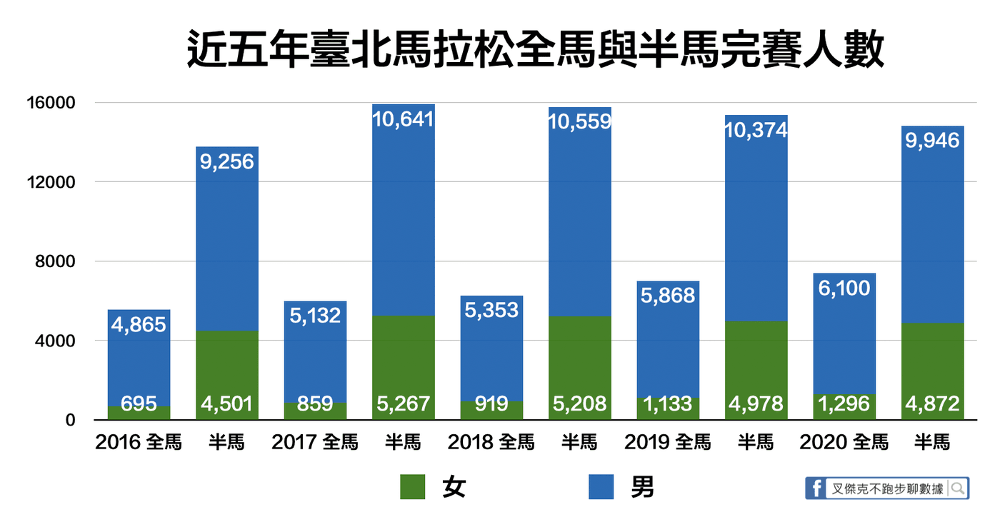
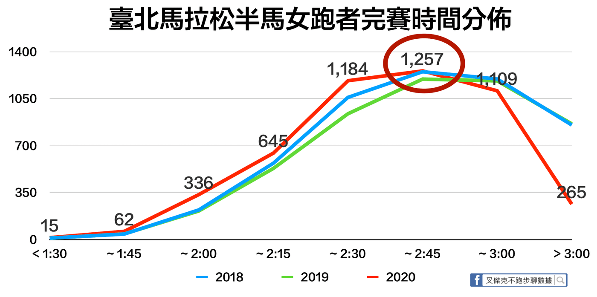
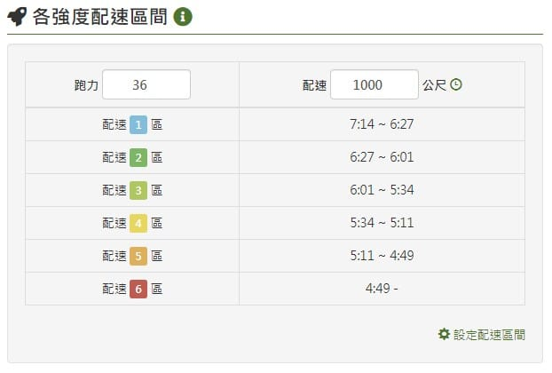

在公開徵求跑步遇到的問題表單中，出現了一則令人匪夷所思的問題，他寫到「我都沒有妹子陪跑，到底該如何才能像 CEO 一樣跟一群妹子跑步呢？」原本，我認為這根本與跑步訓練沒有什麼關係，打算忽略此問題。BUT！我的文章主編仙女卻表示，跑步動力是踏出訓練第一步相當重要的一環，當然要利用數據的力量去解決跑者的疑惑啊。

對啊，跑步訓練除了內在動力外，總是需要一些外部刺激，規律跑步可以讓身體更健康你我都懂，但真正會去跑步的人有多少呢？不如就利用這一個題目，發揮我的數據分析專業，以今年全球最大馬拉松賽事臺北馬拉松的資料為例，用科學的力量讓一群妹子陪你跑！

## 秘訣 1：跑什麼馬拉松，去報半馬！

上表為近五年來臺北馬拉松全馬與半馬實際完賽人數，資料來源為中華民國路跑協會公告的數據，女跑者以綠色表示，下方數字為女跑者完賽人數，男跑者使用藍色，完賽人數置於頂端。

根據實際完賽人數觀察，雖然每年跑全程馬拉松的女跑者比例從 2016 年的 12.5% 一直升高到 2020 年的 17.52%，人數足足增加了 601 人，單看趨勢會覺得非常有潛力，但是，對比歷年半馬完賽女跑者的比例都在 33% 左右，對於想要提高跟一群妹子跑在一起的機率來說，請放棄你最愛的馬拉松，去報名半馬吧！

秘訣 2：跑快沒有用，配速七分多就好

上圖為近三年來臺北馬拉松半馬女跑者完賽時間區間人數統計，其中有顯示數字的為 2020 年的完賽人數，顏色為紅色，可以看出人數最多的區間都是在 2:30 ~ 2:45 之間，換算均速在每公里 7:07 ~ 7:49 之間，除了今年 2:15 ~ 2:30 區間完賽人數位居第二外，前兩年都是 2:45 以後區間人數次之。

看到這，你是不是以為我就會下「跑個七分半速就好」的結論嗎？科學分析哪這麼簡單！所有完賽女跑者的平均配速為每公里 7:09 ，但是前幾名的神人像是謝千鶴、傅淑萍等，都用三分速高速完賽，就像臺灣平均月收入五萬三千元一樣，整體的算數平均數根本只是前段班貢獻太多，導致完全不可靠。

首先，我要拿出來用的為中位數，它代表著所有數列最中間的數值，也就是跑在此速度前與後的半馬女跑者人數是相同的，以 2020 臺北馬拉松來看，中位數為每公里 7:14。再來，更具代表性的眾數要出場了，最多半馬女跑者使用的配速為每公里 7:33，共有 42 位。搭配上這兩個數據，終於可以下結論，跑在中位數 7:14 與眾數 7:33 之間，將會有最多妹子陪你一起跑步。

## 秘訣 3：還是要練！跑力至少要 36

看到用七分多速跑半馬就覺得不用練了嗎？可別高興得太早，用每公里均速 7:14 完賽半馬套入跑力計算器（註 1）內，會獲得 30.5 的跑力。但你以為擁有這跑力就可以跟一群妹子跑步了嗎？大錯特錯！這是你在盡全力下完賽的最佳成績而已，但你肯定要帥帥地跑在這配速下，代表此速度必須為你的最輕鬆跑步區間，也可以稱之為「 1.0 區間」或 「E 配速下限」（註 2），反查回來，配速區間 1.0 為 7:14 /km 的跑力最少要有 36.0 呢！

值得注意的是，別太小看女力崛起的現在，在上一個圖表中你應該有發現女跑者們越跑越快，在 2019 臺北馬拉松的均速中位數與眾數分別為每公里 7:36 與 8:26，等等！女跑者光是 2019、2020 這兩年均速就成長高達 9%耶，明年若還想跟一群妹子跑，你還認為練到跑力 36 就足夠了嗎？

## 結語

根據歷年臺北馬拉松數據分析下來，如果你很希望有一群妹子陪著你跑步，在此篇推薦你提高機率的方式就是：首先你要報名半馬；再來平均速度要抓在 7:14 ~ 7:33 每公里之間；最重要的是，為了要保持跑得帥又輕鬆愜意，你還必須將跑力練到至少 36 以上，希望這些分析能夠解決你的疑惑囉！若想要更有效率地訓練，也歡迎找我們的簽約合作教練團（註 3）唷！

你有跟妹子一起跑步的好方法嗎？或是在跑步上有遇到什麼問題嗎？[歡迎留言告訴我](http://bit.ly/2L5WOEg)，還有機會獲得小禮物呢！→ [http://bit.ly/2L5WOEg](http://bit.ly/2L5WOEg)

註 1：跑力檢測又稱[跑力計算器](http://bit.ly/38M2L35)，可以根據全力完賽成績幫您換算成跑力，能更直覺了解自己的跑步實力與訓練配速區間唷。

註 2：E 配速為輕鬆跑 Easy Run 的速度，但是每個人的輕鬆跑配速區間都不盡相同，您可以透過分析跑力了解自己[最適合的配速區間](https://www.runningquotient.com/article/single/11)。

註 3：位於跑團荒漠地帶或是時間比較難配合一般跑班嗎？歡迎找 [RQ 認證的一對一線上教練](https://www.runningquotient.com/course/online)們幫您突破自我，創造最佳成績喔。
