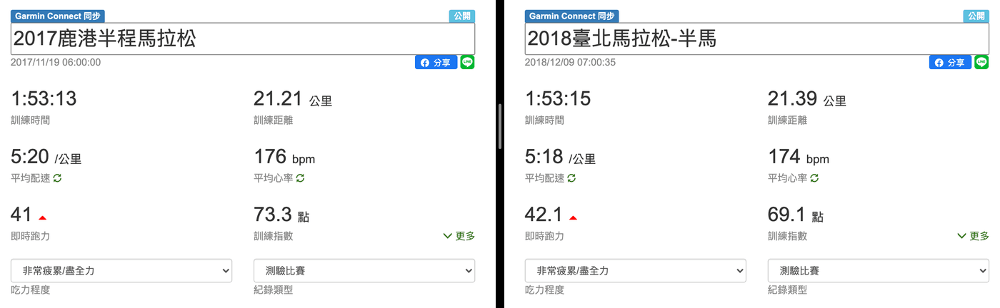

對剛開始跑步的人來說，只要規律訓練一陣子，肯定能明顯感受到自己突飛猛進，但對於訓練有素的跑者，變強的感受就沒有這麼明確了。尤其當賽事取消，沒有具體的成績佐證，這時要評斷自己的跑步實力是不是像在隔空抓藥？

這篇提供你三個佐證方式，無論是跑步初學者還是馬拉松高手，都讓你可以大聲說出「我真的進步了！」。

## 1. 能夠持續跑得更遠了

最直接的判斷方法當然就是用距離啦！

想起那時剛失戀的我，身為 90 公斤的肥宅，想擺脫情傷的糾纏，到了學校田徑場想要狂奔，結果連四百公尺都無法一次跑完，好不丟臉啊！爾後，只敢去跑步機上慢慢跑，直到能持續跑 1 公里、2 公里甚至 3 公里，終於鼓起勇氣報名並完成人生第一場 5 公里路跑賽。接下來，逐步挑戰十公里、十二公里到半程馬拉松。後來苦練半年，終於完成一次全程馬拉松，這當然毋庸置疑是變強啦！

*Photo by Jenny Hill on Unsplash*

但是，當已經能夠完成一場馬拉松後，若繼續往更遠的距離挑戰，整個訓練期會花費更多時間，而且距離可以無限延長，這對一般市民跑者來說，就不是個可以永遠追求的客觀判斷方式了。

## 2. 相同距離跑得更快了

用相同條件與一樣的距離，看哪位選手能夠用最短的時間完成，就是冠軍，這是最真實的數據，也是徑賽與路跑賽上決勝負使用的方式。

若你把競爭對手看成是無限個過去的自己，你家附近最常跑的那條路線，以前要花一個多小時跑完，在規律跑步一段時間後，你發現不用一小時就能完成，那肯定是很明確的進步指標。這也是為什麼很多跑者會選定不同的路跑賽事，作為各階段的目標。一場毫無保留的競賽，肯定是能最明確看見自己不斷進步的檢測方式啊！

*文章主編仙女（圖中綠色賽衣）於 2020 臺北馬突破自我最佳成績之終點衝線照（攝/蕭宇翰）*

但是，對於馬拉松跑者來說，要全力挑戰一場馬拉松，準備期少說三到六個月，再加上賽後恢復期度個蜜月，每次能看到自己進步的週期總是會越拉越久。

## 3. 相同配速心率更低了

到底有什麼客觀衡量方式，能讓平常訓練就知道自己進步，不用等久久一次比賽才發現呢？

再次回到你家附近最常跑的那條路線，假設你剛開始需要用盡全力才能夠一個小時整跑完，但經過一段規律訓練後，忽然發現自己用一小時跑完該路線已經游刃有餘，再多跑一點也沒問題。沒錯，這就是你已經適應了這個速度，所以身體綜合費力程度降低許多了。

拜穿戴式裝置普及之賜，我們有一個很容易取得能衡量綜合耗力程度的數據，那就是心率。心率越低通常代表你目前的費力程度越低，而能夠用更低的成本來維持此配速，在體能相同下，當然就可以跑得更遠更久囉！

*我在跑臺北半馬時，比鹿港半馬配速更快，平均心率卻更低。*

但是，其實影響心率的因素有相當多，或許是早上喝的那杯咖啡，或是昨天晚上熬夜加班，抑或是剛剛跑過飄著粉紅泡泡的馬尾妹，可能都會讓你心動不已，這就需要一些經驗來判斷了

## 結語

自己變強了，身體的反應會告訴你自己，而想要客觀地<s>（讓其他人）</s>知道自己進步，你可以秀出你能持續完成跑步的距離越來越遠了，或是每場相同距離的路跑賽事能用更短的時間完賽，也可以從手錶上看到相同速度下的心率越來越低。達到這些條件，你當然可以展示出來讓大家看到你努力的結晶。

最後，也推薦你一個自動判斷的方式，透過 RQ 獨家推出的「跑力」（註 1），它將從你長期的跑步訓練數據中分析，轉換成一個絕對數值等級，等級越高就代表跑步能力越強，能更直覺地了解自己的跑步能力進步情況。

就像是超級賽亞人的戰鬥力，跑力是跑者的戰鬥力，而我們開發的服務 RQ 也可以說是戰鬥力探測器「史考特」，用各種衡量方式提供你最直觀的指標。

*RQ 是跑者戰鬥力探測器「跑步史考特」(From Dragon Ball wiki)*

你有客觀衡量自己進步的好方法嗎？或是在跑步上有遇到什麼問題嗎？[歡迎留言告訴我](http://bit.ly/3o9vlQ5)，還有機會獲得小禮物呢！

註 1：[衡量跑步實力的指標：當前跑力](https://www.runningquotient.com/article/single/154)
